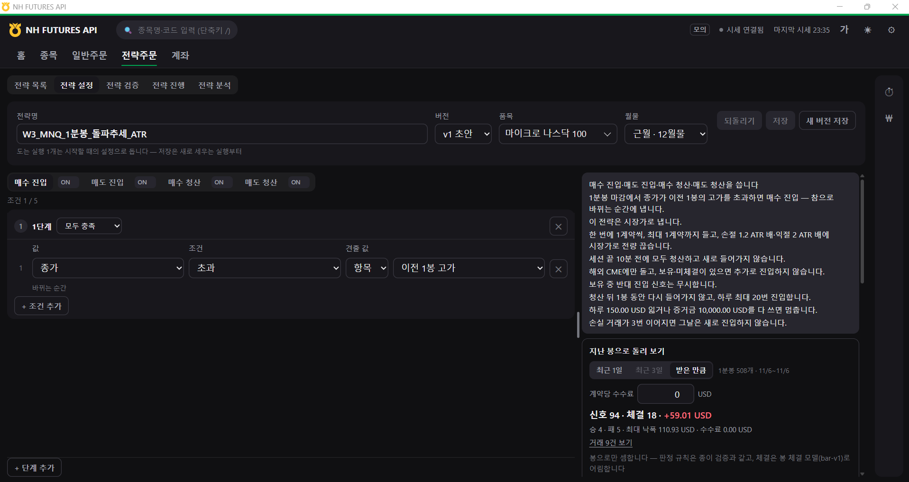
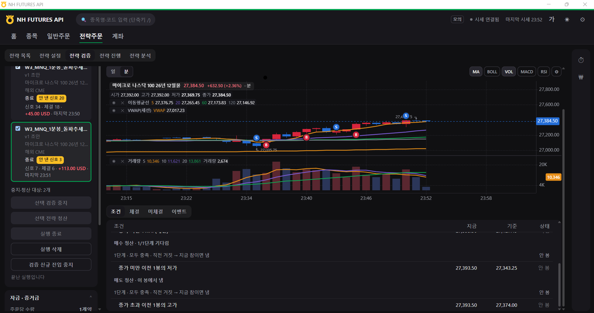
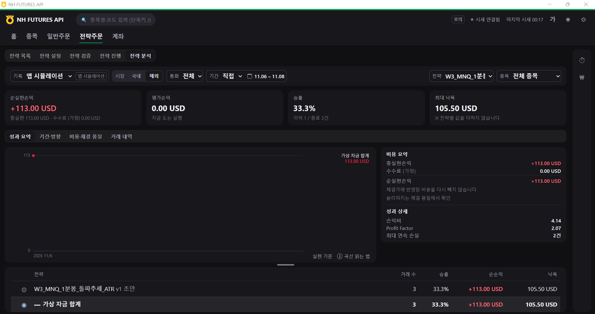

# 3주차 과제: 미국 나스닥100 선물 1분봉 돌파·VWAP·ATR 전략

- 팀번호: 09
- 팀명: BE RICH
- 팀원: 김파란하늘, 정은서
- 작성일: 2026-11-06

## 1. 과제 개요

미국 주가지수 선물인 Micro E-mini Nasdaq-100(MNQ) 2026년 12월물을 대상으로 1분봉 단타 전략을 구성했다. 직전 봉 고가 돌파와 세션 VWAP를 진입 기준으로 사용하고, ATR 기반 손절·익절과 보유 수량 제한을 적용했다.

CME 거래소의 거래시간, 최소 호가단위, 계약 승수와 결제 통화를 확인한 뒤 NH FUTURES API 프로그램에서 전략을 검증했다.

최종 앱 시뮬레이션에서는 거래 3건이 완료됐으며, 실현손익은 +113.00 USD, Profit Factor는 2.07이었다. 주문·체결 내역과 전략 분석 화면을 함께 제출했다.

### 1.1 실행 정보

| 항목 | 내용 |
|---|---|
| 전략명 | W3_MNQ_1분봉_돌파추세_ATR |
| 최종 전략 ID | `draft-1793975086566` |
| 실행 ID | `run-1793975483722` |
| 거래소 | CME (`FCME`) |
| 종목 | Micro E-mini Nasdaq-100 Futures |
| 월물 | 2026년 12월물 |
| 종목코드 | `MNQZ26` |
| 세션 | 해외 CME |
| 기준 봉 | 1분봉 |
| 평가 시점 | 봉 마감 |
| 검증 방식 | NH FUTURES API 앱 시뮬레이션 |
| 체결 모형 | `paper-v2` |
| 주문 수량 | 1계약 |
| 가상 초기자금 | 10,000 USD |
| 실행 일자 | 2026-11-06 |

### 1.2 해외상품 특성과 전략 반영

MNQ는 나스닥100 지수를 기초자산으로 하는 CME 상장 선물이다. 실제 거래에 사용하는 계약 단위와 시간 기준을 확인하고 전략 설정 및 손익 계산에 적용했다.

| 항목 | MNQ 상품 명세 | 전략 적용 내용 |
|---|---|---|
| 거래소 | Chicago Mercantile Exchange(CME) | 해외 CME 세션 사용 |
| 거래 플랫폼 | CME Globex | NH FUTURES API 해외선물 시세 사용 |
| 상품코드 | MNQ | 12월물 `MNQZ26` 선택 |
| 거래 통화 | USD | 손익과 손실 제한을 달러로 관리 |
| 계약 승수 | 지수 1포인트당 2 USD | 체결가 차이에 승수 2 적용 |
| 최소 호가단위 | 0.25포인트 | 체결 가격의 호가단위 확인 |
| 1틱 가치 | 0.50 USD | 거래 손익을 틱 단위로 재검산 |
| 계약월 | 3·6·9·12월 | 2026년 12월물 선택 |
| 거래시간 | 일요일 18:00~금요일 17:00(미국 동부시간) | CME 거래시간에 맞춰 검증 |
| 일일 정비시간 | 17:00~18:00(미국 동부시간) | 세션 종료 10분 전 정리 규칙 설정 |
| 장중 거래 중지 | 16:15~16:30(미국 동부시간) | 거래 가능 시간 확인 |

11월 6일은 미국 겨울시간이 적용되는 기간이다. 한국시간은 미국 동부시간보다 14시간 빠르다.

- 미국 정규장 개장 09:30 EST = 한국시간 23:30
- 일일 정비시간 17:00~18:00 EST = 한국시간 다음 날 07:00~08:00
- 이번 검증의 첫 진입 시각 23:35 KST = 미국 동부시간 09:35

이번 전략은 미국 주식시장 정규장 개장 직후의 가격 움직임을 대상으로 실행됐다.

MNQ는 가격이 1포인트 움직일 때 1계약당 2 USD의 손익이 발생한다. 0.25포인트가 1틱이므로 1틱의 가치는 0.50 USD다. 실제 체결 기록의 가격과 손익도 이 계약 단위에 맞게 계산됐다.

## 2. 전략 구성

### 2.1 직전 봉 고가 돌파를 이용한 매수

1분봉 종가가 직전 봉의 고가를 넘어서면 단기 상승 움직임이 이어질 가능성이 있다고 판단해 매수한다.

진행 중인 봉에서는 가격이 일시적으로 고가를 넘어설 수 있으므로 봉 마감 시점에 조건을 평가하도록 설정했다.

### 2.2 세션 VWAP를 이용한 매도

세션 VWAP(Volume Weighted Average Price)는 거래량을 반영한 평균 가격이다.

종가가 세션 VWAP 아래에 있으면 해당 세션의 평균 거래가격보다 낮은 수준에서 거래되고 있다고 판단해 매도 진입 조건으로 사용했다.

초기 검증에서는 직전 봉 저가 이탈 조건도 함께 사용했지만, 이후 매도 조건을 세션 VWAP 기준으로 조정했다. 최종 실행에는 수정한 조건이 적용됐다.

### 2.3 ATR 기반 청산

ATR(14)을 이용해 시장 변동성에 따라 손절·익절 가격을 설정했다.

- 손절 거리: ATR(14) × 1.2
- 익절 거리: ATR(14) × 2.0
- 손절 대비 익절 목표 거리: 약 1.67배

매수 포지션에서는 직전 봉 저가 이탈, 매도 포지션에서는 직전 봉 고가 돌파를 별도 청산 조건으로 적용했다.

## 3. 매매 규칙과 설정

### 3.1 진입·청산 조건

| 구분 | 조건 |
|---|---|
| 매수 진입 | 종가 > 이전 1봉 고가 |
| 매도 진입 | 종가 < VWAP(세션) |
| 매수 청산 | 종가 < 이전 1봉 저가 |
| 매도 청산 | 종가 > 이전 1봉 고가 |
| 손절 | ATR(14) × 1.2 |
| 익절 | ATR(14) × 2.0 |
| 조건 평가 | 1분봉 마감 |

### 3.2 주문과 위험 제한

| 항목 | 설정 |
|---|---|
| 주문 유형 | 시장가 |
| 주문당 수량 | 1계약 |
| 최대 보유 | 1계약 |
| 보유 중 추가 진입 | 금지 |
| 보유 중 반대 진입 신호 | 무시 |
| 청산 후 재진입 대기 | 1봉 |
| 하루 최대 진입 | 20회 |
| 연속 손실 제한 | 3회 |
| 하루 손실 한도 | 150 USD |
| 증거금 예산 설정 | 10,000 USD |
| 세션 종료 처리 | 종료 10분 전 전량 청산 |
| 계약당 수수료 설정 | 0 USD |

### 3.3 최종 전략 확인

최종 전략 설정은 `strategies.json`에서 확인할 수 있다.

`drafts["draft-1793975086566"]`

실제로 검증에 사용한 설정은 `results/strategy-runs.json`의 다음 실행 기록에 저장돼 있다.

`run-1793975483722`

두 파일에 저장된 최종 전략의 진입·청산 조건과 설정값을 대조했으며 일치했다.

## 4. API와 프로그램 사용

### 4.1 해외선물 API 구성

NH FUTURES API 제공 프로그램의 해외선물 API와 실시간 시세 기능을 사용했다.

| 기능 | API 또는 구분값 | 경로·방식 |
|---|---|---|
| 접근 토큰 발급 | `common_auth/token` | `POST /auth-service/v1/token` |
| WebSocket 접속키 | `common_auth/web-socket-key` | `GET /permission/v1/web-socket-key` |
| 해외 분봉 조회 | `overseas_chart-minute` | `POST /trade/v1/overseas/chart-minute` |
| 해외 현재가 조회 | `overseas_price` | `POST /trade/v1/overseas/price` |
| 해외 품목 정보 | `overseas_product-detail` | `POST /trade/v1/overseas/product-detail` |
| 해외 실시간 체결 | `FA` | WebSocket |
| 해외 실시간 호가 | `FB` | WebSocket |

제공 프로그램의 API 정의와 실시간 시세 처리 코드를 확인했다. 실행 기록에는 준비 봉 495개와 실시간 신호·주문·체결 내역이 저장돼 있다.

### 4.2 전략 처리 순서

1. 해외 분봉 데이터를 불러와 지표 계산에 필요한 가격과 거래량을 준비한다.
2. 실시간 시세를 수신하면서 1분봉을 구성한다.
3. 봉 마감 시점에 매수·매도 진입 조건을 평가한다.
4. 진입 조건과 주문 제한을 확인한 뒤 주문을 생성한다.
5. 보유 중에는 청산 규칙과 ATR 손절·익절을 평가한다.
6. 청산이 완료되면 MNQ 계약 승수로 손익을 계산한다.
7. 신호·주문·체결·완료 거래를 로그에 저장한다.

### 4.3 사용 코드와 설정 파일

| 파일 | 역할 |
|---|---|
| `code/strategy/indicators.py` | VWAP·ATR 등 지표 계산 |
| `code/strategy/rules.py` | 진입·청산 조건 평가 |
| `code/strategy/engine.py` | 전략 실행과 주문 처리 |
| `code/strategy/paper.py` | 앱 시뮬레이션 체결 처리 |
| `code/strategy/journal.py` | 실행 이벤트 기록 |
| `code/strategy/records.py` | 완료 거래와 성과 집계 |
| `strategies.json` | 팀이 설정한 전략과 매매 규칙 |
| `results/strategy-runs.json` | 전략 검증 실행 정보 |
| `results/strategy-trades.jsonl` | 신호·주문·체결·손익 기록 |

전략 엔진은 제공된 NH FUTURES API 프로그램을 활용했다. 팀에서 구성한 매매 조건과 위험 제한은 전략 설정 파일에 저장했다.

## 5. 실행 방법

### 5.1 프로그램 준비

1. NH FUTURES API 프로그램을 실행한다.
2. 해외 시세용 APP Key와 Secret Key를 등록한다.
3. 시세 연결 상태를 확인한다.
4. 해외선물에서 마이크로 나스닥100 2026년 12월물을 선택한다.

### 5.2 전략 설정

1. `전략주문 → 전략 설정`으로 이동한다.
2. 전략명을 `W3_MNQ_1분봉_돌파추세_ATR`로 설정한다.
3. 기준 봉을 1분봉, 평가 시점을 마감으로 선택한다.
4. 매수·매도 진입 및 청산 조건을 입력한다.
5. ATR 손절 1.2배, 익절 2배를 설정한다.
6. 주문 수량과 위험 제한을 확인하고 저장한다.

### 5.3 전략 검증

1. `전략주문 → 전략 검증`을 선택한다.
2. 저장한 MNQ 전략을 선택한다.
3. 해외 CME 세션과 종목코드를 확인한다.
4. 앱 시뮬레이션을 시작한다.
5. 조건·체결·이벤트 기록을 확인한다.
6. 실행 종료 후 `전략 분석`에서 성과를 조회한다.

### 5.4 결과 조회

전략 분석 화면에서는 다음과 같이 설정했다.

- 기록: 앱 시뮬레이션
- 시장: 해외
- 기간: 직접 선택, 2026-11-06~2026-11-08
- 전략: `W3_MNQ_1분봉_돌파추세_ATR`

## 6. 실행 결과

### 6.1 실행 정보

| 항목 | 기록 |
|---|---|
| 실행 시작 | 2026-11-06 23:31:23 KST |
| 준비 봉 | 495개 |
| 첫 진입 체결 | 23:35:00 |
| 마지막 청산 체결 | 23:50:55 |
| 실행 종료 | 23:51:05 |
| 최종 상태 | `ended` |
| 가상 주문 | 6건 |
| 가상 체결 | 6회 |
| 완료 거래 | 3건 |

### 6.2 거래 내역

모든 거래의 수량은 1계약이며, 시간은 한국시간 기준이다.

| 번호 | 방향 | 진입 시각 | 진입가 | 청산 시각 | 청산가 | 청산 방식 | 손익 |
|---|---|---|---:|---|---:|---|---:|
| 1 | 매도 | 23:35:00 | 27,090.75 | 23:36:57 | 27,138.25 | 자동 손절 | -95.00 USD |
| 2 | 매수 | 23:40:00 | 27,239.75 | 23:43:00 | 27,234.50 | 규칙 청산 | -10.50 USD |
| 3 | 매수 | 23:45:00 | 27,274.00 | 23:50:55 | 27,383.25 | 자동 익절 | +218.50 USD |
| 합계 | | | | | | | +113.00 USD |

### 6.3 성과 요약

| 지표 | 결과 |
|---|---:|
| 완료 거래 | 3건 |
| 이익 거래 | 1건 |
| 손실 거래 | 2건 |
| 승률 | 33.3% |
| 총이익 | +218.50 USD |
| 총손실 | -105.50 USD |
| 실현손익 | +113.00 USD |
| 평가손익 | 0.00 USD |
| 최대 낙폭 | 105.50 USD |
| 손익비 | 4.14 |
| Profit Factor | 2.07 |
| 최대 연속 손실 | 2건 |

최종 누적 실현손익은 다음과 같다.

`0 → -95.00 → -105.50 → +113.00 USD`

Profit Factor는 총이익을 총손실의 절댓값으로 나눈 값이다.

`218.50 ÷ 105.50 = 2.07`

### 6.4 신호·주문·체결 기록

| 구분 | 건수 |
|---|---:|
| 진입·청산 신호 이벤트 | 7건 |
| 주문 전 차단 이벤트 | 3건 |
| 가상 주문 | 6건 |
| 가상 체결 | 6회 |
| 완료 거래 | 3건 |

최종 실행 ID에 해당하는 기록을 기준으로 집계했다.

## 7. 규칙 검증과 결과 분석

### 7.1 진입 조건 확인

체결 로그에 저장된 신호 시점의 조건값을 확인했다.

| 거래 | 확인한 조건 | 결과 |
|---|---|---|
| 1번 매도 | 종가 27,090.75 < VWAP 27,094.56 | 매도 조건 충족 |
| 2번 매수 | 종가 27,236.50 > 이전 고가 27,234.00 | 매수 조건 충족 |
| 3번 매수 | 종가 27,273.00 > 이전 고가 27,268.75 | 매수 조건 충족 |

세 거래 모두 설정된 진입 조건에 따라 신호가 발생했다.

### 7.2 MNQ 계약 단위와 손익 검산

MNQ의 승수는 1포인트당 2 USD이고, 최소 호가단위는 0.25포인트다.

| 거래 | 가격 변동 | 틱 수 | 손익 계산 |
|---|---:|---:|---|
| 1번 매도 | -47.50포인트 | -190틱 | -95.00 USD |
| 2번 매수 | -5.25포인트 | -21틱 | -10.50 USD |
| 3번 매수 | +109.25포인트 | +437틱 | +218.50 USD |

1번 매도 거래의 손익은 다음과 같이 계산된다.

`(27,090.75 - 27,138.25) × 2 USD = -95.00 USD`

3번 매수 거래는 다음과 같다.

`(27,383.25 - 27,274.00) × 2 USD = +218.50 USD`

체결 가격 6개 모두 0.25포인트 단위에 맞았으며, 거래별 계산 결과도 앱에 저장된 손익과 일치했다.

### 7.3 청산과 주문 제한 확인

첫 거래는 자동 손절, 두 번째 거래는 매수 청산 규칙, 세 번째 거래는 ATR 익절 조건으로 종료됐다.

추가 진입 제한도 실행 기록에서 확인했다.

| 시각 | 상황 | 처리 결과 |
|---|---|---|
| 23:37 | 청산 직후 신규 진입 신호 | 재진입 대기 적용 |
| 23:49 | 기존 포지션 보유 중 추가 신호 | 추가 진입 차단 |
| 23:51 | 실행 종료 후 신규 신호 | 주문 차단 |

### 7.4 전략 성과 분석

이번 검증에서는 매수 진입이 두 차례, 매도 진입이 한 차례 이루어졌다.

첫 번째 매도는 손절로 종료됐고 두 번째 매수는 직전 봉 저가를 이탈하면서 청산됐다. 이후 세 번째 매수에서 상승 움직임이 이어져 ATR 익절이 발생했다.

세 번째 거래의 이익 218.50 USD가 앞선 거래의 손실 105.50 USD를 상회하면서 최종 손익은 +113.00 USD로 마감했다. 평균 이익 대비 평균 손실 비율은 4.14였으며, 전략 분석 화면에서도 동일한 결과를 확인했다.

과거 봉 검증에서는 1분봉 508개를 대상으로 신호 94회, 체결 18건, 실현손익 +59.01 USD가 표시됐다. 최종 앱 검증 결과와 함께 확인하되 각 검증의 성과는 별도로 집계했다.

## 8. 실행 중 문제와 해결

### 8.1 매도 진입 조건 조정

초기 전략은 세션 VWAP와 직전 봉 저가 이탈 조건을 함께 사용했다.

과거 봉 검증을 진행하면서 매도 신호 조건을 조정했고, 최종 전략에서는 세션 VWAP를 매도 진입 기준으로 사용했다. 변경한 설정은 최종 전략 파일과 실행 기록에 반영됐다.

### 8.2 검증 결과 구분

전략 검증 과정에서 여러 실행 기록이 저장됐다.

최종 보고서는 실행 ID `run-1793975483722`를 기준으로 작성했으며, 해당 실행의 주문·체결·완료 거래만 집계했다.

### 8.3 해외 거래시간과 성과 조회

해외선물 거래일과 한국시간의 차이를 고려해 실행 시간을 확인했다.

전략 분석 화면에서는 해외 시장을 선택하고 조회 기간을 11월 6일부터 8일까지 설정해 최종 거래 3건과 손익을 확인했다.

## 9. 개선 계획

| 개선 항목 | 확인할 내용 |
|---|---|
| 개장 직후와 일반 시간대 비교 | 시간대별 진입 횟수와 손익 |
| 매도 조건 추가 검증 | VWAP 기준과 직전 봉 저가 조건의 성과 비교 |
| ATR 설정 비교 | 손절·익절 배수별 거래 결과 |
| 여러 거래일 검증 | 거래일별 승률과 Profit Factor |
| 거래비용 반영 | 수수료·슬리피지 적용 후 손익 |
| 해외상품별 확장 | MNQ 외 다른 미국 주가지수 선물과 비교 |

## 10. 제출 자료

### 10.1 파일 설명

| 경로 | 내용 |
|---|---|
| `README.md` | 전략 설명, 해외상품 명세, 실행 결과와 분석 |
| `strategies.json` | 최종 전략 규칙과 설정 |
| `code/strategy/` | NH FUTURES API 제공 전략 엔진 소스 |
| `results/strategy-runs.json` | 전략 실행 설정과 상태 기록 |
| `results/strategy-trades.jsonl` | 신호·주문·체결·손익 로그 |
| `screenshots/01_settings.png` | 전략 설정 및 과거 봉 검증 |
| `screenshots/02_execution.png` | 최종 전략 검증 실행 |
| `screenshots/03_analysis.png` | 최종 전략 성과 분석 |

### 10.2 전략 설정

### 10.3 체결 기록

최종 실행은 화면 왼쪽의 두 번째 실행 기록이며, 실현손익은 +113.00 USD다.

### 10.4 성과 화면

## 11. 참고 자료

- [CME Micro E-mini Nasdaq-100 계약 명세](https://www.cmegroup.com/markets/equities/nasdaq/micro-e-mini-nasdaq-100.contractSpecs.html)
- [CME Micro E-mini 주가지수 선물 FAQ](https://www.cmegroup.com/articles/faqs/micro-e-mini-equity-index-futures-frequently-asked-questions.html)
- [NH FUTURES API 제공 프로그램](https://github.com/PetterChanHyuk/nh-futures-open-api)
- [NH선물 REST API 개발자센터](https://apidev.futures.co.kr/)
- [Pioneer 1기 제출 예시](https://github.com/PetterChanHyuk/pioneer-1st-submission-example/tree/main/week02)

해외상품의 계약 단위와 거래시간은 CME 공식 자료를 기준으로 확인했다. API 경로와 전략 실행 구조는 NH FUTURES API 제공 프로그램의 소스를 참고했다.
