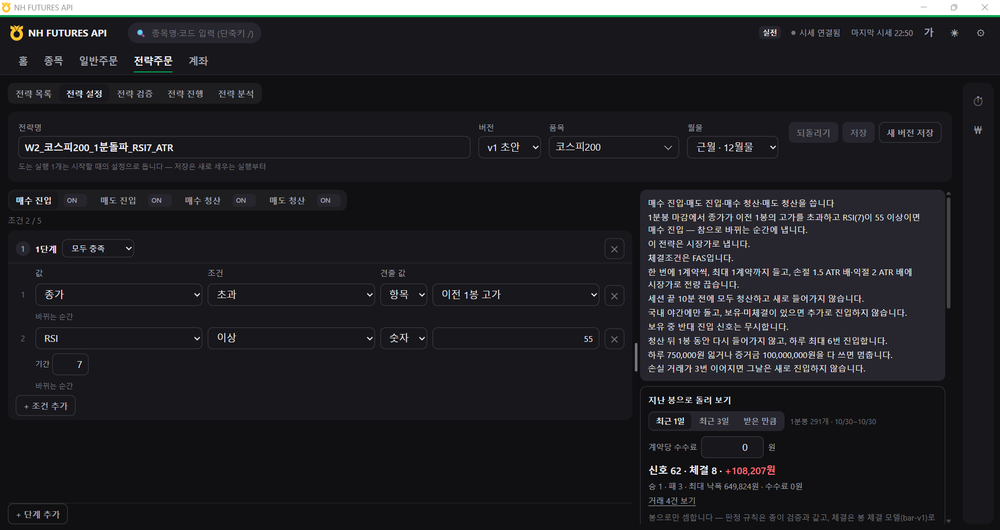
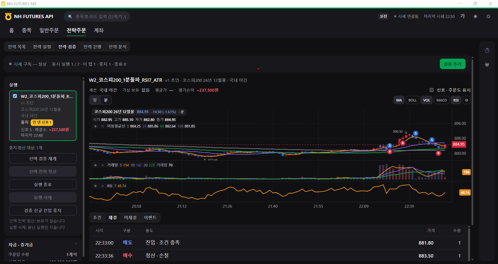
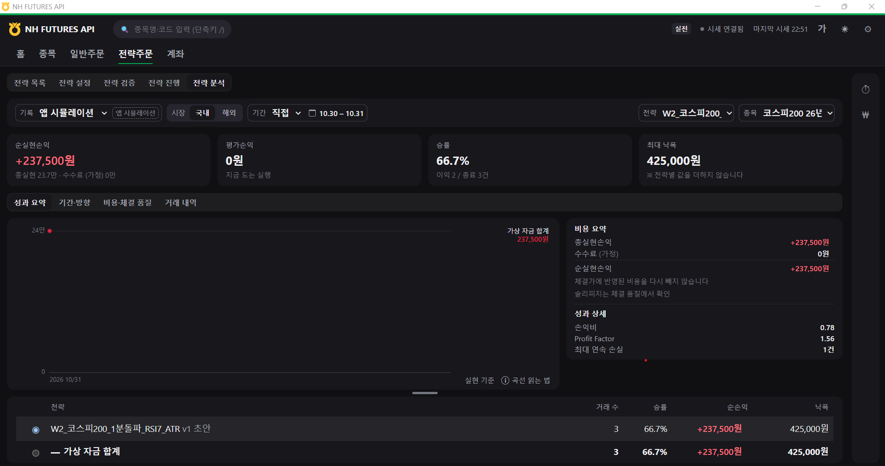

# 2주차 과제: 코스피200 선물 1분봉 돌파·RSI 전략

- 팀번호: 09
- 팀명: BE RICH
- 팀원: 김파란하늘, 정은서
- 작성일: 2026-10-30

## 1. 과제 개요

코스피200 선물 2026년 12월물에 직전 1분봉의 고가·저가 돌파와 RSI를 결합한 전략을 적용했다. 진입 조건을 충족하면 1계약을 거래하고, 반대 방향 돌파와 ATR 손절·익절 조건으로 보유 포지션을 관리했다.

국내 모의계좌 운영시간인 09:00~15:45 이후에 실행했으므로, 과제 공지에 따라 실전계좌 APP Key로 야간 시세를 받아 앱 내부 시뮬레이션을 진행했다.

거래 3건이 완료되었으며, 실현손익은 +237,500원, 승률은 66.7%였다. 신호 발생부터 주문, 체결, 청산, 손익 계산까지의 기록을 파일로 저장하고 전략 설정과 대조했다.

### 1.1 실행 정보

| 항목 | 내용 |
|---|---|
| 전략명 | W2_코스피200_1분돌파_RSI7_ATR |
| 전략 버전 ID | draft-1793359554507 |
| 분석 대상 실행 ID | run-1793367040527 |
| 종목 | 코스피200 선물 2026년 12월물 |
| 종목코드 | A016C000 |
| 세션 | 국내 야간 |
| 기준 봉 / 평가 시점 | 1분봉 / 봉 마감 |
| 실행 환경 | 실전 시세를 이용한 앱 내부 시뮬레이션 |
| 실행 메뉴 | 전략주문 → 전략 검증 |
| 체결 모형 | paper-v2 |
| 가상 초기자금 | 100,000,000원 |
| 거래승수 | 1포인트당 250,000원 |
| 주문당 수량 / 최대 보유 | 1계약 / 1계약 |
| 계약당 체결 수수료 | 0원 |

이 보고서의 주문·체결·손익은 앱 내부 시뮬레이션 기록이다. 실행 설정의 `mode: paper`와 체결 기록의 `virtual: true`에서 실행 방식을 확인할 수 있다. 계좌로 전송한 주문은 없다.

### 1.2 과제 항목과 제출 자료

| 평가 항목 | 배점 | 관련 내용 |
|---|---:|---|
| 과제 수행 | 25 | 국내 선물 전략 구성과 실행 기록. 1·5·6절, results/ |
| 전략·매매 로직 | 25 | 전략 선택 이유, 매매 규칙, 실제 조건값 대조. 2·3·7절 |
| API 활용 | 25 | 준비 봉 조회, 실시간 시세·호가 수신, 체결과 기록 저장. 4절 |
| 실행·분석 | 15 | 거래별 손익, 주문 제한, 문제 해결과 개선 계획. 6~9절 |
| GitHub·README | 10 | 실행 방법, 파일 설명과 화면 증빙. 5·10·11절 |

## 2. 전략 구성

### 2.1 가격 돌파로 진입 시점 결정

직전 1분봉의 가격 범위를 벗어난 움직임이 짧게 이어질 수 있다는 가설을 세웠다.

방금 마감된 봉의 종가가 직전 봉의 고가보다 높으면 매수 방향, 직전 봉의 저가보다 낮으면 매도 방향으로 판단한다. 봉 마감 시점에 평가하여 진행 중인 봉의 일시적인 가격 움직임을 걸러내도록 했다.

직전 봉의 고가·저가는 기준이 명확해 실제 신호 기록과 비교하기 쉽다.

### 2.2 RSI로 진입 방향 확인

돌파 방향과 최근 가격 변화가 일치하는지 확인하기 위해 RSI(7)를 함께 사용했다.

- 매수: RSI(7) 55 이상
- 매도: RSI(7) 45 이하

RSI 50 부근에서는 신규 진입을 제한했다. 기간 7은 짧은 가격 변화에 반응하기 위해 선택했고, 55와 45는 중립값 50에서 간격을 둔 기준으로 설정했다.

### 2.3 청산과 위험 관리

보유 방향과 반대로 직전 봉의 가격 범위를 벗어나면 청산하도록 했다. 청산 조건은 가격 돌파만으로 판단해 반대 방향 움직임에 대응하도록 구성했다.

손절은 ATR의 1.5배, 익절은 2배로 설정했다. 제공 엔진은 ATR(14)을 사용하며, 마지막으로 마감된 봉의 ATR에 따라 손절·익절 거리를 갱신한다.

보유 규모와 반복 진입은 최대 보유 수량, 추가 진입 제한, 청산 후 대기, 하루 진입 횟수와 손실 한도로 관리했다.

## 3. 매매 규칙과 설정

### 3.1 진입·청산 조건

표의 종가는 방금 마감된 1분봉의 종가이며, 이전 고가·저가는 그 직전 1분봉의 값이다.

| 구분 | 조건 |
|---|---|
| 매수 진입 | 종가 > 이전 1봉 고가 AND RSI(7) ≥ 55 |
| 매도 진입 | 종가 < 이전 1봉 저가 AND RSI(7) ≤ 45 |
| 매수 청산 | 종가 < 이전 1봉 저가 |
| 매도 청산 | 종가 > 이전 1봉 고가 |
| 손절 | 평균 진입가에서 불리한 방향으로 ATR(14)의 1.5배 |
| 익절 | 평균 진입가에서 유리한 방향으로 ATR(14)의 2배 |
| 세션 종료 처리 | 세션 종료 10분 전 전량 청산 및 신규 진입 제한 |

진입 조건은 두 항목을 모두 충족해야 한다. 1분봉 마감 시 조건을 평가하고, 거짓에서 참으로 바뀌는 시점에 신호를 발생시킨다.

손절·익절은 보유 중 실시간 가격으로 감시한다. 체결은 신호 발생 이후의 시세와 호가를 이용해 처리한다.

### 3.2 주문과 위험 제한

| 항목 | 설정 |
|---|---|
| 주문 유형 | 시장가 |
| 체결 조건 | FAS |
| 주문당 수량 | 1계약 |
| 최대 보유 수량 | 1계약 |
| 보유 중 추가 진입 | 금지 |
| 보유 중 반대 진입 신호 | 무시 |
| 청산 후 재진입 대기 | 1봉 |
| 하루 최대 진입 | 6회 |
| 하루 손실 한도 | 750,000원 |
| 연속 손실 제한 | 3회 |
| 증거금 예산 | 100,000,000원 |
| 별도 신규 진입 시간대 | 설정하지 않음 |
| 추적 청산 | 설정하지 않음 |

### 3.3 설정 일치 확인

저장한 최종 전략은 다음 위치에서 확인할 수 있다.

`strategies.json` → `drafts["draft-1793359554507"]`

실행에 적용된 설정은 다음 위치에 있다.

`results/strategy-runs.json` → 실행 ID `run-1793367040527` → `draft`

두 파일의 진입·청산 조건과 주문·위험 제한 값을 대조했으며, 설정이 일치했다.

## 4. API와 프로그램 사용

### 4.1 API 구성

아래 표는 사용한 제공 프로그램의 API 구현을 기준으로 정리했다.

| 기능 | API 또는 실시간 구분 | 방식·경로 | 사용 목적 |
|---|---|---|---|
| 접근 토큰 발급 | common_auth/token | POST /auth-service/v1/token | API 접근 인증 |
| WebSocket 접속키 발급 | common_auth/web-socket-key | GET /permission/v1/web-socket-key | 실시간 연결 인증 |
| 국내 분봉 조회 | domestic_chart-minute | POST /trade/v1/domestic/chart-minute | 지표 계산용 준비 봉 확보 |
| 국내 품목별 세부정보 | domestic_product-detail | POST /trade/v1/domestic/product-detail | 거래시간과 증거금 등 조회 |
| 국내 야간 실시간 체결 | KC | WebSocket | 가격 수신과 전략 평가 |
| 국내 야간 실시간 호가 | KD | WebSocket | 가상 체결에 사용할 호가 수신 |

실행 기록에서는 다음 내용을 확인했다.

| 확인 항목 | 기록 |
|---|---|
| 준비 봉 수신 | 준비 봉 조회 2000줄 — 새 봉 2000개(지금 2000개) |
| 데이터 출처 | origin: live |
| 실행 모드 | mode: paper |
| 체결 표시 | virtual: true |
| 신호 당시 값 | snapshot에 종가, 이전 고가·저가, RSI 등 저장 |

### 4.2 처리 순서

1. 분봉 API로 준비 봉을 받는다.
2. 국내 야간 실시간 체결과 호가를 수신한다.
3. 1분봉 마감 시 지표와 조건식을 계산한다.
4. 신호가 발생하면 보유 상태, 실행 상태와 위험 제한을 확인한다.
5. 주문이 허용되면 paper-v2 모형에서 가상 체결을 처리한다.
6. 체결에 따라 보유 상태를 갱신하고, 청산 시 손익을 계산한다.
7. 신호·주문·체결·손익·차단 사유를 파일에 저장한다.

### 4.3 체결 모형

paper-v2는 일반 주문에 0.3초 지연을 적용하고, 이후 수신한 호가·체결로 주문을 처리한다. 시장가는 반대편 호가에 표시된 잔량을 기준으로 체결한다.

시세가 끊긴 구간에서는 체결 생성을 멈추고, 세션 종료 시 대기 주문을 취소하도록 구현되어 있다. 이번 실행에서는 가상 주문 6건이 모두 전량 체결되었다.

### 4.4 구현 범위

API 통신, 지표 계산, 조건 평가, 가상 체결과 기록 저장은 제공된 NH FUTURES API 프로그램을 사용했다.

팀은 가격 돌파·RSI 진입 조건과 청산·위험 제한을 구성하고, 실행 결과를 원본 기록과 대조했다.

| 파일 | 역할 |
|---|---|
| code/strategy/indicators.py | RSI·ATR 등 지표 계산 |
| code/strategy/rules.py | 조건식 평가 |
| code/strategy/engine.py | 신호, 주문, 위험 관리와 청산 처리 |
| code/strategy/paper.py | 가상 체결 |
| code/strategy/journal.py | 실행 기록 저장 |
| code/strategy/records.py | 거래 집계와 성과 계산 |
| strategies.json | 전략 규칙과 설정 |
| results/strategy-runs.json | 실행 모드, 적용 설정과 상태 |
| results/strategy-trades.jsonl | 신호·주문·체결·손익·이벤트 기록 |

`code/strategy/`에는 제공 프로그램의 전략 관련 소스 사본을 넣었다. 팀이 구성한 규칙은 `strategies.json`과 실행 상태 파일의 `draft`에 저장되어 있다.

## 5. 실행 방법

### 5.1 프로그램 준비

1. [NH FUTURES API 저장소](https://github.com/PetterChanHyuk/nh-futures-open-api)에서 전체 소스를 내려받고 압축을 푼다.
2. Windows에서는 저장소 안내에 따라 `NH FUTURES API Setup.exe`로 설치한다.
3. 프로그램 오른쪽 위 설정 → 인증 정보에서 실전투자·국내 항목에 본인의 APP Key와 APP Secret Key를 입력하고 저장한다.
4. 설정 → 일반에서 접속 환경을 실전투자로 선택한다.
5. 시세 연결을 확인한다.

실행에는 제공 저장소의 전체 프로그램과 의존성이 필요하다. 인증정보는 실행하는 사람의 로컬 설정에 입력한다.

### 5.2 전략 설정

1. `전략주문 → 전략 설정`에서 코스피200 선물 전략을 생성한다.
2. 전략명을 `W2_코스피200_1분돌파_RSI7_ATR`로 설정한다.
3. 3절의 진입·청산 조건을 입력한다.
4. 기준 봉은 `1분봉`, 조건 평가는 `마감`, 세션은 `국내 야간`으로 선택한다.
5. 주문 수량과 위험 제한을 설정하고 저장한다.
6. `전략 검증 → 검증 추가`에서 해당 전략을 선택한다.
7. 월물과 종목코드를 확인하고 앱 시뮬레이션을 실행한다.
8. `조건`, `체결`, `미체결`, `이벤트`에서 실행 과정을 확인한다.

이번 종목은 2026년 12월물 `A016C000`이다. 다른 시점에 실행할 경우 해당 월물의 거래 가능 여부를 확인한다.

실행 메뉴는 `전략 검증`을 사용한다. `전략 진행`은 계좌 주문을 전송하는 기능이다.

### 5.3 기록 집계

보고서의 집계 대상은 실행 ID `run-1793367040527`이다.

`results/strategy-trades.jsonl`에서 해당 `runId`를 가진 줄을 선택하고 아래 항목을 확인한다.

| 확인 내용 | 기록 |
|---|---|
| 완료 거래와 손익 | kind: trade, netPl |
| 체결 횟수와 체결가 | kind: fill, quantity, price |
| 주문 처리 결과 | kind: order, outcome |
| 조건식 신호 | kind: event, event: signal |
| 주문 전 차단 | kind: event, event: blocked, reason |
| 신호 당시 조건값 | fill 기록의 snapshot |
| 청산 사유 | order 또는 fill 기록의 reason |

### 5.4 성과 조회

`전략 분석`에서 다음 항목을 선택한다.

- 기록: 앱 시뮬레이션
- 시장: 국내
- 전략: W2_코스피200_1분돌파_RSI7_ATR
- 종목: 코스피200 선물 2026년 12월물
- 기간: 직접, 2026-10-30~2026-10-31

앱은 이번 국내 야간 거래를 10월 31일로 묶어 집계한다. 실제 체결 시각은 10월 30일 밤이며, 조회 종료 날짜에 10월 31일을 포함하면 결과를 확인할 수 있다.

## 6. 실행 결과

### 6.1 실행 시간과 상태

모든 시각은 한국시간(KST)이다.

| 항목 | 기록 |
|---|---|
| 실행 생성 | 2026-10-30 22:30:40 |
| 준비 봉 | 2,000개 |
| 첫 진입 체결 | 22:33:00 |
| 마지막 청산 체결 | 22:48:41 |
| 신규 진입 중지 | 22:48:59 |
| 제출 기록의 마지막 이벤트 | 22:54:00 |
| 저장된 실행 상태 | paused |
| 제출 기록 기준 잔여 보유 | 0계약 |
| 가상 주문 결과 | 6건 모두 filled |

### 6.2 거래 내역

거래 수량은 모두 1계약이다.

| 번호 | 방향 | 진입 시각 | 진입가 | 청산 시각 | 청산가 | 청산 방식 | 손익 |
|---|---|---|---:|---|---:|---|---:|
| 1 | 매도 | 22:33:00 | 881.80 | 22:33:36 | 883.50 | 자동 손절 | -425,000원 |
| 2 | 매수 | 22:37:00 | 888.00 | 22:41:02 | 888.40 | 매수 청산 규칙 | +100,000원 |
| 3 | 매도 | 22:46:00 | 884.95 | 22:48:41 | 882.70 | 수동 청산 | +562,500원 |
| 합계 | | | | | | | +237,500원 |

손익은 체결가 차이에 거래승수 250,000원을 적용해 계산했다.

- 1번: (881.80 - 883.50) × 250,000 = -425,000원
- 2번: (888.40 - 888.00) × 250,000 = +100,000원
- 3번: (884.95 - 882.70) × 250,000 = +562,500원

### 6.3 성과 요약

| 항목 | 결과 |
|---|---:|
| 완료 거래 | 3건 |
| 이익 거래 / 손실 거래 | 2건 / 1건 |
| 승률 | 66.7% |
| 이익 거래 손익 합계 | +662,500원 |
| 손실 거래 손익 합계 | -425,000원 |
| 실현손익 | +237,500원 |
| 반영된 수수료 | 0원 |
| 평균 이익 거래 | +331,250원 |
| 평균 손실 거래 | -425,000원 |
| 평균 이익 / 평균 손실 절댓값 | 0.78 |
| Profit Factor | 1.56 |
| 실현손익 기준 최대 낙폭 | 425,000원 |
| 가상 초기자금 대비 실현 수익률 | +0.2375% |

- 승률: 2 ÷ 3 × 100 ≈ 66.7%
- Profit Factor: 662,500 ÷ 425,000 ≈ 1.56
- 초기자금 대비 수익률: 237,500 ÷ 100,000,000 × 100 = 0.2375%

완료 거래의 누적 실현손익은 다음과 같다.

`0원 → -425,000원 → -325,000원 → +237,500원`

최대 낙폭은 이 누적 실현손익을 기준으로 계산했다.

### 6.4 신호·주문·체결 건수

| 구분 | 건수 |
|---|---:|
| 조건식 신호 | 6건 |
| 진입으로 이어진 신호 | 3건 |
| 주문 전에 차단된 진입 신호 | 2건 |
| 규칙 청산 신호 | 1건 |
| 가상 주문 결과 | 6건 |
| 가상 체결 | 6회 |
| 완료 거래 | 3건 |

신호, 주문, 체결은 각각 구분해 집계했다. 자동 손절과 수동 청산은 청산 주문에 포함되며, 조건식 신호와 별도로 기록된다.

## 7. 규칙 검증과 결과 분석

### 7.1 진입 조건 대조

체결 기록의 신호 당시 값과 설정 조건을 비교했다.

| 거래 | 가격 조건 | RSI 조건 | 결과 |
|---|---|---|---|
| 1번 매도 | 종가 881.85 < 이전 저가 882.95 | RSI(7) 39.17 ≤ 45 | 충족 |
| 2번 매수 | 종가 887.85 > 이전 고가 884.60 | RSI(7) 75.40 ≥ 55 | 충족 |
| 3번 매도 | 종가 884.90 < 이전 저가 885.85 | RSI(7) 39.45 ≤ 45 | 충족 |

세 진입 모두 가격 조건과 RSI 조건을 충족했다.

2번 거래의 신호 봉 종가는 887.85, 진입 체결가는 888.00이었다. 신호 이후의 호가와 처리 지연이 체결 가격에 반영되었다.

### 7.2 청산과 주문 제한

1번 거래는 가격 반등 후 `stop` 사유로 청산되었다.

2번 거래에서는 종가 888.60이 이전 저가 888.80보다 낮아져 매수 청산 조건을 충족했고, `exit` 사유로 청산되었다.

추가 진입과 중지 상태도 기록으로 확인했다.

| 시각 | 상황 | 기록 | 확인 결과 |
|---|---|---|---|
| 22:48:01 | 매도 1계약 보유 중 매도 진입 신호 발생 | blocked / add-while-open | 추가 진입 차단 |
| 22:54:00 | 신규 진입 중지 후 매수 진입 신호 발생 | blocked / state | 신규 주문 차단 |

### 7.3 거래 결과 해석

첫 거래에서는 하향 돌파 이후 가격이 반등했고, 손절로 포지션이 정리되었다. 짧은 돌파 이후에도 반대 방향 움직임이 발생할 수 있어 손절과 보유 제한이 필요하다는 점을 확인했다.

두 번째 거래에서는 매수 진입 후 반대 방향 돌파가 발생해 규칙 청산이 이루어졌다. 세 번째 거래에서는 매도 진입 후 가격이 하락했고, 최종 누적 손익은 +237,500원이 되었다.

이번 실행에서는 양방향 진입, 규칙 청산, 자동 손절, 추가 진입 차단과 중지 후 주문 차단을 확인했다. 이후 검증에서는 거래일과 표본을 늘리고, 자동 청산 결과와 비용 차감 성과를 함께 비교할 계획이다.

## 8. 실행 중 문제와 해결

### 8.1 성과 화면 조회

체결 기록이 있었지만 전략 분석 화면에서 종료 거래가 없다고 표시되었다.

조회 종료 날짜가 10월 30일로 설정되어 있었고, 앱은 해당 야간 거래를 10월 31일로 집계하고 있었다. 조회 기간을 2026-10-30~2026-10-31로 변경한 뒤 거래 3건과 손익을 확인했다.

### 8.2 여러 실행 기록 구분

저장 파일에는 초기 전략과 이전 실행도 포함되어 있었다.

성과 화면에서는 최종 전략을 선택하고, 파일 집계에서는 실행 ID `run-1793367040527`을 기준으로 해당 실행의 기록을 추렸다.

### 8.3 주문 차단 확인

진입 신호 2건이 각각 `add-while-open`과 `state` 사유로 차단되었다. 보유 중 추가 진입 금지와 신규 진입 중지 설정이 적용된 결과로 확인했다.

## 9. 개선 계획

| 작업 | 확인할 내용 |
|---|---|
| 신호·청산 로그에 ATR과 손절·익절 기준 가격 추가 | 기록을 이용한 청산 판단 재계산 |
| 실행 시간과 종료 절차를 사전에 고정 | 동일한 조건에서 실행 결과 비교 |
| 직전 1봉과 여러 봉의 돌파 조건 비교 | 거래 수, 거래당 손익, 최대 낙폭 |
| 실제 수수료를 적용한 손익 계산 | 비용 차감 전후 성과 |
| 진입 시 ATR 고정 방식과 매 봉 갱신 방식 비교 | 청산 시점과 거래별 손실 |
| 규칙을 고정한 뒤 여러 거래일에서 실행 | 날짜별 성과와 손실 구간 |
| 야간 집계 날짜를 화면에 안내 | 성과 조회 편의성 개선 |

## 10. 제출 자료

### 10.1 파일 설명

| 경로 | 내용 |
|---|---|
| [README.md](README.md) | 실행 방법, 전략, API, 결과와 분석 |
| [strategies.json](strategies.json) | 저장한 전략 규칙과 설정 |
| [code/strategy/](code/strategy/) | 제공 프로그램의 전략 관련 소스 사본 |
| [results/strategy-runs.json](results/strategy-runs.json) | 분석 대상 실행의 설정과 상태 |
| [results/strategy-trades.jsonl](results/strategy-trades.jsonl) | 신호·주문·체결·손익 원본 기록 |
| [screenshots/01_settings.png](screenshots/01_settings.png) | 최종 전략 설정 |
| [screenshots/02_execution.png](screenshots/02_execution.png) | 최종 실행의 체결 기록 |
| [screenshots/03_analysis.png](screenshots/03_analysis.png) | 최종 성과 화면 |

### 10.2 전략 설정

### 10.3 체결 기록

### 10.4 성과 화면

## 11. 참고 자료

- NH선물 REST API Pioneer 1기 2주차 과제 공지
- [2주차 제출 예시](https://github.com/PetterChanHyuk/pioneer-1st-submission-example/tree/main/week02)
- [NH FUTURES API 제공 프로그램](https://github.com/PetterChanHyuk/nh-futures-open-api)
- [NH선물 REST API 개발자센터](https://apidev.futures.co.kr/)

API 경로와 인증은 `backend/nh_api/catalog.py`, `backend/auth/auth_functions.py`를 참고했다.

국내 야간 실시간 구분은 `backend/realtime/feeds.py`, 전략 판정과 체결·집계 방식은 `backend/strategy/`의 관련 소스에서 확인했다.