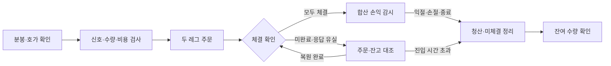
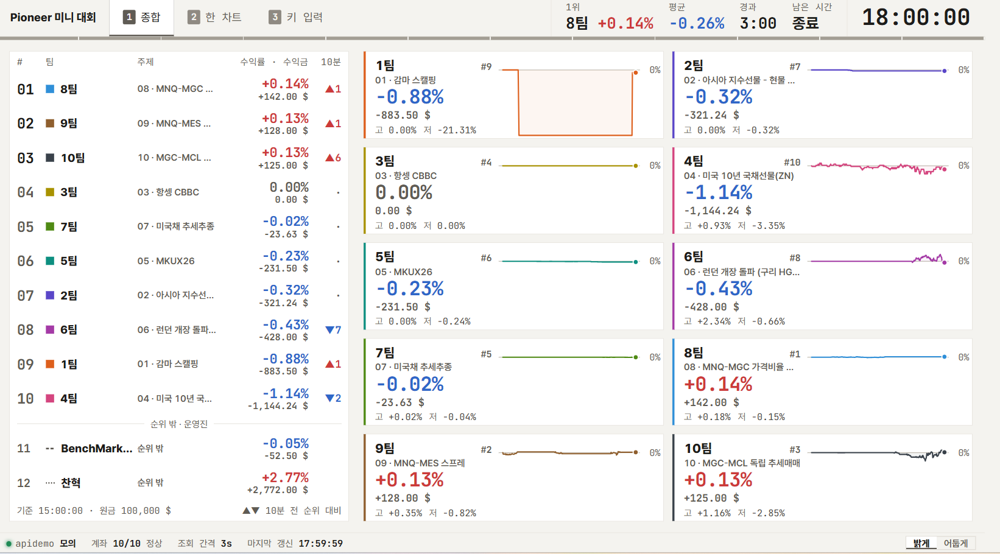
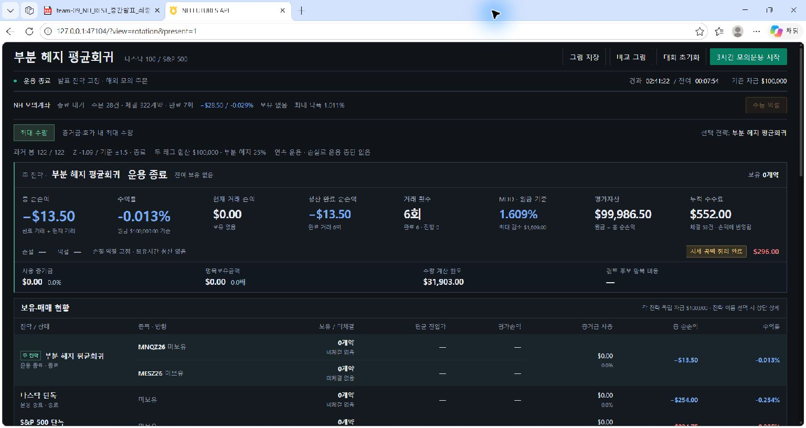
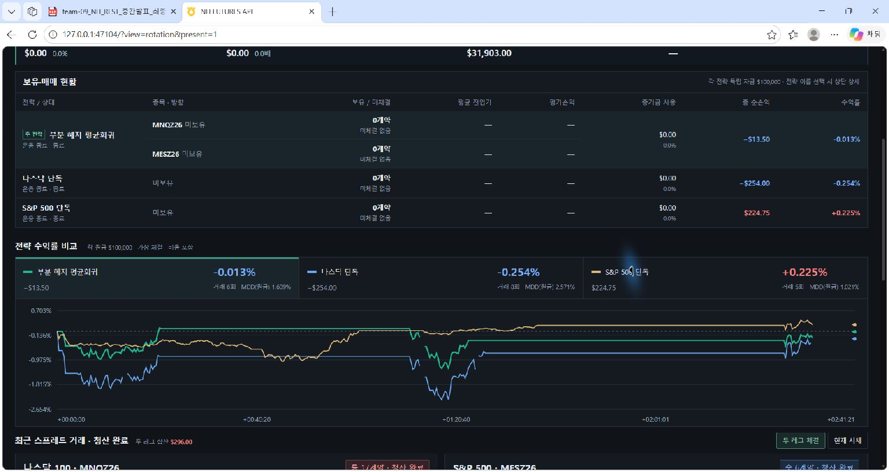
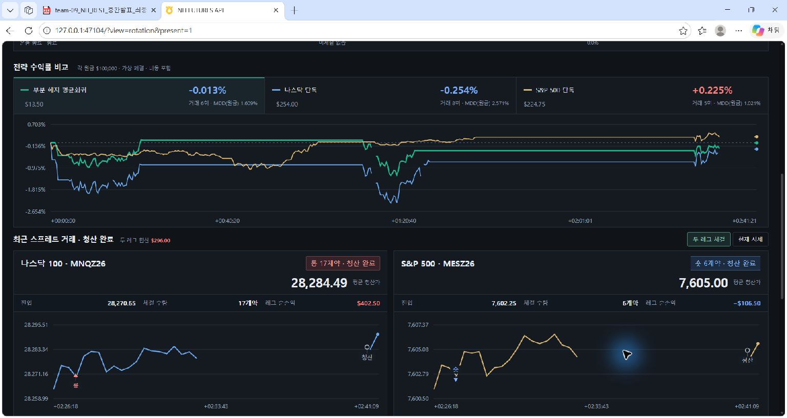

# 4주차 복수상품·스프레드 전략: MNQ·MES 부분 헤지 평균회귀

NH선물 REST API Pioneer 1기 · 9팀 · 제출일 2026/11/13

마이크로 나스닥100과 마이크로 S&P 500의 로그가격 차이를 거래했다. 상대가격이 최근 평균에서 벗어났다가 평균 방향으로 움직이면 두 종목을 반대 방향으로 진입한다. 계약 수는 두 레그의 합산 증거금과 거래비용을 기준으로 정하고, 청산도 합산 손익으로 판단한다.

| 항목 | 내용 |
| --- | --- |
| 종목 | `MNQZ26`, `MESZ26` — 2026년 12월물 |
| 실행 환경 | NH 해외 **모의계좌** 주문·체결. 실전 API는 시세·분봉 조회에 사용 |
| 자금 | 스프레드 두 레그 합산 $100,000 |
| 제출 실행 | 11/13 14:58:41~17:40:04, **2시간 41분** |
| 계좌 거래 | 스프레드 왕복 **7회**, 주문·체결 각각 28건 |
| 대회 결과 | **10팀 중 2위**, 주최측 집계 **+$128.00 / +0.13%** |
| 종료 상태 | 두 종목 보유 0계약, 잔여 미체결 0건 |

시간은 모두 한국시간이다. 발표자료는 11/09~11/11 검증 내용이며, 아래 계좌 내역과 제출 로그는 11/13 실행 결과다. 발표자료의 선택 구간과 당일 비교군은 6절에 나누어 정리했다.

## 1. 과제 개요

이번 주에는 두 종목의 상대가격으로 신호를 만들고, 한쪽 주문만 체결되는 상황까지 처리하는 것을 목표로 했다. 기존 NH FUTURES API 프로그램에 스프레드 전략, 모의계좌 주문 관리, 단일 종목 비교군과 운용 화면을 추가했다.

종목별 가격 단위, 계약 승수, 증거금, 체결 시점을 확인하고 두 레그를 하나의 거래로 관리했다. 한쪽이 먼저 체결되면 남은 주문을 추적하고, 청산할 때는 두 종목의 잔여 수량을 함께 확인한다.

구현 범위는 다음과 같다.

1. 상대가격의 평균 이탈과 회귀를 이용한 단기 매매 규칙.
2. 동일 자금으로 운용한 단일 종목 전략과 수익률·낙폭·거래비용 비교.
3. 모의계좌의 두 레그 주문·체결·청산과 재접속 후 계좌 대조.

### 진행 범위

| 구분 | 기간·환경 | 확인한 내용 |
| --- | --- | --- |
| 발표 전 전략 검증 | 11/09~11/11 연구, 과거 분봉 사용 | 계수와 매매 규칙을 실험하고 단일 종목 전략과 비교 |
| 대회 당일 실행 | 11/13, NH 해외 모의계좌 | 확정한 규칙으로 실제 주문·체결, 수동 청산과 종료 처리 |
| 당일 비교군 | 11/13, 같은 시세를 이용한 앱 시뮬레이션 | 세 전략의 수익률·낙폭·거래 횟수를 같은 체결 모델로 비교 |

### 필수 기능과 구현 위치

| 필수 기능 | 구현 | 코드·실행 근거 |
| --- | --- | --- |
| 복수 종목 조회 | 같은 시각의 완료 1분봉과 최신 호가 수집 | [blend_runtime.py](code/application/backend/strategy/blend_runtime.py), [시세 기록](results/raw/market-data.jsonl.gz) |
| 스프레드 신호 | 로그가격 차이의 평균·표준편차와 평균 방향 움직임 확인 | [spread_blend.py](code/application/backend/strategy/spread_blend.py) |
| 두 레그 주문 | MNQ·MES 반대 방향 주문, 수량·체결·손익 함께 관리 | [blend_mock.py](code/application/backend/strategy/blend_mock.py), [주문 내역](results/nh-mock/orders.csv) |
| 위험 관리 | 합산 손절·익절, 부분 체결 정리, 중복 주문 방지 | [blend_recovery.py](code/application/backend/strategy/blend_recovery.py) |
| 실행 기록 | 시세·신호·주문·체결·청산 및 상태 저장 | [원시 로그](results/raw/), [집계 코드](code/summarize_run.py) |
| 성과 비교 | 같은 시세에서 스프레드와 단일 종목 전략 비교 | [비교 결과](results/app-simulation/summary.csv) |

## 2. 전략 설명

### 상품 선택과 스프레드

MNQ는 나스닥100, MES는 S&P 500을 추종한다. 두 상품은 미국 주식시장의 영향을 함께 받으며, 지수 구성 비중에 따라 상대적인 강약이 생긴다. 같은 거래소에서 거래되고 미국달러로 결제되므로 두 레그의 손익을 USD로 합산했다.

마이크로 상품은 계약을 작은 단위로 조절할 수 있어 정수 계약 수로 헤지 비율을 맞추기 쉽다. 두 상품의 가격과 계약 승수를 반영한 명목금액을 기준으로 수량 조합을 계산했다.

| 항목 | MNQ | MES |
| --- | ---: | ---: |
| 1포인트당 손익 | $2 | $5 |
| 최소 호가 단위 | 0.25포인트 | 0.25포인트 |
| 1틱당 손익 | $0.50 | $1.25 |
| 이번 실행의 거래당 수량 | 17계약 | 6계약 |

### 로그가격 차이를 사용한 이유

로그가격의 변화는 수익률에 가까워 두 지수의 상대 움직임을 비율로 표현할 수 있다. MNQ를 주 레그로 두고 MES의 로그가격을 0.25배 차감해 스프레드를 계산했다.

```text
S = ln(MNQ 종가) − 0.25 × ln(MES 종가)
Z = (현재 S − 직전 120개 S의 평균) / 직전 120개 S의 표준편차
```

Z는 상대가격이 최근 평균에서 표준편차 몇 배 떨어져 있는지 나타낸다. 예를 들어 Z가 +1.5이면 평균보다 표준편차의 1.5배 위에 있다는 뜻이다. 이 값으로 최근 변동폭 대비 이탈 크기를 판단한다.

평균과 표준편차는 신호봉 직전의 완료 봉 120개로 계산한다. 코드에서는 최초 가격 대비 로그값을 사용하며, S에서 일정한 상수를 빼도 Z값은 위 식과 같다. 표준편차는 모집단 표준편차를 사용한다. 계산 위치는 [blend_signal()](code/application/backend/strategy/spread_blend.py#L40)이다.

### 0.25의 선정과 부분 헤지

계수 **0.25는 발표 전 실험을 통해 정했다.** 대회에서는 이 값을 고정하고, MES의 목표 명목금액을 MNQ 명목금액의 25%로 맞췄다. 스프레드 계산과 포지션 구성에 같은 비율을 적용했다.

MNQ 롱·MES 숏에서는 두 지수가 함께 상승할 때 MNQ의 이익 일부와 MES의 손실이 상쇄된다. 두 지수가 함께 하락하면 MES 숏의 이익이 MNQ 롱의 손실 일부를 줄인다. MNQ 숏·MES 롱은 상대가격 하락을 거래하는 조합이다. 두 조합 모두 **합산 손익**으로 청산을 판단한다.

첫 거래 체결가를 기준으로 포지션 규모를 계산하면 다음과 같다.

| 항목 | MNQ 롱 | MES 숏 |
| --- | ---: | ---: |
| 진입가 | 28,288.75 | 7,610.50 |
| 수량·승수 | 17계약 × $2 | 6계약 × $5 |
| 명목금액 | $961,817.50 | $228,315.00 |

실제 명목금액 비율은 23.74%다. 계약 수를 정수로 맞추면서 목표 25%와 차이가 생겼으며, 설정한 오차 범위 10% 안에 들어간다. 헤지 후에도 MNQ 방향의 노출이 일부 남는다.

### 과거 봉 준비와 신호 시점

과거 분봉을 API로 불러와 기준 구간을 확보한다. 가격 기준점, 120개 기준 봉, 현재 신호봉을 포함해 두 종목의 완료 분봉 122개가 정렬되면 계산을 시작한다.

11/13 실행에서는 시작 **1.549초 뒤 494개의 정렬된 분봉**이 처음 저장됐다. 첫 모의계좌 체결은 시작 **79.253초 뒤**였다.

분봉 처리 순서는 다음과 같다.

1. 두 종목의 API 응답에서 같은 시각의 봉만 남기고 시간순으로 정렬한다.
2. 완료 봉을 사용하며, 신호봉 직전 120개 봉으로 평균·표준편차를 구한다.
3. 봉의 시간 간격, 가격의 양수 여부, 최근 봉의 최신성을 검사한다. 결측 구간은 자료가 확보될 때까지 대기한다.
4. 완성된 신호를 최신 호가·잔량·주문 가능 수량과 함께 검사한 뒤 주문한다.

자료 수집은 [BlendRuntime._get_history()](code/application/backend/strategy/blend_runtime.py#L122), 신호 계산은 [blend_signal()](code/application/backend/strategy/spread_blend.py#L40)에 있다.

## 3. 매매 로직

### 진입 조건

| 조건 | MNQ | MES |
| --- | --- | --- |
| `Z ≥ +1.5`이고 S가 이전 완료 봉보다 하락 | 숏 | 롱 |
| `Z ≤ −1.5`이고 S가 이전 완료 봉보다 상승 | 롱 | 숏 |

Z 기준 충족과 S의 평균 방향 전환을 함께 확인한다. 양의 Z에서 S가 이전 봉보다 하락하면 MNQ 숏·MES 롱, 음의 Z에서 S가 상승하면 MNQ 롱·MES 숏 후보가 된다.

두 지수의 최근 5분 수익률 곱이 0 이상인지 확인해 공통 방향 조건을 검사한다.

호가는 5초 이내, 두 종목의 시각 차이는 2초 이내여야 한다. 같은 완료 봉에서는 한 번만 진입한다.

| 판단 단계 | 확인하는 값 | 대기 중 처리 |
| --- | --- | --- |
| 자료 준비 | 122개 완료 봉, 시간 정렬, 최근 봉 | 새 자료 수신 대기 |
| 이탈·회귀 | Z의 절댓값 1.5 이상, S가 평균 방향으로 전환 | 다음 완료 봉 대기 |
| 공통 방향 | 최근 5분 수익률의 곱 0 이상 | 진입 보류 |
| 주문 여건 | 최신 호가, 잔량, 거래량, 증거금·주문 가능 수량 | 조건에 맞는 계약 조합 재계산 |
| 비용 | 예상 왕복 비용과 손절 예산·목표 수익 비교 | 다음 신호 감시 |

대기 중에도 자료를 갱신하면서 다음 신호를 확인한다.

### 계약 수와 비용

```text
MNQ 명목금액 D = MNQ 가격 × $2 × MNQ 계약 수
MES 목표 계약 수 = 0.25 × D / (MES 가격 × $5)
```

가능한 정수 계약 조합 중 아래 조건을 만족하는 최대 합산 명목금액 조합을 선택한다.

| 제한 | 기준 |
| --- | --- |
| 자금 | 두 레그 증거금 + 예상 왕복 비용 ≤ 가용 자금 |
| 가용 자금 | `$100,000`과 `$100,000 + 누적 순손익` 중 작은 값 |
| 주문 가능 수량 | 30초 이내에 조회한 모의계좌 주문 가능 수량 이내 |
| 유동성 | 주문 수량을 채울 수 있는 호가 잔량, 직전 1분 거래량의 5% 이내 |
| 수량 한도 | 종목당 최대 100계약, MES 목표 수량과의 오차 10% 이내 |

매 신호마다 가격·거래량·호가 잔량·가용 자금을 반영해 계약 조합을 계산한다. 이번 실행에서는 매번 MNQ 17계약·MES 6계약이 선택됐다. 수량 계산은 [blend_sizes()](code/application/backend/strategy/spread_blend.py#L79)에 있다.

| 종목 | 계약당 증거금 | 계약 수 | 필요 증거금 |
| --- | ---: | ---: | ---: |
| MNQ | $4,634 | 17 | $78,778 |
| MES | $2,939 | 6 | $17,634 |
| **합계** | | **23** | **$96,412** |

두 레그의 **합산 예산 $100,000** 중 96.412%를 증거금으로 사용했다. 발표 전 검증에서 사용한 MES 증거금은 $2,935였고, 당일에는 새로 조회한 $2,939를 적용했다.

### 거래비용 반영

예상 왕복 비용 C에는 수량별 매수·매도 호가 차이, 편도 1틱의 추가 가격 불리함, 계약당 편도 $2의 수수료를 반영했다. $2는 프로그램의 수수료 가정이다. 17·6계약의 왕복 수수료는 **$92**다.

```text
종목별 예상 비용
  = 계약 수 × {편도 수수료 × 2
              + [수량별 매도·매수 호가 차이 + 추가 1틱 × 2] × 승수}

예상 왕복 비용 C = MNQ 예상 비용 + MES 예상 비용
```

호가 비용은 주문 수량별 잔량을 반영한 체결 가격으로 계산한다. 여러 호가에 걸쳐 체결되는 수량까지 비용에 포함하고, 해당 수량을 소화할 수 있는 계약 조합을 선택한다. 여기에 왕복 수수료를 더해 순익 목표와 비교했다.

### 익절·손절

σ는 상대가격 S의 표준편차, D는 MNQ 명목금액, C는 예상 왕복 비용이다.

```text
순익 목표 T = min(1.5 × σ × D − C, $600)
손절 폭 R   = min(0.75 × σ × D + C, $600)
```

진입 전에 `C ≤ 0.4 × R`인지 확인한다. 상한을 적용한 비용 차감 전 목표도 C의 1.25배 이상이어야 한다. T와 R은 진입 시 고정하고, 두 레그 합산 순손익이 T 이상이면 익절, −R 이하이면 손절한다.

예상 왕복 비용은 손절 예산의 40% 이내로 제한했다. 잔여 예산은 진입 뒤 가격 변동에 배정하고, 거래당 순익 목표와 손절 폭의 상한은 각각 $600으로 설정했다.

#### 실제 적용 예: 17:26 진입

| 항목 | 기록된 값 |
| --- | ---: |
| 신호봉 | 17:25 완료 1분봉 |
| Z | −2.2902 |
| 상대가격 표준편차 σ | 0.00078317 |
| 진입 방향 | MNQ 롱·MES 숏 |
| 계약 수 | 17계약·6계약 |
| 예상 왕복 비용 C | $180.25 |
| 순익 목표 T / 손절 폭 R | $600 / $600 |
| 비용 ÷ 손절 예산 | 30.04% |

이 거래는 Z와 회귀 방향 조건을 충족했고, 예상 비용도 손절 예산의 40% 이내였다. 변동성 배수 1.5와 0.75에 비용 및 $600 상한을 적용한 결과, 목표와 손절 금액은 각각 $600으로 결정됐다. 이 거래의 금액 기준 손익비는 1:1이다.

실행 기록: [종료 상태](results/raw/state.json.gz), [마지막 거래의 진입 설정](results/raw/mock-intent.json).

보유 중에는 합산 손익으로 청산을 판단하고, 손절 뒤에는 다음 유효 신호를 감시한다. $600은 청산 요청 기준이며 실제 손실에는 주문·체결 지연과 체결 가격이 반영된다.

적용 모델은 `partial-hedge-blend-v15 / cost-buffer-v5`다. 전체 설정은 [strategy-settings.json](results/strategy-settings.json)에 저장했다.

## 4. API 활용과 주문 관리

### REST·웹소켓 사용

| 기능 | 방식 | 용도·주기 |
| --- | --- | --- |
| 실전 환경 호가 | REST `bid_price` | 화면·앱 비교군 시세. 응답 완료 후 1초 대기 |
| 완료 1분봉 | REST `chart_minute` | 두 종목 신호 계산. 응답 완료 후 12초 대기 |
| 모의 환경 호가 | REST `bid_price` | 실제 주문의 비용·호가 신선도 확인. 응답 완료 후 2초 대기 |
| 주문 가능 수량 | REST `orderable_quantity` | 수량 제한과 조회 시각 확인 |
| 주문·취소 | 모의 환경 REST | 주문번호를 받아 주문 상태 추적 |
| 실시간 현재가·호가 | 웹소켓 `QUOTE`, `BOOK` | 종목별 시세 갱신 |
| 주문·체결 통보 | 웹소켓 `ORDERS` | 주문번호별 접수·체결 반영 |
| 잔고·주문 이력 | REST `open_interest`, `order_history` 등 | 시작 전 확인, 재접속·응답 유실 후 대조 |

웹소켓 구독은 두 종목의 현재가·호가 4개와 계좌 주문 통보 1개로 구성했다. 공지의 APP Key당 상한 20건 이내다. 주문 송신부는 해외 모의 환경의 MNQ·MES만 허용한다.

REST로 과거 분봉과 계좌 상태를 조회하고, 웹소켓으로 실시간 시세와 주문·체결 통보를 받았다. 주문 확인이 필요한 경우 REST 주문내역·잔고를 웹소켓 통보와 대조한다. 시세는 실전 환경에서 조회하고 주문은 모의 환경으로 전송한다.

공통 API 클라이언트는 환경·시장·호출 등급별로 요청 간격을 관리한다. 시세·계좌는 최소 0.1초, 주문은 0.2초, 인증은 약 0.334초 간격이다. 전략의 반복 조회 주기에 이 제한기 대기 시간과 응답 시간이 더해진다. 관련 코드는 [rate_limit.py](code/application/backend/nh_api/rate_limit.py)와 [client.py](code/application/backend/nh_api/client.py)에 있다.

### 당일 저장한 시세·조회 자료

| 자료 | 저장 건수 | 사용 목적 |
| --- | ---: | --- |
| 두 종목 호가 묶음 | 8,111 | 현재가 표시, 앱 비교군 체결·평가 |
| 정렬된 분봉 묶음 | 717 | 신호 계산에 사용할 과거 봉 갱신 |
| 모의계좌 신규 주문 가능 수량 | 455 | 주문 수량과 조회 시각 확인 |
| 상품별 증거금 | 1 | 합산 예산 계산 |

위 숫자는 [market-data.jsonl.gz](results/raw/market-data.jsonl.gz)의 자료 종류별 저장 건수다. 조회 회차별 자료 묶음을 1건으로 세었으며, 한 묶음에 두 종목의 자료가 포함될 수 있다.

### 두 레그 처리



두 레그의 주문과 체결 상태를 각각 추적한다. 신규 주문의 접수 응답이 유실되면 기존 주문과 누적 체결을 먼저 조회한다.

진입·청산은 다음 순서로 처리한다.

1. **진입 전:** 두 종목의 보유와 미체결이 모두 0인지 확인한다. 신호 봉별 진입 내역을 관리해 각 봉에서 한 번씩 주문한다.
2. **주문 접수:** 선택한 MNQ·MES 수량과 방향을 하나의 거래 계획으로 저장한 뒤 각 레그를 주문한다. 주문번호를 받아 체결 통보와 연결한다.
3. **체결 확인:** 두 레그 모두 목표 수량을 채웠는지 확인한다. 한쪽이 미완료 상태로 10초가 지나면 남은 진입 주문을 취소하고 체결분을 정리한다.
4. **보유 중:** 롱은 매수호가, 숏은 매도호가로 청산할 때의 손익을 계산한다. 청산에 필요한 수수료까지 반영한 합산 순손익으로 익절·손절을 판단한다.
5. **청산 완료:** 두 레그 보유와 미체결이 모두 0인지 확인한 뒤 거래를 완료 처리한다. 운용 시간이 남아 있으면 다음 신호를 감시한다.

| 상황 | 처리 |
| --- | --- |
| 10초 안에 진입 미완료 | 남은 진입 주문 취소 후 체결분 정리 |
| 접수 응답 유실 | 종목·방향·수량·종류·접수 시각으로 기존 주문 조회. 단일 주문 확인 완료까지 신규 전송 보류 |
| 부분 체결 뒤 재접속 | 이미 반영한 수량을 제외한 추가 체결분만 반영 |
| 취소 응답 유실 | 남은 주문 수량 확인 후 취소 재시도 |
| 시세 공백 30초 | 포지션 정리 절차 시작. 접속 복구 후 주문·잔고 대조 |
| 예정 종료 60초 전 | 신규 진입 제한, 보유·미체결 정리 |
| 수동 청산 | 현재 거래쌍 청산 후 신호 감시 계속 |
| 중지 요청 | 신규 진입 중단, 보유·미체결 정리 후 종료 |

조회 실패 시 간격을 늘려 재시도하고, 연결이 복구되면 계좌 상태와 내부 기록을 대조해 주문 처리를 이어 간다.

응답이 유실된 신규 주문은 종목·방향·수량·주문 종류·접수 시각으로 조회한다. 조건에 맞는 주문이 정확히 하나일 때 기존 주문번호에 연결한다. 누적 체결량이 늘어난 경우에는 이미 기록한 수량을 제외한 나머지만 반영한다. 이 처리로 재조회가 같은 체결을 중복 계산하거나 새 주문을 만드는 것을 막았다. 구현은 [RecoverableMockService](code/application/backend/strategy/blend_recovery.py#L75)에 있다.

손절 거래가 끝난 뒤에도 예정된 운용 시간까지 다음 신호를 확인한다. 예정 종료 60초 전부터 신규 진입을 제한하고 잔여 포지션을 정리한다. 사용자의 중지 요청은 즉시 신규 진입 중단으로 처리한다.

## 5. 실행 결과

### 대회 집계



15시 계좌 평가금액을 기준으로 한 주최측 집계는 **+$128.00, 10팀 중 2위**다. 원금 $100,000 대비 +0.128%이며 화면에는 +0.13%로 표시됐다. 사진은 18시 종료 화면이고 마지막 갱신 시각은 17:59:59다.

### 프로그램 거래 집계

| 항목 | 결과 |
| --- | ---: |
| 실행 시작 → 마지막 청산 | 14:58:41 → 17:40:04 |
| 실제 운용 시간 | 2시간 41분 23초 |
| 완료 거래 / 승률 | 7회 / 42.86% (3승 4패) |
| 가격 손익 | +$615.50 |
| 수수료 가정 | $644.00 |
| 수수료 차감 순손익 | **−$28.50 / −0.0285%** |
| 관측 최대 낙폭 | $1,010.50 / 원금의 1.0105% |
| 주문 / 체결 기록 | 28건 / 28건 |
| 평균 / 중앙 보유시간 | 5분 31.42초 / 2분 50.97초 |
| 최단 / 최장 보유시간 | 31.23초 / 16분 20.65초 |
| 종료 시 보유 / 미체결 | 0계약 / 0건 |

대회 집계는 15시 계좌 평가금액 대비 변화다. 프로그램 순손익은 모의계좌 체결 가격으로 계산한 손익에서 계약당 편도 $2의 수수료 가정을 차감했다. 최대 낙폭은 실행 중 저장한 평가손익으로 계산했다.

### 실행 경과

| 시각 | 기록 |
| --- | --- |
| 14:58:41 | 운용 시작 |
| 14:58:43 | 첫 과거 분봉 묶음 저장, 같은 시각의 두 종목 분봉 494개 확보 |
| 15:00:00 | 첫 거래 MNQ 롱 17계약·MES 숏 6계약 체결 |
| 16:12:29~30 | 두 레그의 데이터 공백 감지 |
| 16:12:47~48 | 재접속 후 계좌 대조 일치 기록 |
| 16:12:49~51 | 당시 보유하던 세 번째 거래의 두 레그 청산 완료 |
| 16:18:21 / 16:19:32 / 16:20:59 | 수동 청산 요청 3회 |
| 16:42:19~20, 16:42:50 | 재접속 후 계좌 대조 일치 기록 |
| 17:26:00 | 마지막 거래 MNQ 롱 17계약·MES 숏 6계약 체결 |
| 17:40:02~03 | 재접속 후 계좌 대조, 중지 요청 |
| 17:40:04 | 마지막 청산 완료, 보유·미체결 0 확인 |

시세 공백 감지부터 재접속, 계좌 대조, 청산까지의 처리 순서를 시간순으로 확인했다. 각 단계의 시각과 상태는 [모의계좌 원문](results/raw/mock-events.jsonl)과 [실행 이벤트](results/raw/events.jsonl.gz)에 기록되어 있다.

### 거래 내역

한 번의 거래는 두 레그의 진입부터 청산까지다. 모든 거래의 수량은 **MNQ 17계약·MES 6계약**이다. 체결 시각은 앱 수신 시각이며, 청산 시각은 두 레그 중 마지막 체결 기준이다.

| # | 진입 | 청산 | MNQ / MES | MNQ 순손익 | MES 순손익 | 합계 | 수동 청산 |
| --- | --- | --- | --- | ---: | ---: | ---: | --- |
| 1 | 15:00:00 | 15:00:32 | 롱 / 숏 | −$688.50 | +$51.00 | −$637.50 | — |
| 2 | 15:03:00 | 15:19:21 | 롱 / 숏 | +$850.00 | −$106.50 | +$743.50 | — |
| 3 | 16:10:00 | 16:12:51 | 숏 / 롱 | −$365.50 | −$9.00 | −$374.50 | — |
| 4 | 16:15:00 | 16:18:22 | 숏 / 롱 | +$178.50 | −$54.00 | +$124.50 | 있음 |
| 5 | 16:19:00 | 16:19:33 | 숏 / 롱 | −$178.50 | −$24.00 | −$202.50 | 있음 |
| 6 | 16:20:01 | 16:21:00 | 숏 / 롱 | −$153.00 | −$1.50 | −$154.50 | 있음 |
| 7 | 17:26:00 | 17:40:04 | 롱 / 숏 | +$586.50 | −$114.00 | +$472.50 | — |
| **합계** | | | | **+$229.50** | **−$258.00** | **−$28.50** | **3회** |

종목별 왕복 기록은 MNQ 7회·MES 7회로 총 14개다. 이를 거래쌍으로 묶으면 7회이며, 두 레그의 진입·청산 수량을 모두 합하면 322계약이다.

운용자는 네트워크 대응을 위해 수동 청산했고, 배터리 충전을 위해 종료했다고 [운용 메모](results/operator-notes.json)에 기록했다. 실행 로그에는 수동 청산 3회와 17:40:03 중지 요청이 남아 있다. 수동 청산 후에는 다음 신호를 감시했고, 중지 요청 후 신규 진입을 끝냈다. 실제 운용 시간은 2시간 41분이다.

원문·상세 내역: [계좌 요약](results/nh-mock/summary.json), [거래쌍](results/nh-mock/trades.csv), [체결가·주문번호](results/nh-mock/fills.csv), [수동 요청](results/nh-mock/manual-actions.csv), [운용 메모](results/operator-notes.json).

### 주문부터 체결까지

28개 주문은 모두 전량 체결로 완료됐다. 주문당 체결 기록은 1건씩이다. 주문 생성 시각부터 마지막 체결을 수신한 시각까지의 중앙값은 **465ms**, 최댓값은 **635ms**였다.

| 주문 처리 지표 | 결과 |
| --- | ---: |
| 주문 생성 → 최종 체결 수신 | 최소 299ms / 중앙 465ms / 최대 635ms |
| 진입 시 두 레그 체결 시각 차이 | 중앙 110ms / 최대 203ms |
| 청산 시 두 레그 체결 시각 차이 | 중앙 201ms / 최대 2,101ms |

처리시간은 프로그램의 주문 생성 시각부터 체결 통보 수신 시각까지 측정했다. 두 레그의 청산 시각 차이에는 레그별 청산 요청 시점의 차이도 포함된다.

첫 거래의 주문번호와 처리 내역은 다음과 같다.

| 주문번호 | 내용 | 수량 | 체결가 | 주문 → 체결 |
| --- | --- | ---: | ---: | ---: |
| 0000001207 | MNQ 매수 진입 | 17 | 28,288.75 | 452ms |
| 0000001208 | MES 매도 진입 | 6 | 7,610.50 | 562ms |
| 0000001210 | MNQ 매도 청산 | 17 | 28,270.50 | 315ms |
| 0000001211 | MES 매수 청산 | 6 | 7,608.00 | 524ms |

두 레그의 주문번호·체결번호가 모두 기록되어 진입 수량과 청산 수량이 같은지 대조할 수 있다. [주문 내역](results/nh-mock/orders.csv), [체결 내역](results/nh-mock/fills.csv), [추가 집계](results/run-analysis.json).

### 운용 화면



상단에는 NH 모의계좌의 손익·보유·종료 상태를 표시했다. 시세 공백이나 주문 확인이 필요한 경우에는 현재 상태와 대기 사유를 함께 표시했다.



비교 화면은 세 전략의 수익률, 완료 거래 횟수, 최대 낙폭을 함께 표시한다. 이 영역의 수치는 같은 시세를 사용한 앱 시뮬레이션 결과다.



종목별 화면에는 롱·숏, 계약 수, 평균 체결가, 평가손익, 진입·청산 타점을 표시했다. 위 사진은 앱 비교군의 최근 청산 거래다.

## 6. 비교 실험과 결과 분석

### 발표 전 검증

11/09~11/11에 전략을 검증했고, 발표자료에는 **11/10 15:00~18:00의 3시간 구간**을 사용했다. 세 전략에 같은 과거 분봉, 다음 봉 시가 체결, 편도 2틱의 가격 불리함과 계약당 편도 $2의 수수료를 적용했다.

| 전략 | 완료 거래 | 순손익 | 수익률 | 최대 낙폭 |
| --- | ---: | ---: | ---: | ---: |
| 스프레드 | 4회 | +$1,263.00 | +1.2630% | $1,188.50 |
| 나스닥 단독 | 5회 | +$651.00 | +0.6510% | $1,501.50 |
| S&P 500 단독 | 2회 | +$251.50 | +0.2515% | $387.50 |

이 구간에서 스프레드는 나스닥 단독보다 0.6120%p, S&P 500 단독보다 1.0115%p 높은 수익률을 기록했다. 최대 낙폭은 나스닥 단독보다 작고 S&P 500 단독보다 컸다. 자료별 집계 기간은 [dataset-scope.json](results/dataset-scope.json)에 정리했다.

스프레드 거래는 4회, 3승 1패였다. 거래별 순손익은 −$727.00, +$646.50, +$603.00, +$740.50으로 합계 +$1,263.00이다.

### 11/13 같은 시세의 앱 비교군

대회 계좌에는 스프레드만 주문했다. 비교군은 별도 앱 시뮬레이션으로 운용했고, 세 전략 각각에 $100,000을 배정했다. 같은 실시간 시세·호가, 편도 $2 수수료와 추가 1틱의 체결 가정을 사용했다.

단일 종목 전략도 해당 종목 로그가격의 120분 평균·표준편차, ±1.5 Z와 이전 봉 대비 평균 방향 움직임으로 진입한다. 각 종목이 자신의 평균에서 이탈했다가 돌아오는지를 독립적으로 판단한다.

| 비교 조건 | 스프레드 | 나스닥 단독 | S&P 500 단독 |
| --- | --- | --- | --- |
| 신호 입력 | ln(MNQ) − 0.25 × ln(MES) | ln(MNQ) | ln(MES) |
| 기준 구간 | 직전 120개 완료 1분봉 | 동일 | 동일 |
| 진입 | ±1.5 Z + 평균 방향 전환 | 동일한 방식 | 동일한 방식 |
| 공통 방향 확인 | 두 지수의 최근 5분 방향 | 해당 없음 | 해당 없음 |
| 포지션 | 두 종목 반대 방향 | MNQ 롱 또는 숏 | MES 롱 또는 숏 |
| 초기 자금 | 합산 $100,000 | $100,000 | $100,000 |
| 수량 | 증거금·비용·유동성 조건 내 최대 조합 | 같은 제한 내 최대 수량 | 같은 제한 내 최대 수량 |
| 비용·청산 | 같은 수수료와 체결 모델, 변동성 기준 목표·손절 | 동일한 방식 | 동일한 방식 |

평균회귀 규칙과 자금·비용 조건을 맞춰 두 종목 조합의 효과를 비교했다. 각 전략은 자신의 신호에 따라 독립적으로 진입하므로 거래 시점과 횟수가 달라진다.

| 전략 | 완료 거래 | 순손익 | 수익률 | 최대 낙폭 |
| --- | ---: | ---: | ---: | ---: |
| 스프레드 | 6회 | −$13.50 | −0.0135% | $1,609.00 |
| 나스닥 단독 | 8회 | −$254.00 | −0.2540% | $2,571.00 |
| S&P 500 단독 | 5회 | +$224.75 | +0.22475% | $1,020.75 |

위 표는 앱 시뮬레이션에서 같은 체결 모델로 집계한 결과다. 모의계좌 7회에는 수동 청산이 포함되며, 앱 스프레드 6회는 자동 규칙으로 종료했다. [요약](results/app-simulation/summary.csv), [거래](results/app-simulation/trades.csv), [평가손익 시계열](results/app-simulation/equity.csv).

### 결과 분석

**1. 레그별 손익과 부분 헤지 효과**

첫 거래에서 MNQ는 28,288.75에 매수해 28,270.50에 청산했고, MES는 7,610.50에 매도해 7,608.00에 청산했다. MNQ의 가격 손실은 $620.50, MES의 가격 이익은 $75.00이었다. MES 숏이 MNQ 롱의 손실 일부를 상쇄했다. 두 번째 거래에서는 MNQ의 가격 이익 $918.00에서 MES의 가격 손실 $82.50을 차감했다. 부분 헤지는 MNQ 방향의 손실과 이익을 모두 줄이는 효과가 있었다.

| 레그 | 가격 손익 합계 | 수수료 가정 | 순손익 |
| --- | ---: | ---: | ---: |
| MNQ | +$705.50 | $476.00 | +$229.50 |
| MES | −$90.00 | $168.00 | −$258.00 |
| **합계** | **+$615.50** | **$644.00** | **−$28.50** |

**2. 계약 수에 따른 거래비용**

한 번에 23계약을 진입하고 같은 수량을 청산했다. 왕복 7회의 수수료 대상 수량은 `23 × 2 × 7 = 322계약`이다. 편도 계약당 $2를 적용하면 $644가 된다. 진입 전 비용 검사에도 주문 수량을 반영한 예상 왕복 비용을 사용했다.

**3. 구간별 수익률과 최대 낙폭**

발표자료의 3시간 구간에서는 스프레드 수익률이 두 단일 종목보다 높았다. 11/13 앱 비교에서는 나스닥 단독보다 수익률이 0.2405%p 높고 최대 낙폭이 $962 작았다. 같은 날 S&P 500 단독은 +0.22475%였고 스프레드보다 최대 낙폭도 작았다.

**4. 보유시간과 청산 조건**

당일 7개 거래의 보유시간은 31.23초부터 16분 20.65초까지였고 중앙값은 2분 50.97초였다. 각 거래는 진입 시 정한 합산 목표·손절과 운영상 청산 조건에 따라 종료했다. 수동 청산은 거래 내역에 표시했다.

**5. 주문·체결 대조 결과**

28건의 주문을 주문번호별로 체결과 연결했고 마지막에 두 레그 보유와 미체결이 모두 0인지 확인했다. 재접속 후 계좌 대조가 일치한 기록도 종목별로 남았다. 시세 수신, 신호 계산, 주문 접수, 체결 확인, 청산 완료를 별도 단계로 관리해 화면 상태와 계좌 상태를 비교할 수 있게 했다.

## 7. 오류 제보와 개선 사항

개발 중 공개 프로그램의 가상 체결·전략 엔진에서 발견한 오류 3건을 제보했다. 상세 자료는 저장소의 기존 [오류 제보 폴더](https://github.com/kimbluesky/nh-pioneer-team-09/tree/main/error_reports)에 정리되어 있다.

| 번호·상세 링크 | 발견한 문제 | 제보 | 운영진 답변·조치 |
| --- | --- | --- | --- |
| [R05](https://github.com/kimbluesky/nh-pioneer-team-09/tree/main/error_reports/R05_%EC%A4%91%EB%B3%B5%EC%B2%AD%EC%82%B0_%EB%B0%98%EB%8C%80%ED%8F%AC%EC%A7%80%EC%85%98) | 중복 청산 요청으로 반대 포지션 발생 | 11/11 18:37 | 11/12 13:45 — 기존 미체결 청산 수량을 반영해 추가 청산 수량 계산 |
| [R03](https://github.com/kimbluesky/nh-pioneer-team-09/tree/main/error_reports/R03_FOK%EC%B7%A8%EC%86%8C_%ED%98%B8%EA%B0%80%EC%9E%94%EB%9F%89) | 0체결 FOK 취소 후 호가 잔량 차감이 남음 | 11/12 02:55 | 11/12 14:59 — 전량 체결 여부를 먼저 확인하고 잔량 차감 처리 |
| [R01](https://github.com/kimbluesky/nh-pioneer-team-09/tree/main/error_reports/R01_%EB%B6%80%EB%B6%84%EC%B2%B4%EA%B2%B0_%EC%86%90%EC%A0%88%EB%88%84%EB%9D%BD) | 부분 체결된 보유 수량에 손절 미적용 | 11/12 21:20 | 11/13 10:42 — 체결 수량에도 손절·익절 적용, 남은 진입 주문 취소 |

운용 코드에서는 중복 청산 요청 차단, 부분 체결 후 잔여 정리, 재접속 시 누적 체결량 대조를 반영했다. 위 표의 수정 안내는 운영진 답변 기준이다.

## 8. 코드와 실행 방법

```text
week04/
├── README.md
├── setup.cmd / start.cmd
├── code/
│   ├── application/       실행 소스·기존 공통 모듈·화면·테스트
│   ├── prepare_runtime.py
│   ├── summarize_run.py
│   └── analyze_run.py
├── results/
│   ├── raw/               원시 시세·이벤트·주문·체결
│   ├── nh-mock/           실제 모의계좌 집계
│   └── app-simulation/    당일 앱 비교군 집계
└── screenshots/           운용 화면 3장·대회 종료 화면 1장
```

### 주요 변경 파일

| 파일 | 내용 |
| --- | --- |
| [spread_blend.py](code/application/backend/strategy/spread_blend.py) | 스프레드·단일 종목 신호, 비용과 수량 계산 |
| [blend_engine.py](code/application/backend/strategy/blend_engine.py) | 앱 비교군 진입·청산·평가손익 |
| [blend_runtime.py](code/application/backend/strategy/blend_runtime.py) | 분봉·호가 수집과 실행 주기 |
| [blend_mock.py](code/application/backend/strategy/blend_mock.py) | 모의계좌 두 레그 주문, 수동 청산·종료 |
| [blend_recovery.py](code/application/backend/strategy/blend_recovery.py) | 응답 유실·부분 체결·취소 후 대조 |
| [blend_app.py](code/application/backend/strategy/blend_app.py) | 프로그램 서버, 시작·중지·수동 청산 API |
| [RotationDesk.tsx](code/application/frontend/src/screens/strategy/RotationDesk.tsx), [RotationMonitor.tsx](code/application/frontend/src/screens/strategy/RotationMonitor.tsx) | 계좌 상태, 비교 그래프, 종목별 포지션 화면 |
| [summarize_run.py](code/summarize_run.py) | 저장된 로그에서 거래쌍·체결·손익 재집계 |
| [analyze_run.py](code/analyze_run.py) | 종목별 손익, 보유시간, 주문·체결 시차, 데이터 수집 건수 분석 |

### Windows 실행

1. Python 3.12를 설치하고 `setup.cmd`를 실행한다. 제출 소스를 `runtime/`에 복사하고 의존성을 설치한다.
2. `code/application/config.example.yaml`의 형식에 맞춰 `%USERPROFILE%\NHFutures\config\config.yaml`에 NH API 키를 입력한다. 프로그램은 사용자 PC의 이 경로에서 개인 설정을 읽는다.
3. `start.cmd`를 실행하고 `http://127.0.0.1:47104/?view=rotation&present=1`을 연다. 같은 포트의 프로그램이 이미 켜져 있다면 해당 화면을 사용한다.
4. 시세 권한·모의계좌 보유·미체결을 확인한 뒤 화면의 실행 버튼을 눌러 운용을 시작한다.

### 결과 파일

| 경로 | 내용 |
| --- | --- |
| [results/nh-mock/](results/nh-mock/) | 모의계좌 주문·체결·거래쌍·수동 청산 내역과 손익 요약 |
| [results/app-simulation/](results/app-simulation/) | 당일 세 전략의 앱 비교 결과와 수익률 시계열 |
| [results/raw/](results/raw/) | 실행 당시 저장한 시세·이벤트·주문·체결·상태 원문 |
| [results/strategy-settings.json](results/strategy-settings.json) | 당일 적용한 전략·주문·위험관리 설정 |
| [results/run-analysis.json](results/run-analysis.json) | 본문의 보유시간·레그별 손익·체결 시간 집계 |
| [screenshots/](screenshots/) | 실제 프로그램 화면과 대회 종료 순위 화면 |

대용량 시세·이벤트·상태 파일은 gzip 형식으로 보관했다. 전략, 수량, 주문 복구, 수동 청산, 초기화에 관한 [자동 검사 33개](code/application/tests/)를 통과했다. 주문 처리 코드와 실제 운용에 사용한 코드의 일치 여부도 확인했다.

## 참고

- 기반 프로그램: [PetterChanHyuk/nh-futures-open-api](https://github.com/PetterChanHyuk/nh-futures-open-api). API·계좌·실시간 처리 공통 코드를 사용하고 전략과 운용 화면을 수정했다.
- 보고서 구성: [4팀 week04](https://github.com/sejeans/nh-futures-team4/tree/main/week04). 전략 설명, 실행 근거, 오류 제보와 코드 위치를 연결하는 구성을 참고했다.
