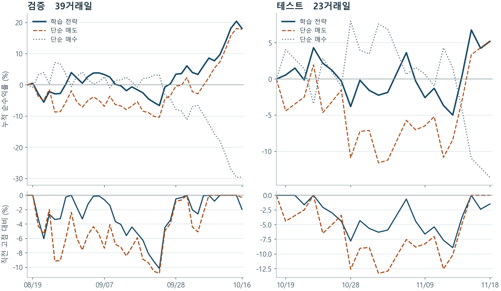
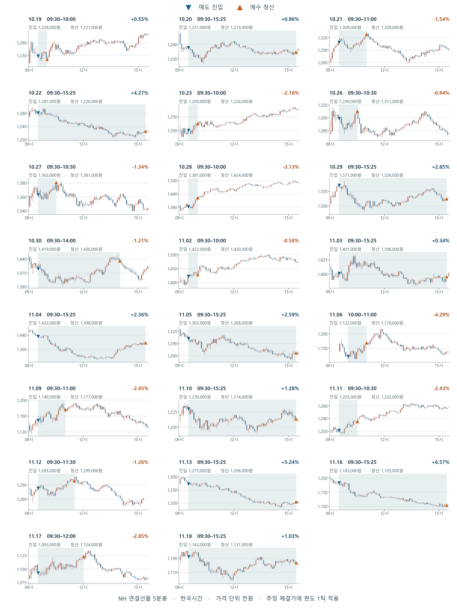
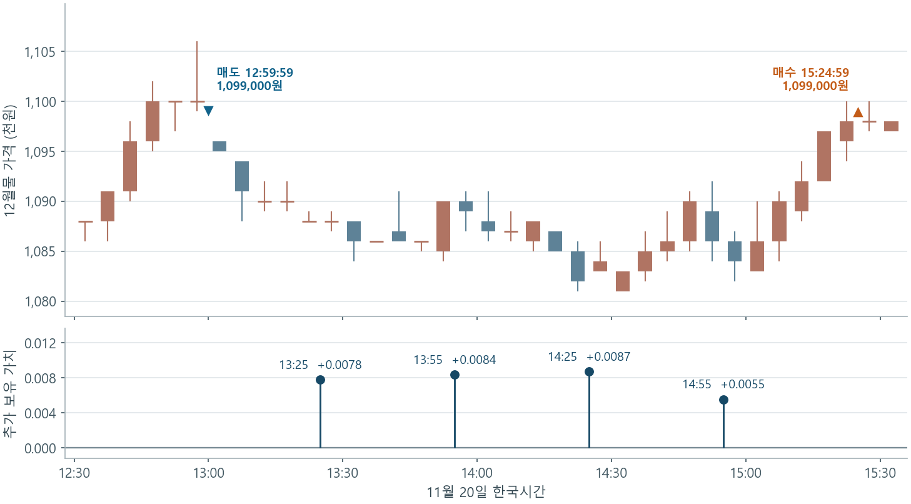

# 5주차 과제: SK하이닉스 주식선물 5분봉 강화학습 전략

NH선물 REST API Pioneer 1기 · 9팀 BE RICH · 5주차 데이터 기반 전략 · 2026.11.20

SK하이닉스 주식선물 5분봉으로 장중 진입과 청산 시점을 학습했다. 30분마다 매수·매도·대기 중 하나를 고르고, 체결 뒤에는 지금 청산할 때와 더 보유할 때의 예상 순손익을 비교한다. 11월 20일에는 이 전략으로 NH 국내 모의계좌에서 거래했다.

| 항목 | 내용 |
| --- | --- |
| 거래 상품 | SK하이닉스 주식선물 2026년 12월물 `A506C000`, 1계약당 10주. [KRX 상품 명세](https://global.krx.co.kr/contents/GLB/02/0201/0201040401/GLB0201040401.jsp) |
| 과거 시세 | NH 주간 연결선물 5분봉 78,659개 · 2022.11.21–2026.11.18 |
| 모델 | 과거 시세로 진입과 청산 시점을 학습하는 오프라인 강화학습 |
| 테스트 | 23거래일 순손익 **+639,878원(+5.21%)** · 같은 시각에 진입한 단순 매도 +649,879원(+5.29%) |
| 국내 모의계좌 | 11월 20일 왕복 1회 · 매매차익 0원 · 수수료 반영 추정 순손익 **−1,868.30원** |

## 1. 과제 개요

청산 시점을 학습하면 순손익과 최대낙폭이 어떻게 달라지는지 확인했다. 같은 시각에 같은 방향으로 진입해 한쪽은 모델 신호에 따라 청산하고, 다른 쪽은 예정 시각까지 보유했다. 계약 수, 수수료율, 슬리피지 가정은 두 전략에 동일하게 적용했다.

### 시세 수집과 학습 구간

NH 국내 분봉 API에서 `sym=A506C000`, `dcnt=5`, `nght_tp=1`, `cidx_yn=1`로 주간 5분봉을 요청했다. 장기간의 시세는 NH가 반환한 미조정 연결선물 `15000000`을 사용했다. 21일씩 나눠 조회하되 인접 구간을 4일 겹쳤다. 70개 응답 99,514행에서 거래일·시각이 겹친 20,855행을 제거해 5분봉 78,659개를 확보했다. 시세가 비어 있던 2024년 4월의 6거래일은 1분봉 재조회 후에도 복원할 수 없어 학습에서 제외했다. 월물 교체에 따른 가격 차이가 신호에 섞이지 않도록 만기일과 다음 관측일에는 전일 종가 대비 갭을 0으로 뒀다. [NH 수집 코드](code/nh_quotes.py) · [수집 내역](results/study.json) · [전체 5분봉](results/hynix_5m.csv.gz)

**표 1. 기간별 시세와 사용 목적**

| 구간 | 기간 | 표본과 용도 |
| --- | --- | --- |
| 진입 학습 | 2022.11.21–2026.08.18 | 907거래일. 시간대별 대기 가치 추정 |
| 청산 학습 | 2023.11.20–2026.08.18 | 661거래일, 진입 시각·방향·보유 기간을 달리해 구성한 보유 판단 100,658건 |
| 검증 | 2026.08.19–10.18 | 39거래일. 진입·청산 설정 비교 |
| 테스트 | 2026.10.19–11.18 | 23거래일. 일별 거래, 비용, 최대낙폭 비교 |
| 모의계좌 | 2026.11.20 | 전날 20:19에 확정한 모델로 1회 왕복 |

테스트 월은 앞선 실험과 후보 교체를 검토할 때도 확인해 모델 선택의 영향이 남는다. 모델을 확정한 뒤 새 시세로 거래한 날은 11월 20일 하루다.

## 2. 전략 설계

### 상품 선택

SK하이닉스 주식선물은 장중 거래량이 많아 5분봉으로 1계약의 진입·청산을 학습하는 데 필요한 유동성을 갖췄다고 봤다. 학습 기간 907일의 일거래량 중앙값은 **223,828계약**이었고, 진입 판단 시각 9,977회 중 **9,956회(99.8%)**에 해당 5분봉에서 거래가 있었다. Goluža 등도 선물 장중 강화학습에서 체결 가격이 불리해질 수 있다는 이유로 거래량이 적은 종목을 제외했다 [[1]](#ref-1). [NH 5분봉](results/hynix_5m.csv.gz)

### 진입과 청산 모델

하루를 한 에피소드로 두고 마지막 판단 시각부터 거꾸로 계산했다. 진입 전에는 **다음 기회까지 기다릴 가치**를, 진입 후에는 **포지션을 더 보유할 가치**를 추정했다. 이 방식은 미국형 옵션의 행사 시점을 구하는 데 쓰인 Least-Squares Monte Carlo(LSMC)에서 가져왔다 [[2]](#ref-2). Tsitsiklis와 Van Roy도 최적정지 문제에서 미래의 보유 가치를 회귀로 추정했다 [[3]](#ref-3). 이번에는 NH에서 관측한 가격 경로와 주식선물 1계약의 비용 차감 손익을 썼다.

| 구분 | 진입 전 | 진입 후 |
| --- | --- | --- |
| 선택 | 대기, 45분 매수·매도, 장 후반까지 매수·매도 | 지금 청산, 다음 판단까지 보유 |
| 주요 입력 | 최근 가격 변화, 당일 고저 범위와 현재 위치, 상대 거래량, 마지막 거래 봉의 경과 시간, 과거 같은 시각의 가격 변화 | 매수·매도 방향, 보유·잔여 시간, 현재 손익, 보유 중 가장 유리했던 가격에서 되밀린 폭, 최근 가격 변화 |
| 판단 | 네 진입 점수와 대기 점수 중 가능한 행동의 최댓값을 선택 | 네 회귀식이 추정한 추가 보유 가치의 평균이 0 미만이면 청산 |

진입 방향은 최근 최대 64거래일의 같은 시각을 기준으로 정했다. 45분 뒤까지와 장 후반까지의 가격 변화를 각각 그날의 고저 변동폭으로 나눈 뒤 최근 거래일에 더 큰 가중치를 줬다. 이 값에 방향 부호와 예상 왕복비용을 적용해 매수·매도 점수를 구했다. 대기 점수는 다음 기회를 기다렸을 때의 보상을 릿지 회귀로 추정했다. 최종 모델에서 당일 지표는 대기 점수에 쓰고, 과거 자료로 구한 방향을 당일 지표로 다시 보정하는 옵션은 껐다.

대기 회귀식은 판단 시각별 13개 항, 보유 회귀식은 12개 항을 썼다. 릿지 규제 강도는 0.7(상수항 0.0001), 학습 가중치 반감기는 252거래일이다. 학습일을 시간순 네 구간으로 나눠 뒤 구간의 목표값을 만들 때는 앞선 날로 학습한 정책을 적용했다. 청산 모델은 5거래일 단위로 묶은 표본을 네 그룹에 번갈아 배정하고 한 그룹씩 제외해 네 번 학습했다. [진입·청산 모델](code/policy.py) · [확정한 가중치](results/models/)

### 보상함수 (Reward Function)

**거래 보상은 수수료와 슬리피지를 차감한 순손익을 진입 당시의 통상적인 하루 변동폭 금액으로 나눈 값**이다. $P_e$와 $P_x$는 진입과 청산에 쓴 5분봉 시가, $d$는 매수 $+1$·매도 $-1$, $C(P,d)$는 해당 주문 한 번의 비용이다.

$$
R(e,x,d)=\frac{10d(P_x-P_e)-C(P_e,d)-C(P_x,-d)}{D_e}.
$$

백테스트에서는 매수는 시가보다 1틱 높게, 매도는 1틱 낮게 체결한 것으로 계산하고 각 체결금액에 수수료 0.0085%를 적용했다. 분모 $D_e$는 진입 판단 전에 알 수 있던 마지막 종가에 10주와 직전 최대 20거래일의 일중 변동폭 비율 중앙값을 곱했다. 일별 고저 차이는 최소 2틱으로 잡아 그날 시가로 나눴고, 비율 중앙값에는 0.05%, 최종 금액에는 2틱의 1계약 금액을 하한으로 뒀다. 가격 수준이 다른 연도의 거래도 당시 변동폭에 비춰 학습하기 위해서다.

테스트 첫날인 10월 19일, 매도 진입과 청산 기준가는 각각 1,229,000원과 1,220,000원이었다. **90,000원(차익) − 20,000원(슬리피지) − 2,081.65원(수수료) = 67,918.35원**이다. 당시 변동폭 금액 487,075.80원으로 나눈 보상은 **+0.1394**였다. [가격·비용 계산](code/market.py) · [거래 원장](results/backtest.csv)

진입한 뒤에는 **지금 청산할 때의 추가 보상을 0**으로 잡는다. 판단 시각 $u$에서 다음 판단 또는 예정 청산 시각 $v$까지 더 보유하면 가격과 청산 비용이 달라진다. 이미 낸 진입 비용은 공통이므로 두 선택의 차이는 아래 식과 같다.

$$
\Delta R_{u,v}=\frac{10d(P_v-P_u)+C(P_u,-d)-C(P_v,-d)}{D_e}.
$$

보유를 이어가는 동안 이 추가 보상을 합산한다. 그 합의 기댓값이 음수면 지금 청산하는 편을 택한다. 거래 횟수에 대한 가산점은 0이다. [청산 보상 계산](code/policy.py#L176)

## 3. 매매 규칙

| 구분 | 적용 규칙 |
| --- | --- |
| 진입 | 09:30–14:30에 30분 간격으로 판단한다. 마지막 회차에는 대기를 제외하고, 주문 가능 수량과 시세가 확인되면 1계약을 거래한다. 청산 뒤 같은 날 재진입하지 않는다. |
| 시세 기준 | 판단 5분 전까지 완료된 봉만 쓴다. 13:00 회차에는 12:55까지 끝난 봉이 보인다. 마지막 거래 봉의 시작이 판단 시각보다 15분 넘게 오래됐으면 신규 진입을 건너뛴다. |
| 보유·청산 | 45분 보유와 장 후반까지 보유 중 진입 때 고른 조건을 따른다. 예정 청산까지 15분 이상 남으면 30분마다 조기 청산을 판단한다. 최종 청산은 일반일 15:25, 만기일 15:00이다. |

국내 모의계좌 운영 시간은 과제 공지 기준 09:00–15:45이며 본문 시각은 한국시간이다. [매매 규칙 구현](code/backtest.py)

## 4. 학습과 검증

### 진입·청산 설정 선택 (Two-Stage Exhaustive Grid Search)

8월 19일–10월 18일의 39거래일을 공통 검증 구간으로 두고 진입과 청산을 순서대로 조정했다. 1단계에서는 거래를 예정 시각까지 보유하게 해 진입 설정만 비교했다. 학습 기간(33·45개월), 같은 시간대 가격 변화의 반감기(8·32거래일), 당일 지표에 따른 방향 보정(끔·켬)의 8개 조합을 모두 학습했다.

하루 한 번 거래하는 조건이므로 거래를 빠뜨린 날이 적은 후보를 먼저 골랐다. 다음으로 순손익이 양수인지, 상한 순손익과 전체 순손익이 얼마나 큰지 순서대로 비교했다. **상한 순손익**은 이익 상위 두 거래의 이익을 세 번째 이익까지만 반영한 합계다. 손실은 전액 반영해 큰 이익 한두 번이 순위를 좌우하는 영향을 줄였다.

**표 2. 진입 설정별 검증 순손익** (원)

| 가격 변화 반감기 | 당일 방향 보정 | 33개월 순손익 | 45개월 순손익 | 상한 순손익 · 두 기간 동일 |
| --- | --- | ---: | ---: | ---: |
| 8거래일 | 끔 | +1,347,050.30 | +1,347,050.30 | +1,176,304.85 |
| 8거래일 | 켬 | +1,057,137.85 | +1,057,137.85 | +886,392.40 |
| 32거래일 | 끔 | +2,687,150.60 | **+2,687,150.60** | +2,327,806.80 |
| 32거래일 | 켬 | +2,687,150.60 | +2,687,150.60 | +2,327,806.80 |

8개 후보 모두 39일 전부 거래했다. 반감기 32일의 네 조합이 같은 순손익으로 공동 1위였다. 학습 기간과 방향 보정에서는 차이가 나지 않아 동점 처리 순서(긴 학습 기간, 후보 이름순)에 따라 **45개월·반감기 32일·방향 보정 끔**(`4y_32_drift`)을 골랐다.

2단계에서는 방금 고른 진입을 고정하고 청산 학습 기간(33·45개월)과 표준오차 배수 $k$ (0·1)의 네 조합을 비교했다. 추가 보유 가치의 평균을 $\bar V$, 네 회귀식으로 구한 표준오차를 $SE$라 하면 $\bar V+k\,SE<0$에서 청산한다. 배수를 높이면 불확실한 구간에서 더 보유할 여지가 생긴다. 이 규칙이 이후 판단의 보상에도 영향을 주므로 후보마다 청산 모델을 다시 학습했다.

**표 3. 같은 진입에서 청산 설정별 검증 결과** (원)

| 청산 학습 기간 | 표준오차 배수 | 조기 청산 / 39회 | 순손익 | 상한 순손익 |
| --- | ---: | ---: | ---: | ---: |
| 예정 시각 청산 | — | 0 | +2,687,150.60 | +2,327,806.80 |
| **33개월** | **0** | **18** | **+2,737,154.85** | **+2,377,811.05** |
| 33개월 | 1 | 32 | −353,107.80 | −613,645.00 |
| 45개월 | 0 | 19 | +2,377,124.25 | +2,017,780.45 |
| 45개월 | 1 | 9 | +2,317,119.15 | +1,957,775.35 |

**33개월·$k=0$**(`3y_se0`)만 검증 39일을 모두 거래하면서 순손익과 상한 순손익 모두 예정 시각 청산을 넘어섰다. 이 조합을 모의 운용의 기준 모델로 삼았다. [당시 후보별 기록](results/tuning.json) · [표 2·3 재현 코드](code/validation.py)

### 추가 후보 비교 (Walk-Forward Validation)

추가 후보는 학습 기간 안에서 두 차례 먼저 평가했다. 3월 5일까지 학습한 후보를 3월 6일–5월 27일에, 5월 27일까지 다시 학습한 후보를 5월 28일–8월 18일에 적용했다. 각각 56거래일이다.

| 탐색 대상 | 바꾼 설정 | 조합 수 |
| --- | --- | ---: |
| 진입 | 33·45개월, 빠른 8일 추정치의 혼합 비중 0·0.5·1(나머지는 32일), 학습 가중치 반감기 84·252일, 릿지 0.08·0.7, 당일 방향 보정 강도 0·0.35·1 | 72 |
| 청산 · 몬테카를로 회귀 | 33·45개월, 선형·구간선형 입력, 가중치 반감기 84·252일, 릿지 0.18·0.7, 음의 보유 보상에 적용한 페널티 0·0.12, 표준오차 배수 0·0.45·0.9 | 96 |
| 청산 · Q(λ) | 33·45개월, 가중치 반감기 84·252일, 추적 계수 λ 0.35·0.85, 보수성 계수 0.1·0.6 | 16 |

거래 누락일이 적은 후보를 우선했다. 일별 순손익을 09:30 판단 직전 변동폭 금액으로 나눠 ±1.5로 제한한 뒤, 두 구간 평균에 부진한 구간 평균의 0.25배를 더하고 음수 부분 절댓값 평균의 0.15배를 뺐다. 같은 진입·청산을 반복한 후보를 걸러 진입 4개, 청산 8개를 남겼다. 기준 모델과 혼합한 경우까지 95조합을 비교해 16개를 검증에 올렸다.

최종 16개에는 모의 운용과 같은 15분 시세 기준을 적용했다. 모델을 교체하려면 검증 39일을 모두 거래하고, 기준보다 순손익과 상한 순손익이 모두 높고, 비용이 두 배여도 흑자이며, 원화 최대낙폭은 기준 모델 이하여야 했다. **교체 후보 15개 중 네 조건을 모두 만족한 후보는 없었다.** 테스트 1위 후보(`E004__M051__100`, +1,739,893원)의 검증 순손익은 +1,777,073원으로 기준 +2,737,155원에 못 미쳤다. 11월 19일 20:19에 기준 모델로 다음 날 모의 운용을 확정했다. [후보별 검증·교체 조건](results/tuning.json) · [테스트 성과와 모델 확정 기록](results/study.json)

### 학습 기간별 검증 성과

학습 기간이 청산 시점에 미친 영향은 모의 운용 뒤 별도로 계산했다. 시작일과 모델 설정을 고정하고 마지막 학습일만 6개월씩 옮겼다. 다섯 모델 모두 동일한 39거래일에서 평가했다.

**표 4. 마지막 학습일에 따른 조기 청산과 수익률**

| 마지막 학습일 | 진입 / 청산 학습일 | 조기 청산 | 검증 순손익 | 검증 수익률 |
| --- | ---: | ---: | ---: | ---: |
| 2024.08.16 | 423 / 177일 | 39회 | −303,104원 | −2.00% |
| 2025.02.18 | 542 / 296일 | 39회 | −303,104원 | −2.00% |
| 2025.08.18 | 664 / 418일 | 39회 | −303,104원 | −2.00% |
| 2026.02.13 | 785 / 539일 | 38회 | +96,930원 | +0.64% |
| 2026.08.18 | 907 / 661일 | 18회 | +2,737,155원 | +18.09% |


**그림 1.** 초기 세 모델은 검증 39일 모두 진입 30분 뒤 첫 판단에서 청산했다. 최종 모델은 첫 판단에서 5회만 청산했고 21회는 예정 시각까지 보유했다. 학습 기간을 늘리면서 최근 시세도 함께 추가됐으므로 이 결과에는 표본 수와 자료의 최신성이 함께 반영돼 있다. [학습 기간별 계산](code/performance.py#L98)

## 5. 비교 실험과 결과

### 비교군과 성과 기준

학습 전략을 **단순 매도**, **단순 매수**와 비교했다. 두 비교군은 첫 진입 가능 시각에 정해진 방향으로 1계약을 진입해 예정 시각까지 보유한다. 세 전략 모두 같은 시세·체결·비용 기준을 썼다. 별도로 학습 모델의 진입을 고정하고 조기 청산을 꺼서 청산 판단의 효과도 계산했다.

구간 수익률은 누적 순손익을 첫 거래의 1계약 명목금액(검증 15,130,000원, 테스트 12,290,000원)으로 나눴다. 최대낙폭(MDD)은 이 금액에 일별 손익을 더한 평가액이 직전 고점에서 하락한 최대 비율이다. 이익계수(PF)는 총이익을 총손실의 절댓값으로 나눈 값이다.

**표 5. 거래비용을 반영한 전략별 성과**

| 구간 | 전략 | 순손익 | 수익률 | 수익 거래 / 전체 | 최대낙폭 | PF |
| --- | --- | ---: | ---: | ---: | ---: | ---: |
| 검증 | **학습 전략** | **+2,737,155원** | **+18.09%** | 20 / 39 | 10.16% | 1.65 |
| 검증 | 단순 매도 | +2,687,151원 | +17.76% | 22 / 39 | 10.83% | 1.50 |
| 검증 | 단순 매수 | −4,472,849원 | −29.56% | 16 / 39 | 34.33% | 0.51 |
| 테스트 | **학습 전략** | **+639,878원** | **+5.21%** | 11 / 23 | 8.92% | 1.21 |
| 테스트 | 단순 매도 | +649,879원 | +5.29% | 17 / 23 | 13.30% | 1.17 |
| 테스트 | 단순 매수 | −1,670,121원 | −13.59% | 6 / 23 | 19.99% | 0.69 |



**그림 2.** 검증·테스트 기간의 전략별 누적 수익률과 고점 대비 낙폭.

### 조기 청산이 손익을 바꾼 날

모델은 검증 39일과 테스트 23일 모두 매도를 골랐다. 조기 청산을 끄면 단순 매도와 진입 시각·손익이 일치했다. 아래 합계는 각 거래일의 **학습 전략 순손익 − 같은 매도를 예정 시각까지 보유한 순손익**이다.

| 구간 | 일찍 청산한 날 | 손익이 개선된 날과 합계 | 손익이 악화된 날과 합계 | 예정 시각 청산 대비 차이 |
| --- | ---: | ---: | ---: | ---: |
| 검증 | 18 / 39일 | 10일 · +2,540,215.90원 | 8일 · −2,490,211.65원 | **+50,004.25원** |
| 테스트 | 13 / 23일 | 5일 · +2,750,233.75원 | 8일 · −2,760,234.60원 | **−10,000.85원** |

손실을 가장 많이 줄인 날은 10월 28일이었다. 10:00에 매도 포지션을 청산한 뒤 선물 가격이 1,423,000원에서 15:25에 1,495,000원까지 올라 **720,061.20원**을 아꼈다. 반대로 가장 불리했던 11월 12일은 11:30 청산 기준가 1,298,000원에서 만기일 예정 청산 시각(15:00)까지 1,252,000원으로 내렸다. 조기 청산은 −162,194.70원, 예정 청산은 +297,844.40원으로 **460,039.10원** 차이가 났다. [거래별 진입·청산과 비교군 손익](results/backtest.csv) · [두 시점의 NH 시세](results/hynix_5m.csv.gz)

테스트 순손익은 단순 매도보다 10,000.85원 적었고 최대낙폭은 13.30%에서 8.92%로 **4.38%p** 줄었다. 두 전략의 최대낙폭 구간은 모두 10월 22일 고점에서 시작했다. 단순 매도는 11월 2일까지 1,666,553.75원, 학습 전략은 11월 12일까지 1,143,715.25원 하락했다.

### 학습·검증·테스트 거래의 5분봉 타점


**그림 3.** 학습 기간 안의 두 56거래일 구간, 검증, 테스트에서 각각 첫 거래일을 표시했다. 학습 구간의 두 사례는 각 구간 시작 전날까지 학습한 모델로 거래를 재현한 결과다. 검증과 테스트에는 8월 18일까지 학습한 가중치를 사용했다. 음영은 보유 시간, ▲는 매수, ▼는 매도다.

**표 6. 그림 3의 진입·청산 시각과 추정 체결가** (가격은 1주당 원)

| 구간 · 날짜 | 진입 | 청산 | 비용 차감 순손익 |
| --- | --- | --- | ---: |
| 학습 기간 · 03.06 | 09:30 매수 930,000 | 10:00 매도 907,000 | −231,561.45원 |
| 학습 기간 · 05.28 | 09:30 매수 2,259,000 | 10:15 매도 2,306,000 | +466,119.75원 |
| 검증 · 08.19 | 09:30 매도 1,512,000 | 15:25 매수 1,504,000 | +77,436.40원 |
| 테스트 · 10.19 | 09:30 매도 1,228,000 | 10:00 매수 1,221,000 | +67,918.35원 |



**그림 4.** 테스트 23거래일의 매도 진입(▼)과 매수 청산(▲). 각 칸의 수익률 분모는 당일 진입 명목금액이다.

| 테스트 거래 | 매도 시각·체결가 | 매수 시각·체결가 | 순손익 | 거래 수익률 |
| --- | --- | --- | ---: | ---: |
| 11.06 최대 손실 | 10:00 · 1,122,000원 | 11:00 · 1,170,000원 | −481,948원 | −4.29% |
| 11.16 최대 수익 | 09:30 · 1,183,000원 | 15:25 · 1,105,000원 | +778,055원 | +6.57% |

11월 6일 09:30에는 마지막 거래 봉이 09:00 시작 봉이었다. 모의계좌와 같은 15분 기준을 적용하자 진입이 10:00으로 밀렸고, 손익은 이전 시세로 진입한 초기 계산의 −321,962원에서 −481,948원으로 바뀌었다. 나머지 22일은 09:30에 진입했다. [당일 판단에 사용한 봉과 변경된 거래](results/study.json)

### 거래비용·체결 지연과 수익 집중도

**표 7. 테스트 거래의 가정을 바꾼 결과**

| 테스트 조건 | 순손익 | 계산 기준 |
| --- | ---: | --- |
| 기본 | +639,878원 | 거래차익 1,150,000원 − 슬리피지 460,000원 − 수수료 50,122원 |
| 거래비용 2배 | +129,756원 | 기본 체결의 슬리피지와 수수료를 각각 2배로 부과 |
| 진입·청산 5분 지연 | −70,121원 | 23건 모두 한 봉 뒤 시가로 체결가·비용 재계산 |
| 수익 상위 2일 제외 | −806,070원 | 11월 13일과 16일의 거래 제외 |

이익 거래는 11회, 손실 거래는 12회였다. 이익 거래 한 건의 평균은 +329,640원으로 손실 거래 평균 −248,847원보다 컸다. 다만 수익 상위 두 날을 빼면 나머지 21일의 손익은 음수다. 비용을 두 배로 잡아도 흑자였지만 진입과 청산이 5분씩 늦어지자 손익의 부호가 바뀌었다. 국내 KOSPI200 선물 강화학습에서도 슬리피지 가정에 따라 수익이 사라지는 결과가 보고됐다 [[4]](#ref-4).

단순 매도 대비 일평균 순손익 차이는 −435원이었다. 같은 날짜의 손익을 짝지어 연속 5거래일 단위로 4,000회 재표집한 95% 구간은 −99,161원에서 +92,193원이었다. 테스트 한 달의 결과로 조기 청산이 평균 수익을 높였다고 보기는 어렵다. [거래비용·지연 실험](results/study.json) · [수익률·낙폭·재표집 계산](code/performance.py)

## 6. API 활용과 주문 관리

| 단계 | 사용 기능 | 적용 |
| --- | --- | --- |
| 시세 | 국내 분봉 조회 | 과거 시세는 실전 API 조회 전용으로 수집했다. 모의 운용일에는 주문할 12월물의 5분봉을 사용했다. |
| 주문 전 | `open_interest` · `order_history` · `orderable_quantity` | 모의계좌의 보유·미체결과 주문 가능 수량을 확인했다. 잔고와 주문내역은 다음 조회 키가 빌 때까지 읽었다. |
| 주문·체결 | `order` · `order_history` | 국내 모의계좌로 시장가 주문을 보냈다. 접수번호로 주문을 찾아 종목·방향·수량·체결가를 장부에 반영했다. |

11월 20일 오전에는 연결이 끊겼고 12:30에는 계좌가 조회됐지만 마지막 거래 봉이 12:05여서 주문을 건너뛰었다. 12:57에 같은 12월물의 실전 조회용 시세로 완료 봉 33개를 보충해 13:00 회차부터 판단할 수 있었다. 각 봉의 최초 수신 시각을 남겨 주문 당시 사용 가능했던 시세를 구분했다. 5분 간격 상태 점검은 예정 85회 중 74회가 기록됐다. [시세 수신 기록](results/paper_bars.csv) · [계좌 확인·주문 처리 코드](code/paper.py) · [장중 운용 기록](results/strategy-runs.json)

## 7. 국내 모의계좌 결과와 운용 화면

13:00 회차의 행동별 점수는 대기 −0.05335, 45분 매도 −0.03352, 45분 매수 −0.02748, 예정 시각까지 매도 **+0.03495**, 예정 시각까지 매수 −0.09595였다. 모델은 점수가 가장 높은 매도로 1계약 진입했다. [판단 당시의 점수](results/strategy-runs.json)

| 시각 | 신호·체결 |
| --- | --- |
| 12:59:59 | NH 시장가 매도 1계약, **1,099,000원**. 앱 체결 확인 13:00:04 |
| 13:25 · 13:55 · 14:25 · 14:55 | 추가 보유 가치 +0.00781, +0.00838, +0.00870, +0.00553. 네 번 모두 보유 |
| 15:24:59 | 예정 시각 청산. NH 시장가 매수 1계약, **1,099,000원**. 앱 체결 확인 15:25:04 |
| 16:00 | 보유 0계약, 미체결 0건 |



**그림 5.** NH가 확인한 두 체결과 네 차례의 보유 판단. 첫 판단이 13:25인 이유는 진입 체결(12:59:59)이 12:55 시작 봉에 속하기 때문이다. 14:00 봉 시가는 1,088,000원까지 내려갔지만 보유 점수가 청산 기준인 0 아래로 떨어진 회차는 없었다. 이후 가격이 되올라 진입가에 청산했다.

| 1계약 정산 | 금액 |
| --- | ---: |
| 체결가 기준 매매차익 | (1,099,000 − 1,099,000) × 10 = **0원** |
| 추정 수수료 | 10,990,000 × 0.0085% × 2 = 1,868.30원 |
| 추정 순손익 / 진입 명목금액 대비 수익률 | **−1,868.30원 / −0.0170%** |

NH 주문내역에서 확인한 두 체결가로 매매차익을 계산했다. 수수료는 정산 명세를 확보하지 못해 백테스트 요율로 추정했다. 같은 날 13:00·15:25 봉 시가(1,096,000원·1,098,000원)에 백테스트 체결 규칙을 적용한 손익은 −41,864.90원이다. [주문·체결 원장](results/trades.jsonl) · [같은 날의 백테스트 계산](results/study.json)

| 매도 체결 직후 | 매수 청산 후 |
| --- | --- |
|  |  |

NH 앱의 **전략주문 → 하이닉스 모의거래** 화면에 진입·청산 판단과 체결 내역을 표시했다. [수정한 화면](code/app/frontend/src/screens/strategy/HynixPaperDesk.tsx) · [화면 조회 API](code/app/backend/strategy/hynix_desk.py)

## 8. 실행 방법

### 학습·검증과 그래프 재현

Python 3.12에서 `week05` 폴더를 기준으로 실행한다. `reproduce.py --train`은 제출한 5분봉으로 모델을 다시 학습해 가중치, 검증·테스트 거래 62건, 모의계좌 신호·체결을 대조한다. `validation.py`는 표 2·3의 후보와 최종 교체 조건을, `figures.py`는 표 4·5의 CSV와 그림 1–5를 재현한다. [재현 코드](code/reproduce.py) · [도표 생성 코드](code/figures.py)

```powershell
python -m pip install numpy==2.5.5 matplotlib==3.10.8
python -B code/reproduce.py --train
python -B code/validation.py
python -B code/figures.py --out ..\week05-rebuilt
```

### 5분봉 재수집

분봉을 다시 받으려면 NH 앱에 국내 시세 조회용 키를 설정한다. 원래 API 응답을 보관한 경우 `--cache <nh_chart_pages.sqlite3 경로>`로 `--app`을 대체할 수 있다. [분봉 수집 코드](code/nh_quotes.py)

```powershell
python -B code/nh_quotes.py --app ..\nh-futures-open-api --out ..\hynix-quotes
```

### 모의 운용 화면 실행

수정한 앱 화면은 NH 공개 프로그램 커밋 `e4ee2bf`에 아래 명령으로 적용한다. `NH_REPLAY=1`은 11월 20일 제출 기록을 화면에 불러오는 설정이다. [원본 프로그램](https://github.com/PetterChanHyuk/nh-futures-open-api/tree/e4ee2bf27bc1f3e4d9093e446ea651920cd57728) · [화면 적용 코드](code/app/install.py)

```powershell
python code/app/install.py ..\nh-futures-open-api
cd ..\nh-futures-open-api
npm.cmd --prefix frontend ci
npm.cmd --prefix frontend run build
$env:NH_REPLAY = "1"
python -m desktop.main --hynix-paper
```

## 참고 자료

<a name="ref-1"></a>

[1]. *Deep reinforcement learning with positional context for intraday trading*. Goluža, S., Kovačević, T., Bauman, T. & Kostanjčar, Z. (2024). Evolving Systems, 15, 1865–1880. [학술지 원문](https://link.springer.com/article/10.1007/s12530-024-09593-6) · [저자 공개본 §4.1, 종목 선정 기준](https://arxiv.org/pdf/2406.08013#page=12)

<a name="ref-2"></a>

[2]. *Valuing American Options by Simulation: A Simple Least-Squares Approach*. Longstaff, F. A. & Schwartz, E. S. (2001). The Review of Financial Studies, 14(1), 113–147. [DOI](https://doi.org/10.1093/rfs/14.1.113)

<a name="ref-3"></a>

[3]. *Regression Methods for Pricing Complex American-Style Options*. Tsitsiklis, J. N. & Van Roy, B. (2001). IEEE Transactions on Neural Networks, 12(4), 694–703. [저자 공개본](https://web.mit.edu/~jnt/www/Papers/J086-01-bvr-options.pdf)

<a name="ref-4"></a>

[4]. *슬리피지를 고려한 강화학습 기반의 KOSPI200 선물 자동 매매 모델 연구*. 정원식·정희택·강영만 (2025). 한국전자통신학회 논문지, 20(2), 371–380. [학술지 원문](https://www.koreascience.or.kr/article/JAKO202513557604220.pdf)
