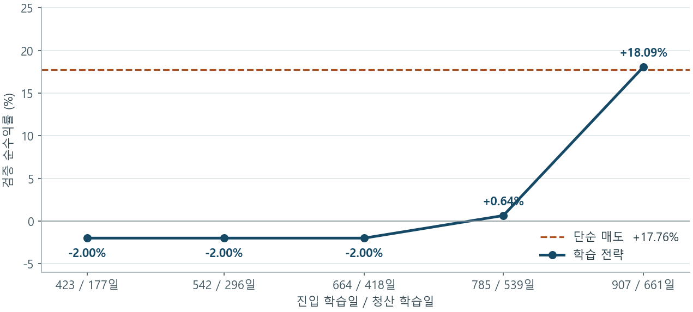
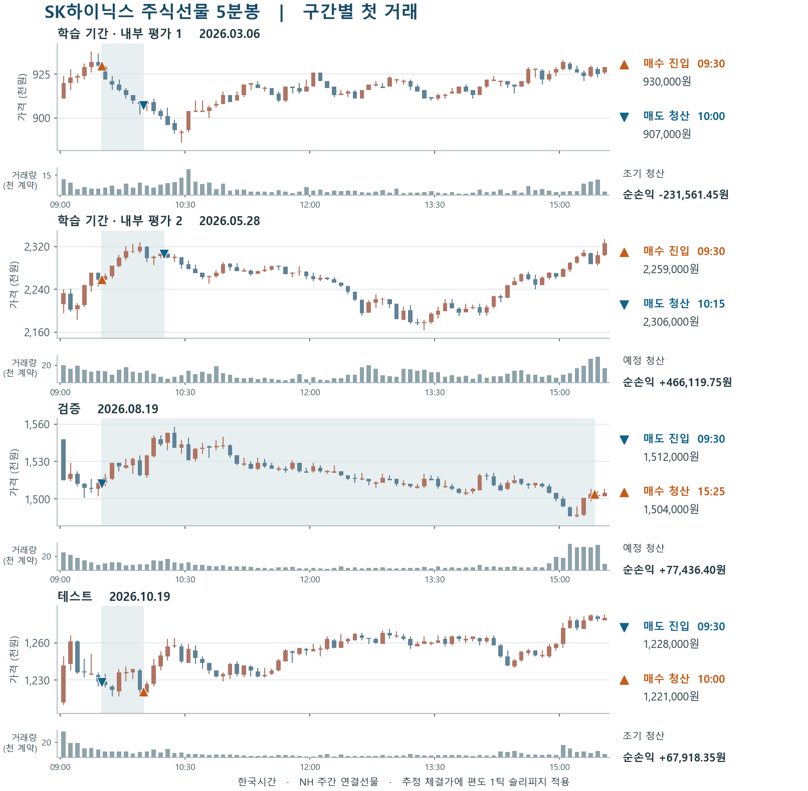
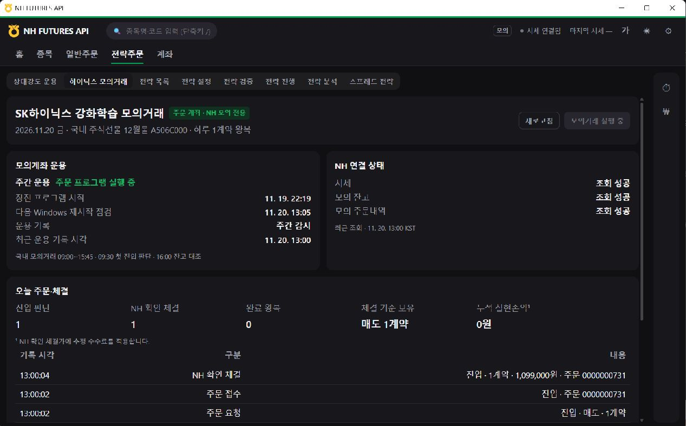
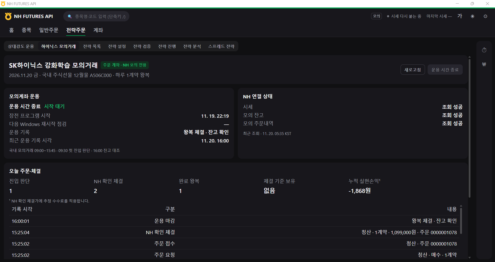

# 5주차 과제: SK하이닉스 주식선물 5분봉 강화학습 전략

NH선물 REST API Pioneer 1기 · 9팀 BE RICH · 5주차 데이터 기반 전략 · 2026.11.20

SK하이닉스 주식선물 5분봉으로 진입과 청산 시점을 학습하는 오프라인 강화학습 전략이다. Least-Squares Monte Carlo(LSMC)를 응용해 진입 전에는 다음 기회까지 기다릴 가치를, 체결 후에는 지금 청산하는 것보다 더 보유할 때 얻는 추가 순손익을 Ridge regression으로 추정한다. 11월 20일에는 이 모델의 신호를 30분 간격으로 확인하며 NH 국내 모의계좌에서 1계약을 거래했다.

| 항목 | 내용 |
| --- | --- |
| 거래 상품 | SK하이닉스 주식선물 2026년 12월물 `A506C000`, 1계약당 10주. [KRX 상품 명세](https://global.krx.co.kr/contents/GLB/02/0201/0201040401/GLB0201040401.jsp) |
| 과거 시세 | NH 주간 연결선물 5분봉 78,659개 · 2022.11.21–2026.11.18 |
| 강화학습 모델 | LSMC 기반 최적정지 모델. 진입 전 대기 가치와 진입 후 보유 가치를 각각 Ridge regression으로 추정 |
| 학습·검증 | 진입 907거래일, 청산 661거래일 학습. 이후 39거래일에서 진입 8조합과 청산 4조합을 비교해 운용 설정 선택 |
| 테스트 | 23거래일 순손익 +639,878원(+5.21%) · 같은 시각에 진입한 단순 매도 +649,879원(+5.29%) |
| 국내 모의계좌 | 11월 20일 왕복 1회 · 매매차익 0원 · 수수료 반영 추정 순손익 −1,868.30원 |

## 1. 과제 개요

전략이 수익을 냈더라도 진입 방향을 잘 고른 것인지, 제때 청산한 것인지는 전체 손익만으로 구분하기 어렵다. 그래서 같은 시각에 같은 방향으로 진입한 거래마다 모델의 신호에 따라 청산했을 때와 처음 정한 시각까지 보유했을 때의 손익을 함께 구했다. 계약 수와 거래비용이 같으므로 두 거래의 순손익과 최대낙폭을 비교하면 청산 시점이 성과에 미친 영향을 볼 수 있다.

### 시세 수집과 학습 구간

NH 국내 분봉 API에 12월물 코드 `A506C000`을 넣고 주간 5분봉·연결선물 조건(`dcnt=5`, `nght_tp=1`, `cidx_yn=1`)으로 조회하면 미조정 연결선물 `15000000`의 시세를 받을 수 있다. 한 번에 조회할 수 있는 봉 수에 맞춰 조회 구간을 21일씩 옮기되, 매번 직전 구간의 마지막 4일을 포함했다. 이렇게 받은 70개 응답의 99,514행을 거래일과 시각 순으로 이어 붙이면, 중복 20,855행을 제외한 5분봉 78,659개가 남는다.

2024년 4월에 비어 있는 6거래일은 1분봉을 다시 조회해도 시세를 복원할 수 없어 학습에서 제외했다. 연결선물은 월물이 바뀌면서 생기는 가격 차이가 당일 시가 갭에 섞일 수 있다. 이 영향을 줄이기 위해 만기일과 그다음 관측일에는 전일 종가 대비 갭을 0으로 두었다. [NH 수집 코드](code/nh_quotes.py) · [수집 내역](results/study.json) · [전체 5분봉](results/hynix_5m.csv.gz)

표 1. 기간별 시세와 사용 목적

| 구간 | 기간 | 표본과 용도 |
| --- | --- | --- |
| 진입 학습 | 2022.11.21–2026.08.18 | 907거래일. 시간대별 대기 가치 추정 |
| 청산 학습 | 2023.11.20–2026.08.18 | 661거래일, 진입 시각·방향·보유 기간을 달리해 구성한 보유 판단 100,658건 |
| 검증 | 2026.08.19–10.18 | 39거래일. 진입·청산 설정 비교 |
| 테스트 | 2026.10.19–11.18 | 23거래일. 일별 거래, 비용, 최대낙폭 비교 |
| 모의계좌 | 2026.11.20 | 전날 20:19에 확정한 모델로 1회 왕복 |

테스트 23거래일의 손익은 앞선 실험에서도 확인했고, 최종 후보의 교체 여부를 검토할 때도 참고했다. 이 구간의 성과에는 모델 선택의 영향이 남아 있으며, 모델을 확정한 뒤 새로 들어온 시세로 거래한 결과는 11월 20일의 모의계좌 기록에서 확인할 수 있다.

## 2. 전략 설계

### 상품 선택

SK하이닉스 주식선물을 고를 때는 일거래량과 함께 주문을 낼 시각에도 거래가 꾸준한지를 봤다. 학습 기간 907거래일의 일거래량 중앙값은 223,828계약이었고, 진입 후보 시각 9,977회 중 9,956회(99.8%)에 해당 5분봉의 거래량이 1계약 이상이었다. 이런 장중 유동성이면 1계약의 진입과 청산을 5분봉에서 비교하기에 적합하다고 판단했다. Goluža 등도 장중 선물 거래에 강화학습을 적용하면서 불리한 가격에 체결될 위험을 고려해 거래량이 적은 종목을 제외했다 [[1]](#ref-1). [NH 5분봉](results/hynix_5m.csv.gz)

### 강화학습 모델과 학습 방법 (LSMC)

Longstaff와 Schwartz는 미국형 옵션의 행사 시점을 구할 때 마지막 행사 시점부터 거슬러 올라가며 즉시 행사할 가치와 더 보유할 때의 기대가치를 비교한다 [[2]](#ref-2). Tsitsiklis와 Van Roy 역시 같은 최적정지 문제에서 미래에 얻을 가치를 회귀로 추정한다 [[3]](#ref-3).

이번 전략에서는 한 거래일의 5분봉을 하나의 에피소드로 보고, 진입 전에는 거래를 다음 회차로 미루는 경우를, 진입 후에는 포지션을 더 보유하는 경우를 평가한다. 두 모델에는 NumPy로 구현한 Ridge regression을 사용해 최근 거래일의 보상에 더 큰 가중치를 주었다. 이때 최소화하는 값은 가중 제곱오차와 회귀계수 제곱에 대한 페널티의 합으로, 일부 지표의 계수가 과도하게 커지는 것을 줄일 수 있다. [회귀 구현](code/policy.py#L14)

| 구분 | 진입 모델 | 청산 모델 |
| --- | --- | --- |
| 학습 자료 | 45개월, 907거래일 | 33개월, 661거래일에서 가능한 진입 시각·방향·보유 기간으로 구성한 판단 사례 100,658건 |
| 입력 변수 | 판단 시각, 최근 가격 변화, 당일 고저 범위 안의 위치, 상대 거래량, 마지막 봉의 경과 시간, 과거 같은 시각의 가격 변화 | 매수·매도 방향, 현재 손익, 보유·잔여 시간, 가장 유리했던 가격에서 되밀린 폭, 최근 가격 변화 |
| 학습 목표 | 지금 진입을 미루고 다음 회차부터 매매할 때 얻는 보상 | 지금 청산하는 경우에 비해 보유를 이어갈 때 더 얻는 보상 |
| 주문에 적용한 규칙 | 대기 점수와 네 진입 점수 중 거래 가능한 행동의 최댓값을 선택 | 네 회귀식의 평균 추가 보유 가치가 음수면 청산하고, 0 이상이면 보유 |

진입할 때는 직전 최대 64거래일의 같은 시각을 기준으로 45분 뒤와 장 후반까지의 가격 변화를 각각 구한다. 각 변화량을 그날의 고저 변동폭으로 나누고 최근 거래일에 더 큰 가중치를 준 다음, 매수·매도 방향과 예상 왕복비용을 반영하면 보유 기간과 방향을 조합한 네 가지 진입 점수가 나온다. 검증에서 선택한 모델은 당일 지표로 방향을 추가 보정하는 항을 두지 않는다. 당일 가격과 거래량은 대기 가치 추정에 쓰이며 현재 가격은 예상 거래비용 계산에도 반영된다. [가격 변화와 거래비용](code/market.py#L67) · [진입 모델 가중치](results/models/entry.npz)

대기 가치는 학습 기간 907거래일을 날짜순으로 네 구간으로 나눠 추정했다. 각 구간에서는 현재 회차를 건너뛴 뒤 앞선 날짜로 학습한 정책을 따랐을 때 받을 보상을 하루의 마지막 판단부터 거꾸로 계산한다. 첫 구간은 참고할 이전 정책이 없으므로 마지막 회차의 45분 매수·매도 평균 보상을 출발점으로 삼는다. 이렇게 구한 보상을 당시 관측한 가격·거래량과 짝지어 대기가 가능한 시각마다 13개 항의 Ridge regression으로 대기 가치를 추정했다. [대기 점수 학습 코드](code/policy.py#L93)

청산 모델의 학습 목표는 지금 청산했을 때와 더 보유했을 때의 순손익 차이다. 같은 가격 움직임도 포지션에 따라 손익이 달라지므로 가능한 진입 시각·방향·보유 기간별로 경로를 만들고, 다음 회차에서도 보유할 경우 그 이후의 추가 보상까지 누적한다.

이때도 거래일을 네 구간으로 나눠 첫 구간은 예정 시각까지 보유한 경우를 기준으로 삼았다. 두 번째 구간부터는 앞선 날짜의 자료로 보유 가치 추정치를 세 차례 갱신한 뒤 다음 구간의 학습 목표를 계산한다. 마지막에는 5거래일씩 묶은 표본을 네 그룹에 번갈아 배정한 뒤 한 그룹씩 제외하면서 12개 항의 회귀식 네 개를 구하고, 네 추정치의 평균을 최종 보유 가치로 사용했다. [보유 점수 학습 코드](code/policy.py#L229) · [청산 모델 가중치](results/models/exit.npz)

마지막 학습일인 8월 18일 09:30에 1계약을 매도해 45분간 보유하는 경로를 예로 들면, 10:00 청산의 순손익은 +86,993.55원이고 10:15까지 보유하면 +26,988.45원이다. 15분을 더 보유하면 순손익이 60,005.10원 줄어드므로, 이 차이를 당시 변동폭 금액 1,358,568.39원으로 나눈 −0.04417이 매도 포지션의 10:00 보유 목표값이다. 같은 시각에 매수한 경로에 같은 계산을 적용하면 +0.04416이 된다. 두 경우 모두 모델이 10:00에 볼 수 있는 입력은 09:55까지 마감된 봉으로 한정하고 이후 시세는 보상을 계산할 때만 사용했다. [학습 경로 구성](code/policy.py#L176) · [NH 원본 5분봉](results/hynix_5m.csv.gz)

### 보상함수 (Reward Function)

같은 비율로 가격이 움직여도 1계약의 명목금액이 높은 시기에는 원화 손익이 더 크게 잡힌다. 시기에 따라 이런 거래가 학습을 좌우하지 않도록, 보상은 수수료와 슬리피지를 차감한 순손익을 진입 당시의 통상적인 하루 변동폭 금액으로 나눈 값으로 정의했다. 식에서 $P_e$와 $P_x$는 각각 진입·청산 봉의 시가, $d$는 매수(+1) 또는 매도(−1) 방향이며 $C(P,d)$는 주문 한 번의 거래비용을 뜻한다.

$$
R(e,x,d)=\frac{10d(P_x-P_e)-C(P_e,d)-C(P_x,-d)}{D_e}.
$$

백테스트에서는 매수 체결가를 해당 봉의 시가보다 1틱 높게, 매도 체결가를 1틱 낮게 잡고 각 체결금액의 0.0085%를 수수료로 반영한다. 분모 $D_e$를 구할 때는 직전 최대 20거래일에 대해 하루 고저 차이(최소 2틱)를 그날 시가로 나눈 뒤 그 비율의 중앙값을 구한다. 여기에 진입 판단 당시 마지막으로 확인한 종가와 계약 승수 10주를 곱하면 1계약의 통상적인 하루 변동폭을 원화로 환산할 수 있다. 중앙값의 하한은 0.05%, 최종 금액의 하한은 1계약 기준 2틱이다.

예를 들어 테스트 첫날인 10월 19일에는 매도 진입 기준가가 1,229,000원, 청산 기준가가 1,220,000원으로 1계약의 매매차익이 90,000원이었다. 여기서 슬리피지 20,000원과 수수료 2,081.65원을 차감한 순손익 67,918.35원을 당시 변동폭 금액 487,075.80원으로 나누면 거래 보상은 +0.1394다. [가격·비용 계산](code/market.py) · [거래 원장](results/backtest.csv)

진입이 끝난 뒤에는 지금 청산하는 경우의 추가 보상을 0으로 두고, 다음 판단 시각이나 예정 청산 시각까지 더 보유할 때의 손익 차이를 구한다. 어느 시각에 청산하든 이미 지불한 진입 비용은 같아서, 현재 시각 $u$에서 다음 시각 $v$까지의 추가 보상에는 가격 변화와 두 시점의 청산 비용 차이만 남는다.

$$
\Delta R_{u,v}=\frac{10d(P_v-P_u)+C(P_u,-d)-C(P_v,-d)}{D_e}.
$$

다음 회차에도 포지션을 유지하면 이후의 추가 보상까지 합산한다. 최종 모델은 그 합의 기댓값이 음수일 때 청산하며, 거래 횟수 자체에는 별도의 보상을 주지 않는다. [청산 보상 계산](code/policy.py#L176)

## 3. 매매 규칙

| 구분 | 적용 규칙 |
| --- | --- |
| 진입 | 09:30–14:30에 30분 간격으로 판단하되, 마지막 회차에는 대기할 수 없다. 주문 가능 수량과 시세를 확인해 1계약을 거래하면 청산 후 같은 날 다시 진입하지 않는다. |
| 시세 기준 | 판단 5분 전까지 마감된 봉을 사용한다. 13:00 회차의 입력은 12:55까지 마감된 봉이며, 마지막 거래 봉의 시작 시각이 판단 시각보다 15분 넘게 앞서면 신규 진입을 건너뛴다. |
| 보유·청산 | 진입할 때 45분 보유와 장 후반까지 보유 중 하나를 정한다. 예정 청산까지 15분 이상 남아 있으면 30분 간격으로 조기 청산을 판단하며, 최종 청산 시각은 일반일 15:25, 만기일 15:00이다. |

본문의 시각은 모두 한국시간이며, 과제 공지에 따른 국내 모의계좌 운영 시간은 09:00–15:45다. [매매 규칙 구현](code/backtest.py)

## 4. 하이퍼파라미터 튜닝과 검증

### 진입·청산 후보 비교 (Two-Stage Exhaustive Grid Search)

8월 18일까지의 시세로 각 모델을 학습하고, 그 뒤 39거래일(8월 19일–10월 18일)은 하이퍼파라미터를 고르는 데 사용했다. 진입과 청산의 효과를 따로 보려면 한쪽을 비교하는 동안 다른 쪽의 조건이 같아야 한다. 그래서 예정 시각까지 보유하는 조건으로 진입 8조합을 먼저 비교한 뒤, 그중 채택한 모델의 진입 시각과 방향을 고정하고 청산 4조합을 평가했다. 두 단계의 후보는 각각 아래 값으로 만들 수 있는 모든 조합이다.

| 단계 | 검증에서 비교한 하이퍼파라미터 | 모의 운용에 채택한 값 |
| --- | --- | --- |
| 진입 · 8조합 | 학습 기간 33·45개월 × 같은 시각 가격 변화의 반감기 8·32거래일 × 당일 지표의 방향 보정항 포함 여부 | 45개월, 반감기 32거래일, 방향 보정항 미포함 |
| 청산 · 4조합 | 학습 기간 33·45개월 × 보유 가치의 표준오차 배수 0·1 | 33개월, 표준오차 배수 0 |

표의 8일·32일은 진입 점수를 계산할 때 같은 시각의 과거 가격 변화에 적용하는 반감기다. Ridge regression에서 최근 학습 표본에 더 큰 가중치를 주는 반감기는 별도로 두었으며, 이 12개 후보를 비교할 때는 252거래일로 통일했다. 회귀계수의 규제 강도 역시 0.7로 같고 상수항에는 0.0001을 적용한다.

진입 후보를 고를 때는 거래가 없었던 날의 수를 먼저 보고, 동률이면 순손익의 흑자 여부, 상한 순손익, 전체 순손익 순으로 비교했다. 상한 순손익을 먼저 보는 이유는 한두 번의 큰 이익이 후보 선택을 좌우할 수 있기 때문이다. 이 지표에서는 이익이 가장 큰 두 거래를 세 번째로 큰 이익까지만 인정하고 손실은 전액 반영한다.

표 2. 진입 설정별 검증 순손익 (원)

| 가격 변화 반감기 | 당일 방향 보정항 | 33개월 순손익 | 45개월 순손익 | 상한 순손익 · 두 기간 동일 |
| --- | --- | ---: | ---: | ---: |
| 8거래일 | 미포함 | +1,347,050.30 | +1,347,050.30 | +1,176,304.85 |
| 8거래일 | 포함 | +1,057,137.85 | +1,057,137.85 | +886,392.40 |
| 32거래일 | 미포함 | +2,687,150.60 | +2,687,150.60 | +2,327,806.80 |
| 32거래일 | 포함 | +2,687,150.60 | +2,687,150.60 | +2,327,806.80 |

진입 후보 8개는 모두 검증 39거래일 동안 하루 한 번씩 거래했으며, 손익 차이는 주로 가격 변화의 반감기에서 나타났다. 학습 기간 45개월에 방향 보정항을 제외한 경우 반감기 8일의 순손익은 1,347,050.30원, 32일은 2,687,150.60원이었다. 반감기 32일인 네 후보는 학습 기간이나 방향 보정항을 바꿔도 손익이 같아서, 미리 정한 순서에 따라 학습 기간이 긴 후보를 우선하고 같은 기간에서는 후보 이름순으로 골랐다. 이 기준으로 선택한 진입 모델은 45개월·반감기 32거래일에 당일 방향 보정항을 제외한 `4y_32_drift`다.

청산 후보는 네 회귀식이 추정한 추가 보유 가치의 평균 $\bar V$와 표준오차 $SE$로 비교한다. 표준오차에 곱하는 배수를 $k$라 하면 $\bar V+k\,SE<0$일 때 청산하므로, 같은 추정값에서는 배수 1이 배수 0보다 보유를 이어갈 여지가 크다. 다만 다음 회차의 청산 여부가 그 앞 회차의 학습 목표에도 반영되기 때문에, 학습 기간과 배수를 조합한 네 후보는 각각 다시 학습했다.

표 3. 같은 진입에서 청산 설정별 검증 결과 (원)

| 청산 학습 기간 | 표준오차 배수 | 조기 청산 / 39회 | 순손익 | 상한 순손익 |
| --- | ---: | ---: | ---: | ---: |
| 예정 시각 청산 | — | 0 | +2,687,150.60 | +2,327,806.80 |
| 33개월 | 0 | 18 | +2,737,154.85 | +2,377,811.05 |
| 33개월 | 1 | 32 | −353,107.80 | −613,645.00 |
| 45개월 | 0 | 19 | +2,377,124.25 | +2,017,780.45 |
| 45개월 | 1 | 9 | +2,317,119.15 | +1,957,775.35 |

검증 39거래일 중 18일을 예정 시각보다 일찍 청산한 33개월·표준오차 배수 0 조합(`3y_se0`)은 기준 대비 순손익과 상한 순손익이 각각 50,004.25원 높았다. 두 지표가 함께 개선된 유일한 조합이어서 이를 모의 운용의 청산 모델로 선택했다. 표 2·3은 11월 19일에 남긴 후보별 기록이며, 제출한 5분봉과 코드로 같은 값을 다시 계산할 수 있다. [11월 19일 후보별 기록](results/tuning.json) · [진입·청산 튜닝 재현 코드](code/validation.py#L37)

### 추가 후보 비교 (Walk-Forward Validation)

기준 모델을 정한 뒤에는 Ridge regression의 규제 강도와 표본 가중치 반감기, 청산 보상까지 범위를 넓혀 학습 기간 안에서 두 차례 추가 검증을 진행했다. 평가 구간은 각각 56거래일로, 3월 5일까지 학습한 모델은 3월 6일–5월 27일에, 5월 27일까지 학습 범위를 넓힌 모델은 5월 28일–8월 18일에 적용하는 방식이다. 아래 조합 수는 11월 19일에 저장한 탐색 기록을 기준으로 한다. [추가 탐색 기록](results/tuning.json)

| 탐색 대상 | 바꾼 설정 | 조합 수 |
| --- | --- | ---: |
| 진입 | 33·45개월, 반감기 8일 추정치의 비중 0·0.5·1(나머지는 32일 추정치), 표본 가중치 반감기 84·252일, Ridge 규제 강도 0.08·0.7, 당일 방향 보정 강도 0·0.35·1 | 72 |
| 청산 · Monte Carlo regression | 33·45개월, 선형·구간선형 입력, 표본 가중치 반감기 84·252일, Ridge 규제 강도 0.18·0.7, 음의 보유 보상에 적용한 페널티 0·0.12, 표준오차 배수 0·0.45·0.9 | 96 |
| 청산 · Q(λ) | 33·45개월, 가중치 반감기 84·252일, 추적 계수 λ 0.35·0.85, 보수성 계수 0.1·0.6 | 16 |

추가 후보도 거래하지 못한 날이 적을수록 우선순위를 높게 두었다. 거래일 수가 같으면 일별 순손익을 09:30 판단 직전의 변동폭 금액으로 나눠 ±1.5로 제한한 뒤, 두 구간의 평균을 기준으로 점수를 매겼다. 두 구간 평균에 성과가 낮은 구간 평균의 0.25배를 더한 뒤, 일평균 손실 크기의 0.15배를 뺀 값이 최종 점수다. 흑자인 날의 손실은 0으로 두어 한 구간에 이익이 몰리거나 손실이 큰 후보의 순위를 낮췄다. 같은 매매 경로를 고른 후보를 걸러 진입 4개와 청산 8개를 남겼으며, 기준 모델과의 혼합을 포함한 95조합에서 최종 16개를 골라 검증했다.

최종 16개 후보에는 모의계좌와 마찬가지로 마지막 거래 봉의 시작 시각이 15분 넘게 지났으면 신규 진입을 보류하는 규칙을 적용했다. 기준 모델을 교체하려면 검증 39일에 모두 거래하면서 순손익과 상한 순손익이 기준을 웃돌아야 한다. 여기에 비용을 두 배로 늘려도 흑자를 유지하고, 원화 최대낙폭도 늘지 않는다는 조건을 함께 두었다.

테스트 수익이 가장 컸던 후보(`E004__M051__100`, +1,739,893원)도 검증 순손익은 +1,777,073원으로 기준 모델의 +2,737,155원보다 낮았다. 15개 교체 후보 중 이 조건을 모두 충족한 경우가 없어 11월 19일 20:19에 기존 진입·청산 조합을 모의 운용 모델로 확정했다. [후보별 검증·교체 조건](results/tuning.json) · [최종 모델 확정 기록](results/study.json)

### 학습 기간별 검증 성과

모의 운용을 마친 뒤에는 학습 자료가 늘어나면서 청산 시점이 어떻게 달라졌는지 살펴봤다. 진입·청산 모델의 시작일과 설정은 그대로 둔 채 마지막 학습일만 6개월씩 옮겨, 다섯 시점의 모델을 동일한 검증 39거래일에 적용했다.

표 4. 마지막 학습일에 따른 조기 청산과 수익률

| 마지막 학습일 | 진입 / 청산 학습일 | 조기 청산 | 검증 순손익 | 검증 수익률 |
| --- | ---: | ---: | ---: | ---: |
| 2024.08.16 | 423 / 177일 | 39회 | −303,104원 | −2.00% |
| 2025.02.18 | 542 / 296일 | 39회 | −303,104원 | −2.00% |
| 2025.08.18 | 664 / 418일 | 39회 | −303,104원 | −2.00% |
| 2026.02.13 | 785 / 539일 | 38회 | +96,930원 | +0.64% |
| 2026.08.18 | 907 / 661일 | 18회 | +2,737,155원 | +18.09% |



그림 1. 초기 세 모델은 검증 39거래일 모두 진입 후 첫 판단에서 청산한 반면, 최종 모델이 첫 판단에서 청산한 날은 5일이었고 예정 시각까지 보유한 날은 21일이었다. 학습 종료일을 뒤로 옮길 때마다 최근 시세도 함께 들어오므로, 이 차이에는 표본 수와 시세의 최신성이 모두 반영돼 있다. [학습 기간별 계산](code/performance.py#L98)

## 5. 비교 실험과 결과

### 비교군과 성과 기준

비교 기준으로는 첫 진입 가능 시각에 1계약을 거래해 예정 시각까지 보유하는 단순 매도와 단순 매수를 사용했다. 세 전략의 시세·체결가 산정 방식·거래비용을 맞추고, 청산 신호의 효과를 따로 보기 위해 학습 모델이 정한 방향과 시각에 진입한 뒤 예정 시각까지 보유하는 경우도 함께 계산했다.

구간 수익률의 분모는 첫 거래의 1계약 명목금액으로, 검증은 15,130,000원이고 테스트는 12,290,000원이다. 누적 순손익을 이 금액으로 나눠 수익률을 구하고, 명목금액에 일별 손익을 더한 평가액이 직전 고점에서 가장 크게 떨어진 비율을 최대낙폭(MDD)으로 잡았다. 이익계수(PF)는 이익 거래의 총이익을 손실 거래의 총손실 절댓값으로 나눈 값이다.

표 5. 거래비용을 반영한 전략별 성과

| 구간 | 전략 | 순손익 | 수익률 | 수익 거래 / 전체 | 최대낙폭 | PF |
| --- | --- | ---: | ---: | ---: | ---: | ---: |
| 검증 | 학습 전략 | +2,737,155원 | +18.09% | 20 / 39 | 10.16% | 1.65 |
| 검증 | 단순 매도 | +2,687,151원 | +17.76% | 22 / 39 | 10.83% | 1.50 |
| 검증 | 단순 매수 | −4,472,849원 | −29.56% | 16 / 39 | 34.33% | 0.51 |
| 테스트 | 학습 전략 | +639,878원 | +5.21% | 11 / 23 | 8.92% | 1.21 |
| 테스트 | 단순 매도 | +649,879원 | +5.29% | 17 / 23 | 13.30% | 1.17 |
| 테스트 | 단순 매수 | −1,670,121원 | −13.59% | 6 / 23 | 19.99% | 0.69 |


그림 2. 검증·테스트 기간의 전략별 누적 수익률과 고점 대비 낙폭.

### 조기 청산이 손익을 바꾼 날

검증 39거래일과 테스트 23거래일에 모델이 택한 방향은 모두 매도였다. 모델의 진입을 따른 뒤 예정 시각까지 보유해 보니 각 거래의 진입 시각과 손익이 단순 매도 기준과 일치했다. 따라서 이 두 구간에서는 같은 날의 학습 전략 순손익에서 단순 매도 순손익을 뺀 값이 곧 청산 시점을 바꿔 얻은 손익 차이다.

| 구간 | 일찍 청산한 날 | 손익이 개선된 날과 합계 | 손익이 악화된 날과 합계 | 예정 시각 청산 대비 차이 |
| --- | ---: | ---: | ---: | ---: |
| 검증 | 18 / 39일 | 10일 · +2,540,215.90원 | 8일 · −2,490,211.65원 | +50,004.25원 |
| 테스트 | 13 / 23일 | 5일 · +2,750,233.75원 | 8일 · −2,760,234.60원 | −10,000.85원 |

조기 청산으로 손실을 가장 많이 줄인 날은 10월 28일이다. 모델이 매도 포지션을 청산한 10:00에는 시가가 1,423,000원이었는데, 예정 청산 시각인 15:25에는 1,495,000원까지 올라 일찍 청산한 쪽의 손실이 720,061.20원 작았다. 반대로 11월 12일에는 11:30 청산 기준가가 1,298,000원이었지만 만기일 예정 청산 시각인 15:00에는 1,252,000원까지 떨어졌다. 이때 모델의 순손익은 −162,194.70원, 끝까지 보유한 경우는 +297,844.40원으로 조기 청산 쪽의 순손익이 460,039.10원 적었다. [거래별 진입·청산과 비교군 손익](results/backtest.csv) · [두 시점의 NH 시세](results/hynix_5m.csv.gz)

테스트 전체에서 조기 청산의 순손익은 단순 매도보다 10,000.85원 적었지만 최대낙폭은 13.30%에서 8.92%로 4.38%p 줄었다. 두 전략 모두 낙폭의 출발점은 10월 22일 고점이었으며, 이후 단순 매도는 11월 2일까지 1,666,553.75원 하락한 데 비해 학습 전략은 11월 12일까지 1,143,715.25원 하락했다.

### 학습·검증·테스트 거래의 5분봉 타점



그림 3. 학습 기간 안에서 따로 평가한 두 56거래일 구간과 검증·테스트 구간의 첫 거래를 표시했다. 학습 기간의 두 거래에는 각 구간의 직전 거래일까지 학습한 모델을, 검증·테스트 거래에는 8월 18일까지 학습한 모델을 적용했다. 음영은 포지션을 보유한 시간이고 ▲와 ▼는 각각 매수와 매도 지점이다.

표 6. 그림 3의 진입·청산 시각과 추정 체결가 (가격은 1주당 원)

| 구간 · 날짜 | 진입 | 청산 | 비용 차감 순손익 |
| --- | --- | --- | ---: |
| 학습 기간 · 03.06 | 09:30 매수 930,000 | 10:00 매도 907,000 | −231,561.45원 |
| 학습 기간 · 05.28 | 09:30 매수 2,259,000 | 10:15 매도 2,306,000 | +466,119.75원 |
| 검증 · 08.19 | 09:30 매도 1,512,000 | 15:25 매수 1,504,000 | +77,436.40원 |
| 테스트 · 10.19 | 09:30 매도 1,228,000 | 10:00 매수 1,221,000 | +67,918.35원 |


그림 4. 테스트 23거래일의 매도 진입(▼)과 매수 청산(▲). 각 거래의 수익률은 해당일의 진입 명목금액을 기준으로 계산했다.

| 테스트 거래 | 매도 시각·체결가 | 매수 시각·체결가 | 순손익 | 거래 수익률 |
| --- | --- | --- | ---: | ---: |
| 11.06 최대 손실 | 10:00 · 1,122,000원 | 11:00 · 1,170,000원 | −481,948원 | −4.29% |
| 11.16 최대 수익 | 09:30 · 1,183,000원 | 15:25 · 1,105,000원 | +778,055원 | +6.57% |

테스트 23일 중 09:30에 진입한 날은 22일이었고, 예외는 11월 6일이었다. 당시 마지막으로 사용할 수 있었던 5분봉은 09:00에 시작한 봉이어서, 모의계좌와 같은 15분 기준을 적용하면 첫 진입이 10:00으로 밀린다. 이 차이를 반영하자 당일 손익도 이전 시세로 진입을 허용한 초기 계산의 −321,962원에서 −481,948원으로 바뀌었다. [당일 판단에 사용한 봉과 변경된 거래](results/study.json)

### 거래비용·체결 지연과 수익 집중도

표 7. 테스트 거래의 가정을 바꾼 결과

| 테스트 조건 | 순손익 | 계산 기준 |
| --- | ---: | --- |
| 기본 | +639,878원 | 거래차익 1,150,000원 − 슬리피지 460,000원 − 수수료 50,122원 |
| 거래비용 2배 | +129,756원 | 기본 체결의 슬리피지와 수수료를 각각 2배로 부과 |
| 진입·청산 5분 지연 | −70,121원 | 23건 모두 한 봉 뒤 시가로 체결가·비용 재계산 |
| 수익 상위 2일 제외 | −806,070원 | 11월 13일과 16일의 거래 제외 |

테스트의 +5.21%는 23거래일을 합산한 수익률이다. 이익 거래가 11회, 손실 거래가 12회여서 거래당 순손익의 중앙값은 −82,424.20원이었지만, 이익이 난 날에는 평균 329,640원을 벌어 손실이 난 날의 평균 손실액 248,847원보다 컸다. 특히 11월 13일과 16일에는 모두 09:30에 매도해 15:25까지 보유하면서 각각 +667,892.85원과 +778,055.20원을 남겼다. 두 거래의 이익 1,445,948.05원에서 나머지 21거래일의 손실 806,070원을 빼면 테스트 순손익 +639,878.05원이 된다. 단순 매도 역시 이 두 날의 진입·청산과 손익이 같았다. 테스트 흑자에는 가격이 크게 내린 날 매도 포지션을 끝까지 보유한 영향이 컸다. [테스트 거래 원장](results/backtest.csv)

체결 조건을 바꾸면 이 손익도 달라진다. 표 7에서 비용을 두 배로 올렸을 때는 흑자가 남았지만, 진입·청산 신호가 나온 다음 봉의 시가에 체결된다고 가정하면 손익이 −70,121원으로 바뀌었다. 국내 KOSPI200 선물에 강화학습을 적용한 연구에서도 슬리피지 가정에 따라 수익이 사라지는 결과가 보고돼 있다 [[4]](#ref-4).

단순 매도와 같은 날짜끼리 짝지어 비교하면 학습 전략의 일평균 순손익 차이는 −435원이다. 연속된 5거래일을 한 묶음으로 4,000회 재표집해 구한 95% 구간이 −99,161원에서 +92,193원에 걸쳐 있어, 이 한 달의 결과만으로는 조기 청산이 평균 수익을 높였다고 보기 어렵다. [거래비용·지연 실험](results/study.json) · [수익률·낙폭·재표집 계산](code/performance.py)

## 6. API 활용과 주문 관리

| 단계 | 사용 기능 | 적용 |
| --- | --- | --- |
| 시세 | 국내 분봉 조회 | 과거 시세는 실전 API의 조회 기능으로 수집했고, 모의 운용일에는 주문 대상인 12월물의 5분봉을 사용했다. |
| 주문 전 | `open_interest` · `order_history` · `orderable_quantity` | 모의계좌의 보유 포지션과 미체결 주문, 주문 가능 수량을 확인한다. 잔고와 주문내역은 다음 조회 키가 빌 때까지 읽는다. |
| 주문·체결 | `order` · `order_history` | 국내 모의계좌에 시장가 주문을 보낸 뒤 접수번호로 체결 내역을 찾아 종목·방향·수량·체결가를 장부에 반영한다. |

11월 20일 오전에는 연결이 끊겼고, 12:30에 계좌 조회가 재개됐을 때도 마지막 거래 봉이 12:05 시작 봉이라 진입을 보류했다. 이후 12:57에 실전 API로 같은 12월물의 마감 봉 33개를 보충하면서 13:00 회차부터 다시 진입을 판단할 수 있었다. 각 봉의 최초 수신 시각을 함께 기록해 그때 실제로 볼 수 있었던 시세를 확인할 수 있으며, 예정된 5분 단위 상태 점검 85회 가운데 기록이 남은 횟수는 74회다. [시세 수신 기록](results/paper_bars.csv) · [계좌 확인·주문 처리 코드](code/paper.py) · [장중 운용 기록](results/strategy-runs.json)

## 7. 국내 모의계좌 결과와 운용 화면

13:00에는 예정 시각까지 보유하는 매도의 점수가 +0.03495로 가장 높아 시장가로 1계약을 매도했다. 같은 시점에 대기는 −0.05335, 45분 매도와 매수는 각각 −0.03352와 −0.02748이었으며, 예정 시각까지 보유하는 매수는 −0.09595였다. [판단 당시의 점수](results/strategy-runs.json)

| 시각 | 신호·체결 |
| --- | --- |
| 12:59:59 | NH 시장가 매도 1계약, 1,099,000원. 앱 체결 확인 13:00:04 |
| 13:25 · 13:55 · 14:25 · 14:55 | 추가 보유 가치 +0.00781, +0.00838, +0.00870, +0.00553. 네 번 모두 보유 |
| 15:24:59 | 예정 시각 청산. NH 시장가 매수 1계약, 1,099,000원. 앱 체결 확인 15:25:04 |
| 16:00 | 보유 0계약, 미체결 0건 |


그림 5. NH의 매도 체결 시각인 12:59:59가 12:55 시작 봉에 속해 첫 보유 판단은 13:25에 이뤄졌다. 매도 후 14:00 봉의 시가는 1,088,000원까지 내려갔다.

### 장중 평가이익과 마감 손익

14:25 판단에서 모델이 볼 수 있었던 마지막 봉은 14:15에 시작해 14:20에 마감한 봉이다. 종가 1,085,000원으로 매도 포지션을 평가하면 진입 체결가 1,099,000원과의 차이가 주당 14,000원으로, 1계약(10주)의 비용 전 평가이익은 140,000원이었다. 이때 모델이 추정한 값은 지금 청산할 때보다 더 보유할 때 얻는 추가 손익이다. 보유 점수 +0.00870은 진입 당시의 변동폭 금액 717,011.31원을 기준으로 약 +6,237원에 해당해 모델은 포지션을 유지했다. [당시까지 수신한 5분봉](results/paper_bars.csv) · [보유 판단 기록](results/strategy-runs.json)

14:55의 마지막 판단에서도 추가 보유 가치가 +0.00553이어서 예정 청산까지 포지션을 유지했다. 테스트에서 수익이 컸던 11월 13일과 16일에는 이처럼 끝까지 보유해도 청산가가 매도 진입가보다 낮았다. 11월 20일에는 가격이 되올라 15:24:59에 진입가와 같은 1,099,000원에 매수가 체결됐고, 장중의 평가이익은 실현 손익으로 남지 않았다.

| 1계약 정산 | 금액 |
| --- | ---: |
| 체결가 기준 매매차익 | (1,099,000 − 1,099,000) × 10 = 0원 |
| 추정 수수료 | 10,990,000 × 0.0085% × 2 = 1,868.30원 |
| 추정 순손익 / 진입 명목금액 대비 수익률 | −1,868.30원 / −0.0170% |

매도와 매수의 체결가는 NH 주문내역에서 확인했다. 두 가격이 같아 실현 매매차익은 0원이고, 장부에 남은 −1,868.30원은 편도 934.15원씩 두 번 반영한 추정 수수료다. 수수료는 별도 정산 명세가 없어 백테스트와 같은 요율을 적용했다. 같은 날에도 13:00·15:25 봉의 시가(1,096,000원·1,098,000원)로 체결을 가정하면 슬리피지와 수수료를 포함한 순손익은 −41,864.90원이다. [모의계좌 주문·체결 원장](results/trades.jsonl) · [같은 날의 백테스트 계산](results/study.json)

| 매도 체결 직후 | 매수 청산 후 |
| --- | --- |
|  |  |

NH 앱의 ‘전략주문 → 하이닉스 모의거래’ 화면에서는 모델이 내린 진입·청산 판단과 해당 주문의 체결 내역을 함께 확인할 수 있다. [수정한 화면](code/app/frontend/src/screens/strategy/HynixPaperDesk.tsx) · [화면 조회 API](code/app/backend/strategy/hynix_desk.py)

### 진입 시각을 맞춘 테스트 비교

기존 테스트 거래는 23건 중 22건이 09:30, 한 건이 10:00에 시작됐다. 11월 20일에는 오전 접속 문제와 시세 지연으로 13:00에야 첫 주문을 낼 수 있었기에, 같은 테스트 23거래일에도 오후부터 거래했다면 손익이 어땠을지 다시 계산했다. 오전 5분봉은 그대로 입력하되 13:00 전에는 신규 진입만 보류하고, 이후에는 기존 모델이 방향과 청산 시각을 선택하도록 했다. 모델 가중치와 계약 수, 수수료·슬리피지 조건은 원래 테스트와 같다.

표 8. 같은 테스트 23거래일에서 첫 진입 가능 시각을 달리한 결과 (1계약, 원)

| 첫 진입 가능 시각 | 모델이 진입한 시각 | 이익 거래 | 비용 전 매매차익 | 슬리피지·수수료 합계 | 순손익 |
| --- | --- | ---: | ---: | ---: | ---: |
| 09:30 (기존) | 09:30 22회, 10:00 1회 | 11 / 23 | +1,150,000.00 | 510,121.95 | +639,878.05 |
| 13:00 (사후 비교) | 13:00 23회 | 13 / 23 | +480,000.00 | 510,044.60 | −30,044.60 |

13:00부터 판단해도 모델은 23일 모두 매도를 골랐다. 이익 거래는 두 번 늘었지만 매매차익 480,000원이 거래비용 510,044.60원을 감당하지 못했다. 이 기간에는 오전부터 진입할 수 있었는지에 따라 같은 모델의 누적 손익도 달라졌다. 이 비교는 진입 시각에 대한 민감도를 보여 주며, 11월 20일 오전에 접속했다면 어떤 손익이 났을지는 그날의 모의거래 기록만으로 알 수 없다. [진입·청산 및 비용 계산](code/backtest.py)

## 8. 실행 방법

### 학습·검증과 그래프 재현

아래 명령은 Python 3.12에서 `week05` 폴더를 기준으로 실행한다. `reproduce.py --train`은 제출한 5분봉으로 모델을 다시 학습해 저장한 가중치와 검증·테스트 62건의 거래 내역, 모의계좌의 신호와 체결 내역을 대조한다. `validation.py`는 표 2·3의 후보별 검증 손익을 다시 계산하고 최종 후보의 교체 조건을 확인하며, `figures.py`는 표 4·5의 CSV와 그림 1–5를 생성한다. [재현 코드](code/reproduce.py) · [도표 생성 코드](code/figures.py)

```powershell
python -m pip install numpy==2.5.5 matplotlib==3.10.8
python -B code/reproduce.py --train
python -B code/validation.py
python -B code/figures.py --out ..\week05-rebuilt
```

<details>
<summary>표 8의 13:00 진입 비교 재현 (PowerShell)</summary>

`week05` 폴더에서 실행한다. 출력 순서는 첫 진입 가능 시각, 이익 거래 수, 전체 거래 수, 비용 전 매매차익, 거래비용, 순손익이다.

```powershell
@'
import sys
sys.path.insert(0, "code")

from backtest import replay, series
from market import CLOCK
from reproduce import END, RESULTS, TEST, load_market, load_models, read_json

study = read_json(RESULTS / "study.json")
stock, calendar = load_market(study)
entry, exit_model = load_models(study)
tape = series(stock, calendar, TEST, END)

class AfternoonEntry:
    def act(self, stage, *inputs):
        if CLOCK[stage] < 13 * 60:
            return 0
        return entry.act(stage, *inputs)

for label, model in (("09:30", entry), ("13:00", AfternoonEntry())):
    stats, _, trades, _ = replay(tape, model, exit_model)
    costs = stats["slippage_krw"] + stats["fee_krw"]
    print(label, stats["wins"], len(trades), round(stats["gross_krw"], 2),
          round(costs, 2), round(stats["net_krw"], 2))
'@ | python -B -
```

</details>

### 5분봉 재수집

분봉을 다시 조회할 때는 NH 앱에 국내 시세 조회용 키를 설정하고 아래 명령을 실행한다. 수집 당시의 API 응답을 보관했다면 `--app` 대신 `--cache <nh_chart_pages.sqlite3 경로>`를 지정해 같은 데이터를 재구성할 수 있다. [분봉 수집 코드](code/nh_quotes.py)

```powershell
python -B code/nh_quotes.py --app ..\nh-futures-open-api --out ..\hynix-quotes
```

### 모의 운용 화면 실행

수정한 화면은 아래 명령으로 NH 공개 프로그램의 커밋 `e4ee2bf`에 적용한다. `NH_REPLAY=1`은 NH API 요청에 저장된 응답을 사용하는 설정이다. 하이닉스 모의거래 화면은 설치 과정에서 복사한 `week05/results`의 운용 기록을 읽어 11월 20일의 신호와 체결을 표시한다. [원본 프로그램](https://github.com/PetterChanHyuk/nh-futures-open-api/tree/e4ee2bf27bc1f3e4d9093e446ea651920cd57728) · [화면 적용 코드](code/app/install.py)

```powershell
python code/app/install.py ..\nh-futures-open-api
cd ..\nh-futures-open-api
npm.cmd --prefix frontend ci
npm.cmd --prefix frontend run build
$env:NH_REPLAY = "1"
python -m desktop.main --hynix-paper
```

## 참고 자료

<a name="ref-1"></a>

[1]. Deep reinforcement learning with positional context for intraday trading. Goluža, S., Kovačević, T., Bauman, T. & Kostanjčar, Z. (2024). Evolving Systems, 15, 1865–1880. [학술지 원문](https://link.springer.com/article/10.1007/s12530-024-09593-6) · [저자 공개본 §4.1, 종목 선정 기준](https://arxiv.org/pdf/2406.08013#page=12)

<a name="ref-2"></a>

[2]. Valuing American Options by Simulation: A Simple Least-Squares Approach. Longstaff, F. A. & Schwartz, E. S. (2001). The Review of Financial Studies, 14(1), 113–147. [DOI](https://doi.org/10.1093/rfs/14.1.113)

<a name="ref-3"></a>

[3]. Regression Methods for Pricing Complex American-Style Options. Tsitsiklis, J. N. & Van Roy, B. (2001). IEEE Transactions on Neural Networks, 12(4), 694–703. [저자 공개본](https://web.mit.edu/~jnt/www/Papers/J086-01-bvr-options.pdf)

<a name="ref-4"></a>

[4]. 슬리피지를 고려한 강화학습 기반의 KOSPI200 선물 자동 매매 모델 연구. 정원식·정희택·강영만 (2025). 한국전자통신학회 논문지, 20(2), 371–380. [학술지 원문](https://www.koreascience.or.kr/article/JAKO202513557604220.pdf)
