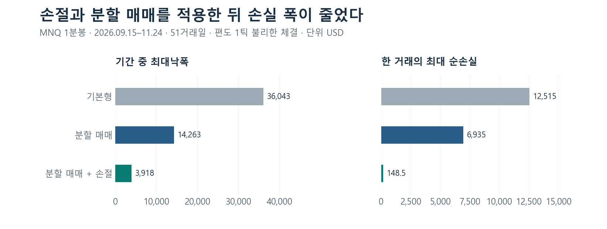
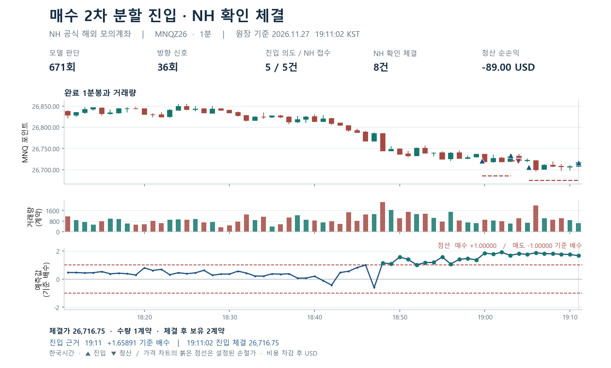

# 6주차 과제 · 마이크로 나스닥100 선물 1분봉 예측과 위험관리

NH선물 REST API Pioneer 1기 · 9팀 BE RICH · 2026년 11월 27일

마이크로 나스닥100 선물의 1분봉으로 향후 12분의 가격 방향을 예측했다. 첫 신호에는 1계약으로 진입하고, 가격이 보유 방향으로 움직이면서 예측이 유지될 때 1계약을 추가했다. 같은 51거래일에 분할 매매와 손실 한도를 차례로 적용해 거래당 손실과 최대낙폭을 비교했다. 11월 27일 NH 해외 모의계좌에서는 6회 거래했고, 수수료를 반영한 순손익은 **−$35.00**이었다. [NH 모의계좌 체결 원장](results/fills.csv)

| 항목 | 결과 |
| --- | --- |
| 전략 | 이번 주 새로 설계한 MNQ 1분봉 예측 전략. 매분 향후 12분의 방향을 평가하고 최대 2계약까지 운용 |
| 실행 환경 | **NH선물 해외 모의계좌** · CME 마이크로 E-mini Nasdaq-100 2026년 12월물 `MNQZ26` |
| 운용 시간 | 07:00 계좌 가동 · 08:00 거래소 재개 · 08:01–21:59 마감 봉 839개 평가 · 22:00 보유 0계약·미체결 0건 확인 후 종료. 시각은 모두 한국시간. [마감 기록](results/close.json) |
| 계좌 실적 | 거래 6회, 체결 18건. 추가 매수 3회, 목표가 분할 익절 1회, 가격 손절로 마친 거래 5회 |
| 위험관리 전후 | 같은 NH 시세 51거래일에서 최대낙폭 **$36,043 → $3,918**, 완료 거래의 최대 손실 **$12,515 → $148.50** |


## 1. 거래 상품과 매매 주기

마이크로 나스닥100 선물(MNQ)은 지수가 1포인트 움직이면 계약당 손익이 $2 변한다. 최소 호가 단위는 0.25포인트($0.50)다. 손절 거리가 25포인트일 때 가격 손실은 1계약이면 $50, 2계약이면 $100이다. 거래당 손실 예산 $150 안에서 진입을 두 번으로 나눌 수 있어 MNQ를 선택했다. [CME 상품 명세](https://www.cmegroup.com/markets/equities/nasdaq/micro-e-mini-nasdaq-100.contractSpecs.html)

모델은 1분봉이 마감될 때마다 예측값을 갱신한다. 보유 중에는 매수·매도 1호가를 확인해 다음 봉 마감 전에도 손절이나 분할 익절 주문을 낸다. 오전 첫 거래에서는 08:10에 예측값을 갱신했고, 21초 뒤 매수 1호가가 손절선 아래로 내려가 청산 주문을 냈다. [운용 이벤트](results/session.jsonl)

## 2. 예측모델 학습과 검증

장기 학습에는 같은 나스닥100 지수를 추종하는 E-mini 선물(NQ)을, 상품 검증과 주문에는 마이크로 선물(MNQ)을 사용했다. 학습 구간에서 관측한 NQ 1분봉은 **2,075,283개**다. 매년 52,000개씩 416,000개 시점을 뽑고, 수익률 부호와 위·아래 꼬리를 뒤집은 표본을 추가해 832,000행을 구성했다. 38개 입력에는 최근 1분부터 59분까지의 가격 변화, 8·30·60분 고저 범위 안의 위치, 거래량 가중평균가와의 거리, 상대 거래량, 뉴욕·런던 현지 시각이 들어간다. 가격 변화는 판단 직전 14개 1분봉의 평균 진폭(ATR)으로 나눴다. [학습 코드](code/fit.py) · [입력 변수와 예측식](code/forecast.py)

| 구간 | 자료와 용도 |
| --- | --- |
| 2017.01 – 2024.12 | NQ 1분봉으로 회귀·분류 모델 학습. 회귀 목표값은 현재 시가와 11·12·13분 뒤 세 시가의 중앙값 사이의 변화량을 ATR로 나눈 값. 세 가격의 중앙값을 써서 한 시점의 급등락 영향을 줄임 |
| 2025년 상반기 | NQ 120,251개 시점에서 모델별 점수 분포를 구하고 진입 기준 후보 설정 |
| 2025년 하반기 | NQ 132거래일에서 12분·30분 예측, 진입 가격, 비용 기준, 손절·익절 거리 비교 |
| 2026.01.22 – 2026.03.03 | MNQ 1차 검증 29거래일. 각 후보의 비용 반영 손익, 하루 거래 횟수, 추가 진입·분할 청산 횟수 집계 |
| 2026.03.04 – 2026.04.14 | MNQ 2차 검증 30거래일. 단일·조합 후보 326개 중 두 MNQ 구간의 선정 기준을 모두 충족한 조합 1개 채택 |
| 2026.09.15 – 2026.11.24 | NH의 MNQ 51거래일, 70,320개 봉에서 선택한 설정을 고정하고 위험관리 전후 비교 |
| 2026.11.27 | 06:25 설정 확정. 당일 NH 해외 모의계좌의 주문·체결·보유 수량으로 실행 결과 확인 |

모델별 진입 기준은 보정 구간의 점수 분포에서 정했다. Huber 회귀에는 점수 절댓값의 94백분위, Ridge 회귀와 가격선 분류에는 99.2백분위를 적용했다. 진입 후보는 점수와 거래비용 두 조건을 모두 충족해야 한다.

| 모델 | 학습 대상과 설정 | 진입 기준과 주문 가격 |
| --- | --- | --- |
| LightGBM Huber 회귀 | ATR 대비 향후 가격 변화. Huber 손실로 큰 오차의 영향을 줄임 | 점수 절댓값 0.147238 초과 · 직전 종가에서 0.75 ATR 되돌림 |
| Ridge 회귀 | 선형 가격 예측에 뉴욕·런던 시간대 효과 반영. 표준화 후 규제 강도 6,000 | 0.158177 초과 · 현재 호가 |
| LightGBM 가격선 분류 | 향후 12분 동안 위·아래 가격선 중 먼저 닿는 방향 학습. 한 봉에서 양쪽에 닿아 선후가 불분명한 표본은 제외 | 0.225825 초과 · 직전 종가에서 0.35 ATR 되돌림 |

거래비용 조건은 **점수 절댓값 × ATR(포인트) × 포인트당 $2**로 계산한다. 기본 왕복 비용은 수수료 $4와 매수·매도 각 1틱의 체결 비용 $1을 합한 $5다. Huber 회귀는 환산값이 $5 이상, Ridge 회귀와 가격선 분류는 $2.50 이상일 때 진입 후보에 넣는다. 같은 분에 여러 후보가 나오면 점수 절댓값을 각 모델의 진입 기준으로 나눠 가장 큰 모델을 택한다. 이 모델이 해당 거래의 추가 진입과 청산을 맡는다. [진입 기준 계산식](code/risk.py)

두 LightGBM 모델에는 트리 95개, 최대 깊이 4, 학습률 0.046, 잎당 최소 표본 750개를 사용했다. MNQ 두 검증 구간의 비용 반영 손익은 편도 1틱에서 **+$539.50**, **+$1,608.50**, 편도 2틱에서 **+$663.50**, **+$1,459.50**이었다. 2틱 조건에서는 되돌림 주문의 체결 가격과 체결 건수가 함께 달라진다. [모델별 기준·검증 집계](strategy.json) · [저장된 학습 모델](model/forecasts.joblib)

## 3. 분할 진입·청산과 손실 한도

첫 체결가부터 최초 손절선까지의 거리를 **R**로 정했다. 기본값은 **2 ATR**이며 최소 5포인트, 호가 단위로 올림한다. 주문 전에는 수수료·불리 체결 여유 $6을 먼저 남기고, 해당 거래에 배정할 수 있는 금액에 맞춰 거리를 제한한다. 손실 예산을 모두 쓸 수 있는 첫 1계약의 최대 거리는 72포인트다. [위험관리 계산식](code/risk.py)

추가 진입에는 가격과 예측 점수를 함께 썼다. 가격이 첫 체결가에서 보유 방향으로 일정 거리 움직이면, 첫 계약을 연 모델의 점수로 방향을 다시 확인했다. 두 검증안 모두 이때 필요한 점수를 최초 진입 기준의 **20%**로 정했다.

| 검증안 | 최초 손절 / 추가 진입 / 첫 익절 | 1차 29일 중 하루 2회 이상 거래 | 2차 30일 중 하루 2회 이상 거래 |
| --- | --- | ---: | ---: |
| Huber·Ridge·가격선 분류 (채택) | 2 ATR / +0.25R / +1R | 26일 | 26일 |
| Huber·Ridge | 3.5 ATR / +0.35R / +1.25R | 15일 | 18일 |

두 MNQ 검증 구간 모두 하루 2회 이상 거래한 날의 비율이 **60% 이상**이어야 했다. 추가 진입과 분할 청산은 각각 거래일 5일당 평균 1회 이상, 비용 반영 손익은 편도 1틱과 2틱에서 모두 흑자를 기준으로 삼았다. 채택한 조합의 편도 1틱 기준 추가 진입은 구간별 101회와 96회, 분할 청산은 49회와 46회였다. [채택한 전략의 검증 기록](strategy.json)

| 구분 | 주문 조건과 수량 | 설정 근거 |
| --- | --- | --- |
| 첫 진입 | 매수는 매도 1호가, 매도는 매수 1호가로 가격을 확인해 **1계약** 주문. 되돌림 조건은 다음 봉 마감 시 만료 | 첫 신호에는 최대 보유량의 절반만 배정. 남은 1계약은 진입 후 가격과 예측을 확인해 배정 |
| 추가 진입 | 최초 체결가에서 유리하게 **0.25R 이상**, 첫 목표 **1R 미만** 진행하고 담당 모델의 같은 방향 점수가 진입 기준의 20% 이상이면 **1계약 추가**. 추가는 한 번 | 가격과 예측이 함께 방향을 지지할 때 2계약으로 확대. 체결 즉시 공동 손절선을 첫 진입가 이상으로 끌어올림(매도는 반대) |
| 손절 | 매수 보유 중 매수 1호가가 손절선 이하가 되면 남은 수량을 시장가로 청산. 매도 보유는 매도 1호가로 대칭 적용 | 실제 청산 주문이 체결될 쪽의 호가로 남은 위험을 계산 |
| 분할 익절 | 2계약 보유 중 **+1R에서 1계약** 청산. 목표 전에도 청산 예상 순손익이 양수이고 예측 강도가 진입 기준의 20% 이하로 약해지면 1계약 축소 | 최초 손절 거리만큼 이익이 생겼을 때 절반을 확보하면서, 남은 계약은 추세를 더 따라갈 수 있게 함 |
| 잔여 청산 | 분할 후 마감 종가에서 **1R** 떨어진 곳으로 손절선을 유리한 쪽으로만 이동. 1계약의 예상 청산손익이 양수이고 보유 방향 점수가 0 이하가 되면 청산. 강한 반대 신호가 나오면 손익과 관계없이 잔량 청산 | 가격이 계속 유리하면 보유를 이어가고, 진입을 결정한 모델의 예측이 꺾이면 잔량 정리 |
| 보유·손실 한도 | **최대 2계약, 거래당 계획손실 $150, 하루 $300**. 당일 실현손익과 보유분 예상 청산손익이 −$300에 닿으면 잔량을 정리하고 신규 진입 중지 | 한 거래에는 하루 손실 예산의 최대 절반만 배정. 추가 계약도 첫 계약과 같은 예산을 공유 |

## 4. 위험관리 적용 전후 백테스트

2026년 9월 15일부터 11월 24일까지의 NH 1분봉과 세 모델의 예측값을 모든 비교에 동일하게 사용했다. 최대 보유량은 2계약, 수수료는 계약당 편도 $2, 기본 체결 비용은 매수·매도 각각 1틱이다. 시가에 청산되지 않은 포지션이 같은 봉 안에서 손절가와 목표가에 모두 닿으면 손절을 먼저 처리했다. 기간 말 보유분은 마지막 가격으로 평가해 청산 비용을 차감했다. 최대낙폭은 매분 종가로 평가한 자산이 직전 고점에서 가장 많이 떨어진 금액이다. [비교 실험 코드](code/replay.py) · [동일 입력 51일분](results/replay_51d.npz)

| 위험관리 단계 | 완료 거래 | 추가 진입 / 분할 청산 | 기간 말 보유 | 비용 반영 평가손익 | 최대낙폭 | 완료 거래 최대 손실 |
| --- | ---: | ---: | ---: | ---: | ---: | ---: |
| 기본형 · 2계약 동시 진입, 강한 반대 예측에 전량 청산 | 23 | 0 / 0 | 2 | −$25,199.00 | $36,043.00 | $12,515.00 |
| 분할 진입·청산과 예측 기반 이익 보호 | 100 | 76 / 72 | 2 | −$7,139.50 | $14,263.00 | $6,935.00 |
| 가격 손절 추가 · 거래당 예산 $150 | 408 | 258 / 120 | 0 | −$2,421.50 | $5,818.00 | $295.00 |
| **최종형 · 하루 손실 한도 $300 추가** | **306** | **193 / 96** | **0** | **−$2,043.00** | **$3,918.00** | **$148.50** |
| 최종형 · 편도 2틱 비용 | 304 | 191 / 93 | 0 | −$2,276.50 | $4,185.00 | $149.00 |

가격 손절을 적용한 두 전략의 거래당 예산은 모두 150달러였다. 최종형은 당일 손실이 쌓이면 다음 거래에 쓸 수 있는 예산을 줄이고, 실현손익과 보유분 예상 청산손익의 합이 −$300에 닿으면 그날 신규 진입을 멈춘다. 하루 한도를 적용한 결과 **최대낙폭이 $1,900 줄었고**, 하루 최대 실현손실은 1,689.50달러에서 298.50달러로 낮아졌다. 완료 거래는 102회 줄었고 비용 반영 손익은 $378.50 개선됐다. 기본형 대비 최종형의 최대낙폭 감소율은 **89.1%**였다.



### 분할 익절 목표 1R과 1.25R 비교

모의 운용을 마친 뒤 같은 51거래일에서 첫 익절 거리를 1R과 1.25R로 설정해 다시 계산했다. 첫 목표가는 추가 진입을 허용하는 가격 범위의 상한이기도 하다. 두 설정 모두 추가 진입은 193회였다. [익절 거리 비교 코드](code/replay.py)

| 첫 익절 거리 | 목표가 도달로 분할 청산 | 비용 반영 평가손익 | 최대낙폭 |
| --- | ---: | ---: | ---: |
| 1R (운용 설정) | 83회 | −$2,043.00 | $3,918 |
| 1.25R | 60회 | −$2,080.50 | $3,821 |

1R에서 목표가 분할 청산은 23회 많았다. 평가손익은 $37.50 높았고 최대낙폭은 $97 컸다.

## 5. NH 해외 모의계좌 거래 결과

첫 매수 신호는 가격선 분류에서 1회, Huber 회귀에서 5회 나왔다. 여섯 거래 모두 모델 점수와 비용 기준을 통과한 뒤, 매도 1호가가 정해 둔 매수가 이내로 내려왔을 때 1계약을 샀다. 추가 매수는 첫 체결가에서 **+0.25R 이상, +1R 미만** 올랐을 때만 검토했다. 이때 같은 모델의 매수 점수가 진입 기준의 20% 이상이고, 두 계약의 위험이 남은 손실 예산 안에 들어야 했다. 아래 수량은 NH 체결을 확인할 때마다 기록한 보유 계약 수다. [시각별 예측·호가·주문 기록](results/session.jsonl)

| 첫 진입–최종 청산 확인 시각 | 보유 수량 | 수량을 바꾼 근거 | 거래 순손익 | 누적 순손익 |
| --- | --- | --- | ---: | ---: |
| 08:03:19–08:10:23 | 0 → 1 → 0 | 가격선 분류 신호로 26,267.50에 1계약 매수. 이후 매분 확인한 매도 1호가는 추가 매수 기준 26,273.75에 못 미쳤다. 매수 1호가가 26,243.00으로 손절선 26,243.25를 밑돌아 1계약을 청산했다. | −$52.50 | −$52.50 |
| 18:59:40–19:03:54 | 0 → 1 → 2 → 1 → 0 | Huber 매수 신호로 26,721.50에 진입.<br>19:03 매도 1호가가 추가 매수 기준 26,730.75를 넘고 점수가 진입 기준의 1.684배여서 26,733.25에 1계약을 추가하고 공동 손절선을 26,721.50으로 올렸다.<br>49초 뒤 매수 1호가가 26,721.25로 밀려 26,721.00과 26,719.50에 차례로 손절했다. | −$36.50 | −$89.00 |
| 19:05:09–19:41:04 | 0 → 1 → 2 → 1 → 0 | Huber 신호로 1계약 매수 후 가격이 +0.25R를 넘어 1계약 추가. 19:17에 +1R 목표를 넘어 첫 계약을 익절했다. 남은 1계약은 추적 손절선을 올리며 보유했고, 19:41에 모델 점수가 음수로 바뀌어 청산했다. | **+$200.50** | +$111.50 |
| 20:44:17–20:45:02 | 0 → 1 → 0 | Huber 점수가 진입 기준의 1.871배였고, 되돌림 조건을 충족해 26,668.25에 매수했다. 추가 매수 기준은 26,674.50이었다. 다음 분에 매수 1호가가 손절선 26,644.00에 닿아 보유한 1계약을 26,645.50에 팔았다. | −$49.50 | +$62.00 |
| 20:46:17–20:47:07 | 0 → 1 → 0 | 앞 거래 청산 후 새 Huber 매수 신호(진입 기준의 1.893배)로 26,641.00에 다시 진입했다. 20:47 매도 1호가는 26,620.50으로 추가 기준 26,648.50보다 낮았다. 6초 뒤 매수 1호가가 26,609.75로 손절선 26,611.00을 밑돌아 26,610.00에 청산했다. | −$66.00 | −$4.00 |
| 20:48:53–21:01:04 | 0 → 1 → 2 → 1 → 0 | Huber 신호로 26,616.00에 1계약 매수.<br>20:57 매도 1호가가 추가 기준 26,625.75를 넘고 점수가 진입 기준의 1.248배여서 26,631.50에 1계약을 더 사고 공동 손절선을 26,616.00으로 올렸다.<br>21:01 매수 1호가가 26,615.00으로 내려와 26,615.75와 26,620.25에 두 계약을 청산했다. | −$31.00 | **−$35.00** |

18:59와 20:48에 시작한 거래에서는 공동 손절선에 닿은 순간 **2계약 전량**을 청산하기로 했다. 프로그램이 1계약의 체결을 확인한 뒤 다음 1계약을 매도해 장부에 `2 → 1 → 0`으로 남았다. 19:05 거래에서는 목표가에 닿았을 때 **1계약만** 팔고, 나머지 1계약은 19:41까지 보유했다. [18건의 체결 수량·가격·사유](results/fills.csv)

표와 체결 차트의 초 단위 시각은 프로그램이 NH 체결을 확인한 시각이다. 체결 원장의 `broker_time`은 NH가 기록한 체결 시각이고, `kst`는 프로그램의 확인 시각이다. 이날 가격 손익은 **+$1.00**, 18건의 체결에 편도 $2씩 적용한 수수료는 **$36.00**이다. 첫 진입부터 잔량 청산까지의 보유 시간을 거래별로 더하면 **1시간 59초**다. [18건의 체결가·수량](results/fills.csv) · [선입선출 손익 검산](code/check_session.py)


### 08:03 진입과 08:10 가격 손절

08:03의 가격선 분류 점수는 **0.226138**로 매수 기준 **0.225825**를 넘었다. 종가 26,272.00에서 0.35 ATR 내려온 **26,267.75 이하**를 기다렸고, 08:03:19에 26,267.50으로 1계약을 샀다. 당시 ATR은 12.096포인트였다. 두 배를 호가 단위로 올림한 24.25포인트를 매수가에서 빼 손절선을 **26,243.25**로 정했다. 08:10:21 매수 1호가가 **26,243.00**으로 내려왔다. NH 체결 시각은 **08:10:22**, 체결가는 **26,243.25**였다. 프로그램은 08:10:23에 체결을 확인했다. 순손익은 −24.25포인트 × $2 − $4 = **−$52.50**이다.


### 19:05–19:41 분할 매수·매도 체결 내역

| 체결 확인 시각 | 판단과 체결 | 체결 후 보유 |
| --- | --- | ---: |
| 19:05:09 | Huber 점수 0.258334로 진입 기준의 1.755배. ATR 15.553572포인트를 적용한 환산값은 $8.04로 비용 기준 $5를 통과했다. 되돌림 기준 26,710.00을 충족해 **26,706.25에 1계약 매수**. 최초 손절 26,675.00, R = 31.25포인트 | 1 |
| 19:11:02 | 추가 매수가 가능한 첫 호가는 26,714.25(최초 매수가 + 0.25R를 호가 단위로 올림). 매도 1호가는 26,716.50, Huber 점수는 진입 기준의 1.659배였다. **26,716.75에 1계약 추가** 후 두 계약의 손절선을 **26,706.25**로 상향 | 2 |
| 19:17:25 | 매수 1호가 26,739.50이 첫 목표 26,737.50(+1R)을 넘어 **26,738.00에 1계약 매도**. 첫 계약의 확정 순이익 **+$59.50** | 1 |
| 19:41:04 | 추적 손절선은 **26,761.25**, 매수 1호가는 26,788.75였다. 잔여 계약의 예상 청산손익이 **+$139.50**인 상태에서 Huber 방향 점수가 진입 기준 대비 **−0.164배**로 바뀌어 **26,789.25에 1계약 매도**. 확정 순이익 **+$141.00** | 0 |




체결별 차트에는 해당 시각까지 NH에서 받은 분봉·거래량·체결가를 표시했다. [19:05 첫 매수 차트](screenshots/02-first-entry.png) · [19:41 잔량 청산 차트](screenshots/05-final-exit.png)

## 6. 실시간 시세 감시와 주문 관리

| 확인 항목 | NH API와 처리 방식 | 11월 27일 기록 |
| --- | --- | --- |
| 완료 봉과 현재 호가 | `chart_minute`로 직전 분의 마감을 확인하고 `bid_price`로 1호가를 조회. 진입 직전 호가가 8초 넘게 지연되거나 스프레드가 4틱을 넘으면 전송 보류 | 10:02:00 조회 중 통신 오류가 발생해 재조회했고, 10:02:03에 해당 봉 판단 완료. 08:01–21:59의 839개 판단 시각이 모두 원장에 남음 |
| 주문 가능 수량과 가격 | `orderable_quantity`로 1계약 주문 가능 여부 확인. 시장가 주문을 전송하기 직전에 되돌림 가격을 다시 확인 | 20:43:40 매도 1호가가 매수 허용 가격을 다시 넘어 주문 1건 보류 |
| 접수와 체결 | 주문 의도를 먼저 기록하고 `order`로 전송. `order_history`에서 해당 주문의 체결 수량·잔량·평균 체결가를 확인한 뒤 장부 반영 | 진입·추가 매수 9건과 청산 9건 접수. 18건 모두 체결 확인 |
| 보유·미체결과 마감 | `open_interest`와 미체결 주문 조회로 계좌와 장부를 대조. 22:00부터 신규 진입을 차단하고 보유분이 있으면 청산 | **22:00:00 보유 0계약·미체결 0건**을 확인하고 종료 |

이날 일일 손실 한도에는 닿지 않았다. 다섯 거래의 손절은 모두 각 거래에 설정한 가격 손절선에서 발동했다. [마감 상태](results/close.json)

[NH 모의계좌 API 연결 코드](code/nh_demo.py) · [주문·체결 대조와 마감 청산 코드](code/nh_execution.py) · [시간순 운용 이벤트](results/session.jsonl) · [NH선물 개발자센터](https://apidev.futures.co.kr/)

## 7. 실행 및 결과 재현

Python 3.12 환경에서 `week06/` 폴더를 열고 아래 명령을 실행한다. 체결 원장 검산에는 표준 라이브러리만 사용한다.

```bash
python code/check_session.py
python -m pip install -r requirements.txt
python code/forecast.py --time 19:05
python code/replay.py
```

`check_session.py`는 주문 접수·체결·보유 수량을 대조하고 여섯 거래의 손익과 22시 잔고를 출력한다. `forecast.py`는 당시 1분봉과 저장한 모델로 19:05의 예측 점수 세 개를 다시 계산한다. `replay.py`는 51일분의 시세·예측값으로 4절의 표를 재계산한다. 세 검산은 계좌 인증 없이 실행할 수 있다. 모의 주문 코드의 NH 연결부는 공개 프로그램의 `backend`를 사용한다. [NH FUTURES API 프로그램](https://github.com/PetterChanHyuk/nh-futures-open-api)

학습부터 재현하려면 지정 버전의 NQ 원본을 받은 뒤 `python code/fit.py NQ.parquet refit.joblib`을 실행한다. 학습 자료의 해시와 모델별 진입 기준을 코드에서 대조한다. [NQ 원본](https://huggingface.co/datasets/syncster-data/historical-market-data/resolve/eff0dac55d843b3b83caec819efa213021a3e3e5/data/futures/1m/NQ.parquet) · [MNQ 검증 자료](https://github.com/axb0306/cme-futures-ohlc/blob/60abd3fb6369c6ce0b6a4a65b0f2562fc96b1264/MNQ/MNQ_1min_20260120_20260415.csv) · [학습·선정 설정](strategy.json)
