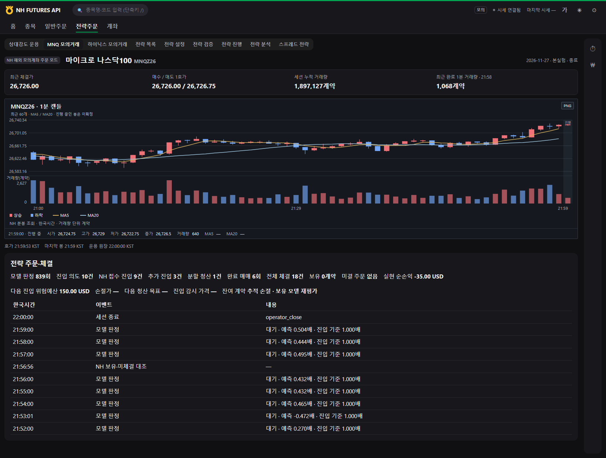
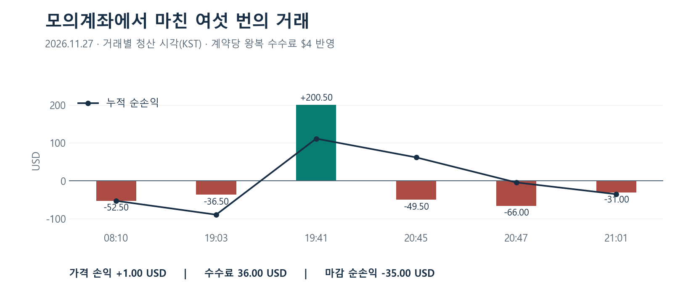
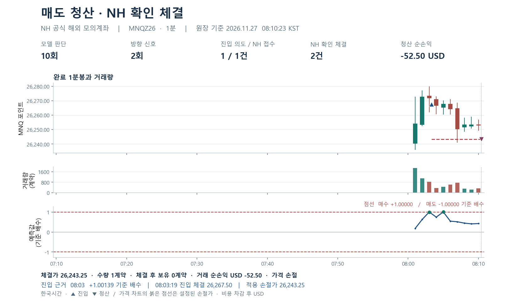
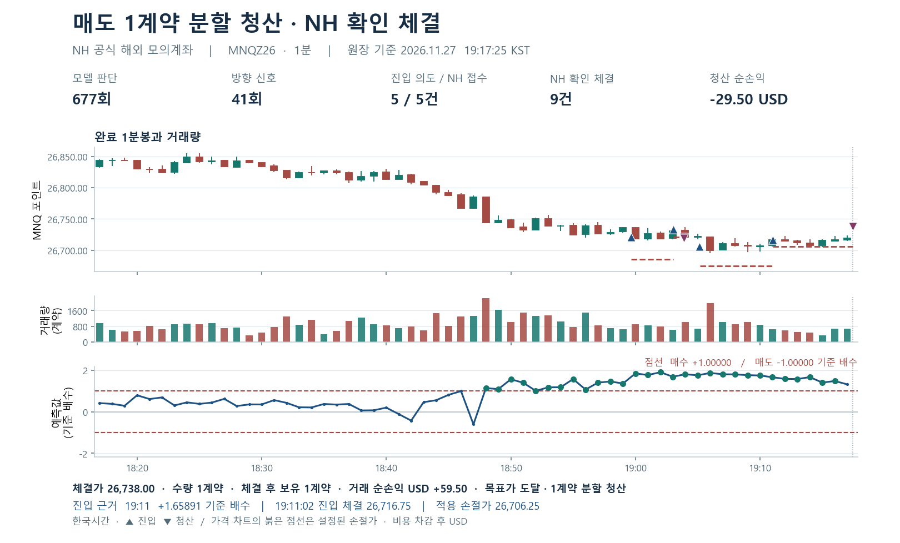

# 6주차 · 마이크로 나스닥100 선물 1분봉 예측과 분할 매매

NH선물 REST API Pioneer 1기 · 9팀 BE RICH · 2026년 11월 27일

11월 27일 19:05, 마이크로 나스닥100 선물 1계약을 26,706.25에 매수했다. 가격이 오른 뒤 1계약을 더 사면서 두 계약의 손절선을 첫 매수가까지 올렸다. 19:17에 목표가에 도달해 1계약을 팔았고, 나머지는 19:41에 상승 예측이 꺾일 때까지 보유했다. 이 거래의 순이익은 **$200.50**이었다. 같은 날 손절한 다섯 거래까지 합한 결과는 **−$35.00**이다. [NH 모의계좌 체결 원장](results/fills.csv)

| 항목 | 결과 |
| --- | --- |
| 전략 | 이번 주 새로 설계한 MNQ 1분봉 예측 전략. 매분 향후 12분의 방향을 평가하고 최대 2계약까지 운용 |
| 실행 환경 | **NH선물 해외 모의계좌** · CME 마이크로 E-mini Nasdaq-100 2026년 12월물 `MNQZ26` |
| 운용 시간 | 07:00 계좌 가동 · 08:00 거래소 재개 · 08:01~21:59 마감 봉 839개 평가 · 22:00 보유 0계약·미체결 0건 확인 후 종료. 시각은 모두 한국시간. [마감 기록](results/close.json) |
| 계좌 실적 | 거래 6회, 체결 18건. 추가 매수 3회, 목표가 분할 익절 1회, 가격 손절로 마친 거래 5회 |
| 위험관리 전후 | 같은 NH 시세 51거래일에서 최대낙폭 **$36,043 → $3,918**, 완료 거래의 최대 손실 **$12,515 → $148.50** |



## 1. 왜 MNQ를 1분마다 판단했나

MNQ는 1계약 기준 지수 1포인트당 $2, 최소 호가 0.25포인트당 $0.50이다. 25포인트 손절을 예로 들면 가격 손실은 1계약일 때 $50, 2계약일 때 $100이다. 거래당 예산 $150 안에서 한 계약을 먼저 사고, 가격을 확인한 뒤 한 계약을 더 살 수 있어 MNQ를 골랐다. [CME 상품 명세](https://www.cmegroup.com/markets/equities/nasdaq/micro-e-mini-nasdaq-100.contractSpecs.html)

모델은 매분 봉이 마감되면 향후 12분의 방향을 다시 계산한다. 손절과 목표가 청산은 봉 사이에도 1호가를 보고 판단한다. 오전 첫 거래에서는 08:10 봉을 평가하고 **21초 뒤** 매수 1호가가 손절선을 밑돌았다. [운용 이벤트](results/session.jsonl)

## 2. 모델은 어떻게 학습하고 골랐나

장기 학습에는 같은 나스닥100 지수를 추종하는 E-mini 선물(NQ)을, 상품 검증과 주문에는 마이크로 선물(MNQ)을 사용했다. 학습 구간에서 관측한 NQ 1분봉은 **2,075,283개**다. 매년 52,000개씩 416,000개 시점을 뽑고, 수익률 부호와 위·아래 꼬리를 뒤집은 표본을 추가해 832,000행을 구성했다. 38개 입력에는 최근 1~59분 가격 변화, 8·30·60분 고저 범위 안의 위치, 거래량 가중평균가와의 거리, 상대 거래량, 뉴욕·런던 현지 시각이 들어간다. 가격 변화는 판단 직전 14개 1분봉의 평균 진폭(ATR)으로 나눴다. [학습 코드](code/fit.py) · [입력 변수와 예측식](code/forecast.py)

| 구간 | 자료와 용도 |
| --- | --- |
| 2017.01~2024.12 | NQ 1분봉으로 회귀·분류 모델 학습. 회귀 목표값은 현재 시가와 11·12·13분 뒤 세 시가의 중앙값 사이의 변화량을 ATR로 나눈 값. 세 가격의 중앙값을 써서 한 시점의 급등락 영향을 줄임 |
| 2025.01~06 | 학습 이후 NQ 120,251개 시점에서 모델별 점수 분포를 구하고 진입 기준 후보 설정 |
| 2025.07~12 · 2026.01.22~03.03 · 03.04~04.14 | NQ 132일과 MNQ 29일·30일에서 12분·30분 예측, 진입 가격, 비용 기준, 위험관리 폭을 비교. 단일·조합 후보 326개 중 MNQ 두 구간의 수익·거래 빈도·분할 체결 요건을 모두 충족한 조합 1개 선정 |
| 2026.09.15~11.24 | NH의 MNQ 51거래일, 70,320개 봉에서 선택한 설정을 고정하고 위험관리 전후 비교 |
| 2026.11.27 | 06:25 설정 확정. 당일 NH 해외 모의계좌의 주문·체결·보유 수량으로 실행 결과 확인 |

각 모델의 점수 분포가 달라 진입 기준도 따로 정했다. 보정 구간에서 점수 절댓값의 94백분위 값을 Huber 회귀에, 99.2백분위 값을 Ridge 회귀와 가격선 분류에 적용했다. 같은 시점에 여러 모델이 기준을 넘으면 **점수 절댓값을 자기 기준으로 나눈 비율이 가장 큰 모델**을 택한다. 첫 계약을 연 모델이 추가 진입과 최종 청산까지 판단한다.

| 모델 | 학습 대상과 설정 | 진입 기준 · 기다릴 가격 |
| --- | --- | --- |
| LightGBM Huber 회귀 | ATR 대비 향후 가격 변화. Huber 손실로 큰 오차의 영향을 줄임 | 점수 절댓값 0.147238 초과 · 직전 종가에서 0.75 ATR 되돌림 |
| Ridge 회귀 | 선형 가격 예측에 뉴욕·런던 시간대 효과 반영. 표준화 후 규제 강도 6,000 | 0.158177 초과 · 현재 호가 |
| LightGBM 가격선 분류 | 향후 12분 동안 위·아래 가격선 중 먼저 닿는 방향 학습. 한 봉에서 양쪽에 닿아 선후가 불분명한 표본은 제외 | 0.225825 초과 · 직전 종가에서 0.35 ATR 되돌림 |

두 LightGBM에는 트리 95개, 최대 깊이 4, 학습률 0.046, 잎당 최소 750개 표본을 사용했다. 각 모델은 거래비용 기준도 통과해야 한다. 기본 비용을 적용한 MNQ 두 검증 구간의 평가 순손익은 각각 **+$539.50**, **+$1,608.50**이었다. 편도 불리 체결을 1틱에서 2틱으로 높여 같은 설정을 다시 계산한 값은 **+$663.50**, **+$1,459.50**이다. 되돌림 가격을 기다리는 주문은 비용 가정에 따라 진입하는 거래 자체가 달라질 수 있다. [모델별 기준·검증 집계](strategy.json) · [저장된 학습 모델](model/forecasts.joblib)

## 3. 얼마나 사고, 얼마나 잃으면 나오는가

첫 체결가부터 최초 손절선까지의 거리를 **R**로 정했다. 기본값은 **2 ATR**이며 최소 5포인트, 호가 단위로 올림한다. 주문 전에는 수수료·불리 체결 여유 $6을 먼저 남기고, 해당 거래에 배정할 수 있는 금액에 맞춰 거리를 제한한다. 손실 예산을 모두 쓸 수 있는 첫 1계약의 최대 거리는 72포인트다. [위험관리 계산식](code/risk.py)

값을 고를 때는 **각 MNQ 검증 구간에서 거래일의 60% 이상에 매매를 두 번 이상 마치는지**, 편도 1틱과 2틱 비용을 각각 적용해도 순손익이 양수인지를 함께 봤다. 최종 설정으로 하루 두 번 이상 거래한 날은 첫 구간 29일 중 26일, 두 번째 구간 30일 중 26일이었다. 편도 1틱 기준 추가 진입은 각각 101·96회, 분할 청산은 49·46회였다. [검증 구간별 집계](strategy.json)

| 시점 | 주문·수량 규칙 | 값을 정한 이유 |
| --- | --- | --- |
| 첫 진입 | 매수는 매도 1호가, 매도는 매수 1호가로 가격을 확인해 **1계약** 주문. 되돌림 조건은 다음 봉 마감 시 만료 | 첫 신호에서는 1계약만 걸고, 다음 봉에서는 새 예측값으로 주문 가격을 다시 정함 |
| 추가 진입 | 최초 체결가에서 유리하게 **0.25R 이상**, 첫 목표 **1R 미만** 진행하고 담당 모델의 같은 방향 점수가 진입 기준의 20% 이상이면 **1계약 추가**. 추가는 한 번 | 가격과 예측이 함께 방향을 지지할 때 2계약으로 확대. 체결 즉시 공동 손절선을 첫 진입가 이상으로 끌어올림(매도는 반대) |
| 손절 | 매수 보유 중 매수 1호가가 손절선 이하가 되면 남은 수량을 시장가로 청산. 매도 보유는 매도 1호가로 대칭 적용 | 실제 청산 주문이 체결될 쪽의 호가로 남은 위험을 계산 |
| 분할 익절 | 2계약 보유 중 **+1R에서 1계약** 청산. 목표 전에도 청산 예상 순손익이 양수이고 예측 강도가 진입 기준의 20% 이하로 약해지면 1계약 축소 | 최초 손절 거리만큼 이익이 생겼을 때 절반을 확보하면서, 남은 계약은 추세를 더 따라갈 수 있게 함 |
| 잔여 청산 | 분할 후 마감 종가에서 **1R** 떨어진 곳으로 손절선을 유리한 쪽으로만 이동. 1계약의 예상 청산손익이 양수이고 보유 방향 점수가 0 이하가 되면 청산. 강한 반대 신호가 나오면 손익과 관계없이 잔량 청산 | 가격이 계속 유리하면 보유를 이어가고, 진입을 결정한 모델의 예측이 꺾이면 잔량 정리 |
| 보유·손실 한도 | **최대 2계약, 거래당 계획손실 $150, 하루 $300**. 당일 실현손익과 보유분 예상 청산손익이 −$300에 닿으면 잔량을 정리하고 신규 진입 중지 | 한 거래에는 하루 손실 예산의 최대 절반만 배정. 추가 계약도 첫 계약과 같은 예산을 공유 |

## 4. 같은 51거래일에서 위험관리 전후 비교

2026년 9월 15일~11월 24일의 NH 1분봉과 세 모델의 예측값을 세 전략에 똑같이 입력했다. 최대 보유량은 2계약, 수수료는 계약당 편도 $2, 기본 체결 비용은 매수·매도 각각 1틱이다. 기간 말에 남은 계약은 마지막 가격으로 평가하고 청산 비용까지 반영했다. 최대낙폭은 매분 종가로 평가한 자산의 고점 대비 최대 하락액이다. [비교 실험 코드](code/replay.py) · [동일 입력 51일분](results/replay_51d.npz)

| 위험관리 단계 | 완료 거래 | 추가 진입 / 분할 청산 | 기간 말 보유 | 비용 반영 평가손익 | 최대낙폭 | 완료 거래 최대 손실 |
| --- | ---: | ---: | ---: | ---: | ---: | ---: |
| 기본형 · 2계약 동시 진입, 강한 반대 예측에 전량 청산 | 23 | 0 / 0 | 2 | −$25,199.00 | $36,043.00 | $12,515.00 |
| 분할 진입·청산과 예측 기반 이익 보호 | 100 | 76 / 72 | 2 | −$7,139.50 | $14,263.00 | $6,935.00 |
| **최종형 · 가격 손절과 일일 한도 추가** | **306** | **193 / 96** | **0** | **−$2,043.00** | **$3,918.00** | **$148.50** |
| 최종형 · 편도 2틱 비용 | 304 | 191 / 93 | 0 | −$2,276.50 | $4,185.00 | $149.00 |

기본형은 강한 반대 신호가 올 때까지 2계약을 보유했다. 분할 매매와 이익 보호를 적용한 뒤 최대낙폭은 $14,263, 가격 손절과 일일 한도까지 적용한 뒤에는 $3,918이었다. **전체 규칙을 적용한 결과 기본형보다 최대낙폭이 89.1% 줄었다.** 먼저 청산한 전략은 다음 신호에서 다시 진입할 수 있어 거래 수도 달라졌다. 시가에 청산되지 않은 포지션이 같은 봉의 고가·저가에서 손절가와 목표가에 모두 닿으면 손절을 먼저 처리했다.

**첫 익절을 더 기다렸다면 어땠을까?** 운용 후 같은 51일을 다시 계산하면서 첫 익절 거리만 1R에서 1.25R로 바꿨다. 이 값은 추가 매수를 허용하는 가격대의 상단이기도 하다. 두 경우 모두 추가 매수는 193회였다. 1R에서는 목표가에 닿아 83회 분할 청산했고, 1.25R에서는 60회였다. 1R의 평가손익은 $37.50 높았고(−$2,043.00 / −$2,080.50), 최대낙폭도 $97 컸다($3,918 / $3,821). [익절 거리 비교 코드](code/replay.py)


## 5. NH 해외 모의계좌 체결

| 첫 진입~최종 청산 확인 시각 | 보유 수량 변화 | 청산 사유 | 거래 순손익 | 누적 순손익 |
| --- | --- | --- | ---: | ---: |
| 08:03:19~08:10:23 | 0 → 1 → 0 | 최초 손절선 도달 | −$52.50 | −$52.50 |
| 18:59:40~19:03:54 | 0 → 1 → 2 → 1 → 0 | 추가 매수 후 두 계약 손절 | −$36.50 | −$89.00 |
| 19:05:09~19:41:04 | 0 → 1 → 2 → 1 → 0 | 목표가 분할 익절 후 예측 약화로 잔량 청산 | **+$200.50** | +$111.50 |
| 20:44:17~20:45:02 | 0 → 1 → 0 | 가격 손절 | −$49.50 | +$62.00 |
| 20:46:17~20:47:07 | 0 → 1 → 0 | 가격 손절 | −$66.00 | −$4.00 |
| 20:48:53~21:01:04 | 0 → 1 → 2 → 1 → 0 | 추가 매수 후 두 계약 손절 | −$31.00 | **−$35.00** |

표와 체결 차트의 초 단위 시각은 프로그램이 NH 체결을 확인한 시각이다. 체결 원장의 `broker_time`은 NH가 기록한 체결 시각이고, `kst`는 프로그램의 확인 시각이다. 이날 가격 손익은 **+$1.00**, 18건의 체결에 편도 $2씩 적용한 수수료는 **$36.00**이다. 첫 진입부터 잔량 청산까지의 보유 시간을 거래별로 더하면 **1시간 59초**다. [18건의 체결가·수량](results/fills.csv) · [선입선출 손익 검산](code/check_session.py)



### 첫 거래에서 손절이 나간 순간

08:03의 가격선 분류 점수는 **0.226138**로 매수 기준 **0.225825**를 넘었다. 종가 26,272.00에서 0.35 ATR 내려온 **26,267.75 이하**를 기다렸고, 08:03:19에 26,267.50으로 1계약을 샀다. 당시 ATR은 12.096포인트였다. 두 배를 호가 단위로 올림한 24.25포인트를 매수가에서 빼 손절선을 **26,243.25**로 정했다. 08:10:21 매수 1호가가 **26,243.00**으로 내려왔다. NH 체결 시각은 **08:10:22**, 체결가는 **26,243.25**였다. 프로그램은 08:10:23에 체결을 확인했다. 순손익은 −24.25포인트 × $2 − $4 = **−$52.50**이다.



### 두 계약을 언제 나눠 사고팔았나

| 체결 확인 시각 | 판단과 체결 | 체결 후 보유 |
| --- | --- | ---: |
| 19:05:09 | Huber 점수 0.258334, 진입 기준의 1.755배. 되돌림 기준 26,710.00을 충족해 **26,706.25에 1계약 매수**. 최초 손절 26,675.00, R = 31.25포인트 | 1 |
| 19:11:02 | 같은 모델의 점수가 기준의 1.659배를 유지했고 가격이 +0.25R을 넘어 **26,716.75에 1계약 추가**. 공동 손절선을 **26,706.25**로 상향 | 2 |
| 19:17:25 | 목표 26,737.50을 넘어 **26,738.00에 1계약 매도**. 첫 계약의 확정 순이익 **+$59.50** | 1 |
| 19:41:04 | 직전 분까지 잔여 계약의 손절선을 **26,761.25**로 올렸다. 담당 모델의 방향 점수가 기준 대비 **−0.164배**로 바뀌어 **26,789.25에 잔량 매도**. 두 번째 계약의 확정 순이익 **+$141.00** | 0 |




체결별 차트에는 해당 시각까지 NH에서 받은 분봉·거래량·체결가를 표시했다. [19:05 첫 매수 차트](screenshots/02-first-entry.png) · [19:41 잔량 청산 차트](screenshots/05-final-exit.png)

## 6. 운용 중 무엇을 감시했나

| 확인 항목 | NH API와 처리 방식 | 11월 27일 기록 |
| --- | --- | --- |
| 완료 봉과 현재 호가 | `chart_minute`로 직전 분의 마감을 확인하고 `bid_price`로 1호가를 조회. 진입 직전 호가가 8초 넘게 지연되거나 스프레드가 4틱을 넘으면 전송 보류 | 10:02:00 조회 중 통신 오류가 발생해 재조회했고, 10:02:03에 해당 봉 판단 완료. 08:01~21:59의 839개 판단 시각이 모두 원장에 남음 |
| 주문 가능 수량과 가격 | `orderable_quantity`로 1계약 주문 가능 여부 확인. 시장가 주문을 전송하기 직전에 되돌림 가격을 다시 확인 | 20:43:40 매도 1호가가 매수 허용 가격을 다시 넘어 주문 1건 보류 |
| 접수와 체결 | 주문 의도를 먼저 기록하고 `order`로 전송. `order_history`에서 해당 주문의 체결 수량·잔량·평균 체결가를 확인한 뒤 장부 반영 | 진입·추가 매수 9건과 청산 9건 접수. 18건 모두 체결 확인 |
| 보유·미체결과 마감 | `open_interest`와 미체결 주문 조회로 계좌와 장부를 대조. 22:00부터 신규 진입을 차단하고 보유분이 있으면 청산 | **22:00:00 보유 0계약·미체결 0건**을 확인하고 종료 |

이날 일일 손실 한도에는 닿지 않았다. 다섯 거래의 손절은 모두 각 거래에 설정한 가격 손절선에서 발동했다. [마감 상태](results/close.json)

[NH 모의계좌 API 연결 코드](code/nh_demo.py) · [주문·체결 대조와 마감 청산 코드](code/nh_execution.py) · [시간순 운용 이벤트](results/session.jsonl) · [NH선물 개발자센터](https://apidev.futures.co.kr/)

## 7. 결과 재현

Python 3.12에서 `week6/`를 작업 폴더로 연다. 첫 명령은 표준 라이브러리만 사용한다.

```bash
python code/check_session.py
python -m pip install -r requirements.txt
python code/forecast.py --time 19:05
python code/replay.py
```

`check_session.py`는 주문 접수·체결·보유 수량을 대조하고 여섯 거래의 손익과 22시 잔고를 출력한다. `forecast.py`는 당시 1분봉과 저장한 모델로 19:05의 예측 점수 세 개를 다시 계산한다. `replay.py`는 51일분의 시세·예측값으로 4절의 표를 재계산한다. 세 검산은 계좌 인증 없이 실행할 수 있다. 모의 주문 코드의 NH 연결부는 공개 프로그램의 `backend`를 사용한다. [NH FUTURES API 프로그램](https://github.com/PetterChanHyuk/nh-futures-open-api)

학습부터 재현하려면 지정 버전의 NQ 원본을 받은 뒤 `python code/fit.py NQ.parquet refit.joblib`을 실행한다. 학습 자료의 해시와 모델별 진입 기준을 코드에서 대조한다. [NQ 원본](https://huggingface.co/datasets/syncster-data/historical-market-data/resolve/eff0dac55d843b3b83caec819efa213021a3e3e5/data/futures/1m/NQ.parquet) · [MNQ 검증 자료](https://github.com/axb0306/cme-futures-ohlc/blob/60abd3fb6369c6ce0b6a4a65b0f2562fc96b1264/MNQ/MNQ_1min_20260120_20260415.csv) · [학습·선정 설정](strategy.json)
